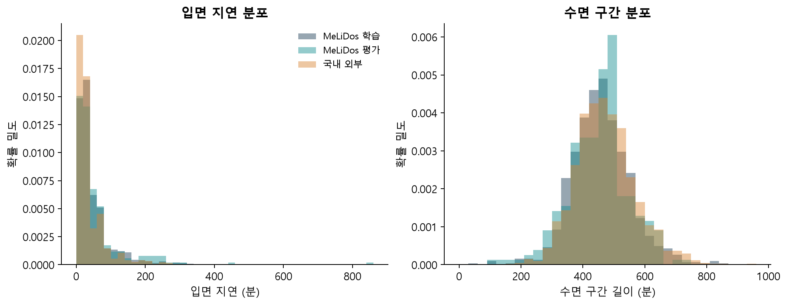
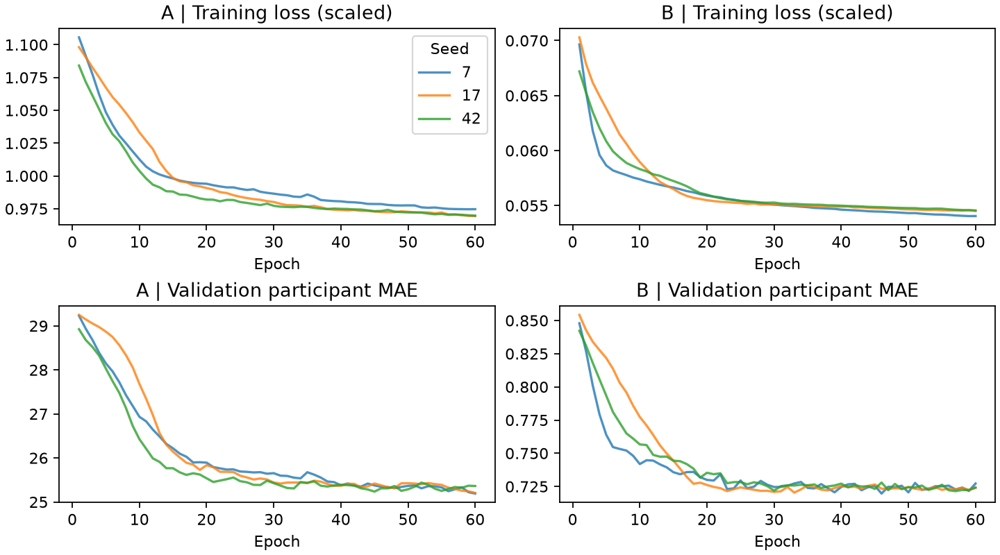
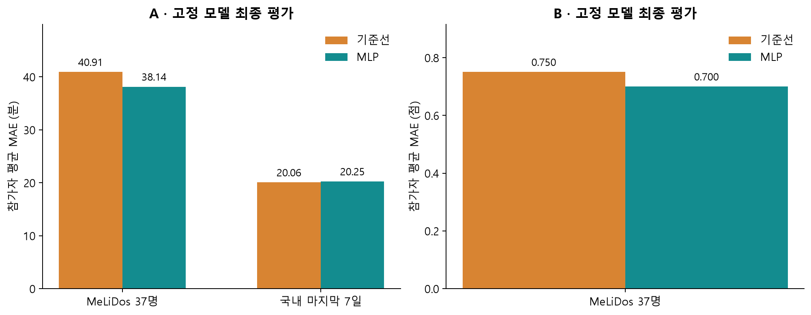
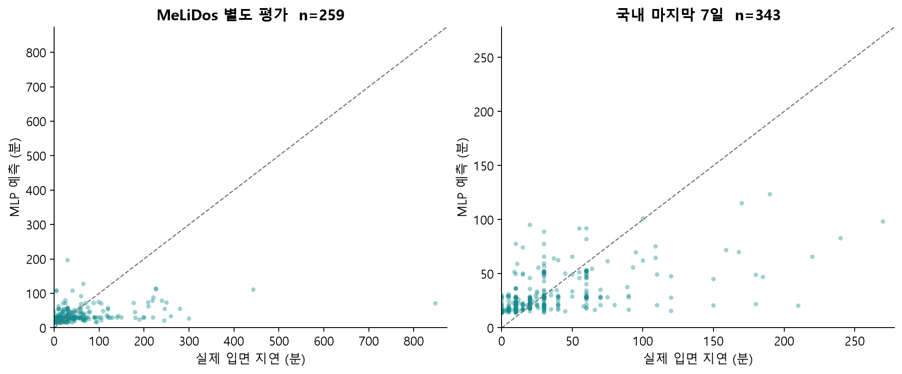
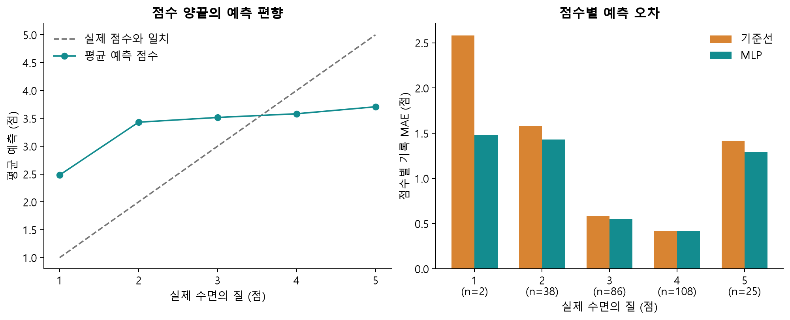
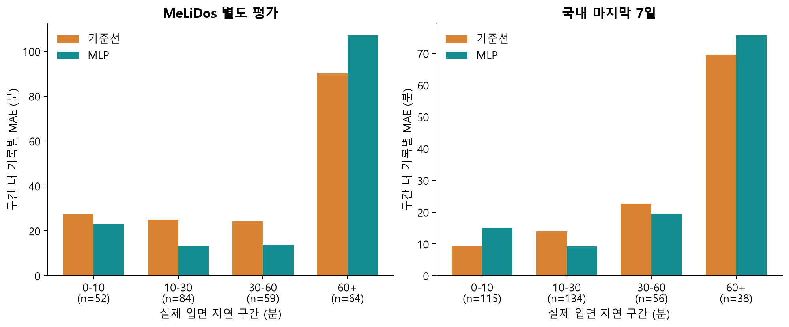

# AI+X Deep Learning Final Project

## 수면일지 기반 입면 지연 예측 및 맞춤형 취침 시각 추정 모델

> AI+X 딥러닝 기말 프로젝트 · 옵션 A

**원하는 시각에 일어나려면, 잠드는 데 걸리는 시간까지 고려해 몇 시에 잠자리에 들어야 할까?**

이 프로젝트에서는 개인별 수면일지를 바탕으로 잠자리에 든 뒤 실제로 잠들기까지 걸리는 시간인 **입면 지연**을 예측합니다. 예측한 입면 지연과 목표 수면 시간을 반영해, 목표 기상 시각에 맞춰 몇 시에 잠자리에 들어야 하는지 추정합니다.

수면일지 탐색과 전처리, 예측 모델 구축, 오차 분석까지의 과정을 단계별로 정리하고, 기상 목표를 설정한 예시를 통해 예측값이 취침 시각 추정에 어떻게 활용되는지 보여줍니다.

## 0. 프로젝트 팀원 및 역할 소개

| 이름 | 캠퍼스 | 학과 | 학번 |
| --- | --- | --- | --- |
| 김  현 | 서울캠퍼스 | 미래자동차공학과 | 2022071794 | 
| 나태우 | 서울캠퍼스 | 미래자동차공학과 | 2022020564 | 
| 서  현 | 서울캠퍼스 | 미래자동차공학과 | 2022014293 | 
| 유민서 | 서울캠퍼스 | 미래자동차공학과 | 2022077429 | 

## 1. 프로젝트 개요와 문제 정의

### 1-1. 주제 선정 배경

같은 시각에 잠자리에 들어도 실제로 잠드는 데 걸리는 시간은 사람마다, 또 날짜마다 다릅니다. 오전 8시에 일어나기 위해 취침 시각을 계산할 때도 이 차이를 고려할 필요가 있습니다.

이 프로젝트는 사람들이 기록한 **수면일지**에서 출발했습니다. 수면일지는 잠자리에 든 시각, 잠든 시각, 일어난 시각 등을 적은 자료입니다. 최근 기록에서 다음 날의 수면을 예측할 단서를 찾고, 그 예측을 취침 시각 계산에 활용해 보고자 했습니다.

### 1-2. 문제 정의

확인하려는 질문은 두 가지입니다.

1. 최근 수면 기록으로 다음 밤의 **입면 지연**, 즉 잠자리에 든 뒤 잠들기까지 걸리는 시간을 예측할 수 있을까요?
2. 최근 기록과 **수면 구간 길이**, 즉 잠든 시점부터 마지막으로 일어난 시점까지의 간격으로 본인이 매긴 수면의 질 점수를 예측할 수 있을까요?

첫 번째 질문은 모델 A, 두 번째 질문은 모델 B로 살펴봅니다. 여기서 **모델**은 과거 자료에서 입력과 정답의 관계를 학습해 새로운 입력의 값을 예측하는 계산 방법입니다.

| 구분 | 모델 A | 모델 B |
| --- | --- | --- |
| 예측할 값 | 잠들기까지 걸리는 시간 | 본인이 평가한 수면의 질 |
| 단위 | 분 | 1~5점 |
| 입력 | 최근 수면 기록을 요약한 숫자 5개 | 같은 숫자 5개와 수면 구간 길이 |

수면 구간 길이에는 밤중에 깨어 있던 시간도 포함됩니다. 따라서 실제로 잠든 시간만 합한 값과는 차이가 있습니다.

### 1-3. 프로젝트 목표와 전체 흐름

프로젝트는 다음 순서로 진행했습니다.

1. 해외·국내 수면일지를 모으고, 서로 다른 시간 표현을 분 단위로 정리했습니다.
2. 같은 사람의 기록이 학습과 평가에 섞이지 않도록 자료를 나눴습니다.
3. 여러 예측 방법을 비교해 모델 A·B를 선택했습니다.
4. 따로 남겨 둔 사람들의 기록으로 성능을 확인하고, 오차가 큰 상황을 분석했습니다.
5. 저장된 모델에 가상 입력을 넣어 취침 시각을 계산했습니다.

목표는 예측이 얼마나 맞는지와 어떤 상황에서 잘 틀리는지 확인하는 것입니다. 실제 취침 시각을 바꿔 수면이 좋아지는지까지 시험한 것은 아닙니다.

## 2. 수면일지 데이터와 전처리

### 2-1. 데이터 수집과 구성

공개된 해외 **MeLiDos 수면일지 9개 지역 자료**와 **국내 49명의 4주 수면일지**를 사용했습니다. MeLiDos는 여러 지역에서 수집한 수면일지 자료의 이름입니다.

| 자료 | 참가자 수 | 전체 기록 수 | A 평가에 쓸 수 있는 기록 | B 평가에 쓸 수 있는 기록 |
| --- | ---: | ---: | ---: | ---: |
| 해외 학습 대상 | 147명 | 1,020건 | 1,007건 | 1,001건 |
| 해외 별도 평가 | 37명 | 262건 | 259건 | 259건 |
| 국내 외부 평가 | 49명 | 1,372건 | 1,372건 | 없음 |

국내 자료에는 수면의 질 점수가 없어 모델 A만 평가했습니다. B는 점수와 수면 구간 길이가 모두 있는 기록을 사용하므로, 전체 기록 수와 실제로 사용하는 수가 다릅니다.

MeLiDos 학습 대상은 사람당 기록 수의 중앙값이 7건이고, 국내 자료는 모두 28건씩 있습니다. 수개월이나 수년 동안의 변화를 관찰한 자료로 해석하기에는 기간이 짧습니다. 원자료의 공개 위치는 [데이터 출처](데이터/출처.md)에 정리했습니다.

### 2-2. 사용 변수와 예측 대상

모델에 넣는 각각의 정보 항목을 **변수**라고 부릅니다. 예를 들어 ‘최근 잠들기까지 걸린 시간’과 ‘그 값을 계산할 때 사용한 기록 수’가 서로 다른 변수입니다.

| 입력 변수 | 뜻 | 사용 모델 |
| --- | --- | --- |
| 최근 입면 지연의 중앙값 | 이전 기록 중 값이 있는 최근 최대 3건의 대표값 | A·B |
| 입면 지연 기록 수 | 위 대표값에 사용한 기록 수, 0~3개 | A·B |
| 바로 앞 기록의 수면 구간 | 가장 최근 기록에서 잠든 시점부터 기상까지의 간격 | A·B |
| 최근 수면 구간의 중앙값 | 이전 기록 중 값이 있는 최근 최대 3건의 대표값 | A·B |
| 수면 구간 기록 수 | 위 대표값에 사용한 기록 수, 0~3개 | A·B |
| 해당 밤의 수면 구간 길이 | 평가에서는 실제 관찰값, 취침 시각 계산에서는 비교할 후보값 | B |

**중앙값**은 숫자를 크기순으로 정렬했을 때 가운데에 오는 값입니다. 예를 들어 입면 지연이 20분, 30분, 25분이면 중앙값은 25분입니다.

A의 정답은 실제 입면 지연인 `bed_to_sleep_min`, B의 정답은 실제 수면의 질 점수인 `sleep_quality`입니다. 참가자 번호·지역·날짜는 자료 분리와 오차 분석에 쓰고, 예측 입력에는 넣지 않았습니다. A의 현재 밤 예측값을 B의 입력으로 넣는 방식도 사용하지 않았습니다.

### 2-3. 데이터 탐색

학습 전에 자료의 크기와 빠진 값, 값이 주로 모여 있는 구간을 확인했습니다. 이처럼 자료의 특징을 먼저 살펴보는 과정을 **데이터 탐색**이라고 합니다.

해외 학습 자료의 입면 지연 중앙값은 30분, 국내 전체 자료는 20분이었습니다. 평균도 각각 46.88분과 33.82분으로 달랐습니다. 두 자료의 수면 기록 특성이 같지 않다는 점을 평가 해석에 반영했습니다.

위 그림의 가로축은 시간, 세로축은 값이 어느 구간에 얼마나 모여 있는지를 나타냅니다. 같은 색의 막대가 높은 구간일수록 그 주변의 기록이 많이 모여 있습니다.

수면의 질은 해외 별도 평가 259건 중 3·4점이 194건이었고, 1점은 2건뿐이었습니다. 전체 평균 오차만 보면 기록이 적은 점수에서의 실패가 가려질 수 있습니다.

### 2-4. 데이터 전처리

**전처리**는 원자료를 모델이 읽을 수 있는 형태로 정리하는 작업입니다.

먼저 시간의 기준과 단위를 맞췄습니다. MeLiDos의 입면 지연은 ‘침대에 들어간 뒤 잠을 청하기까지의 시간’과 ‘잠을 청한 뒤 잠들기까지의 시간’을 더해 계산했습니다. 국내 자료는 취침·입면 시각의 차이로 계산하고, 시간 단위로 저장된 원본 값에 60을 곱한 결과와 대조했습니다. 자정을 넘는 기록도 함께 처리했습니다.

다음으로 참가자별 기록을 밤이 끝난 아침 날짜순으로 정리했습니다. 현재 밤의 입력에는 **그 날짜보다 앞선 기록만** 사용했습니다. 정답을 미리 보고 입력을 만들면 실제 사용보다 성능이 좋아 보일 수 있기 때문입니다. 이런 문제를 **데이터 누수**라고 합니다.

빠진 값을 뜻하는 **결측값**도 구분했습니다. 입력에서 빠진 값은 학습 자료의 중앙값으로 채웠지만, 빠진 정답을 임의로 만들어 채우지는 않았습니다. 바로 앞 기록의 수면 구간이 비어 있다면 입력을 만드는 단계에서는 빈 값으로 남겼습니다.

신경망과 일부 비교 모델에는 **표준화**를 적용했습니다. 표준화는 각 입력에서 학습 자료의 평균을 빼고 값의 퍼짐 정도로 나누어, 숫자의 크기 차이를 줄이는 작업입니다. 검증·평가 자료에는 학습 자료에서 구한 기준을 그대로 적용했습니다. 자세한 처리 과정은 [전처리 코드](코드/prepare.py)에 있습니다.

### 2-5. Train / Validation / Test 데이터 분할

세 용어는 자료의 사용 목적을 구분합니다.

- **Train(학습 자료):** 모델이 입력과 정답의 관계를 배우는 자료입니다.
- **Validation(검증 자료):** 학습 방법과 설정을 고르는 데 사용하는 자료입니다.
- **Test(평가 자료):** 선택을 마친 모델이 새로운 자료에서 얼마나 맞는지 확인하는 자료입니다.

한 사람의 일지를 무작위로 섞으면 같은 사람의 기록이 학습과 평가 양쪽에 들어갈 수 있습니다. 이를 피하기 위해 **사람 단위로 자료를 분리**했습니다.

| 단계 | 참가자 | 사용 방식 |
| --- | --- | --- |
| 해외 학습·검증 | 147명 | 기존 참가자 배정에 따라 5개 그룹으로 나눠 사용 |
| 해외 별도 평가 | 37명 | 모델 선택을 마친 뒤 성능 확인 |
| 국내 외부 평가 | 49명 | 해외 자료로 학습한 A의 성능 확인 |

학습 대상 147명은 매번 4개 그룹으로 학습하고, 남은 1개 그룹으로 검증했습니다. 검증 그룹을 바꿔 5번 반복하는 방법을 **5회 교차검증**이라고 합니다. 각 사람은 검증에 한 번씩 포함됩니다. 그룹별 실제 파일은 [분할 데이터](데이터/분할)에 있습니다.

## 3. 모델 설계와 학습

### 3-1. 예측 방법과 전체 구조

A와 B는 모두 숫자를 예측합니다. 이렇게 연속적인 숫자값을 예측하는 문제를 **회귀 문제**라고 부릅니다. B의 1~5점도 이번 구현에서는 숫자값으로 예측했습니다.

A는 과거 이력을 요약한 숫자 5개로 입면 지연을 예측합니다. B는 같은 5개와 수면 구간 길이로 수면의 질을 예측합니다. 두 모델은 각각 따로 학습합니다.

취침 시각을 계산할 때는 A가 예상한 입면 지연을 사용하고, 여러 수면 구간 후보를 B에 넣어 예상 점수를 비교합니다. 이때 B가 평가에서 사용한 실제 수면 구간과, 시연에서 넣는 후보 구간은 구분해서 해석해야 합니다.

### 3-2. 후보 모델 탐색과 선정

딥러닝 모델이 단순한 방법보다 도움이 되는지 확인하기 위해 다음 방법을 비교했습니다. **기준선**은 복잡한 모델의 성능을 판단할 때 출발점으로 삼는 간단한 예측 방법입니다.

| 방법 | 쉬운 설명 |
| --- | --- |
| 기준선 | A는 개인의 최근 입면 지연 중앙값, 이력이 없으면 학습 자료의 중앙값을 사용합니다. B는 학습 자료의 평균 점수를 사용합니다. |
| Ridge Regression | 입력마다 비중을 곱해 더하는 방식입니다. 특정 입력의 비중이 지나치게 커지지 않도록 제한합니다. |
| Random Forest | 조건에 따라 자료를 나누어 예측하는 ‘결정나무’를 여러 개 만들고, 결과를 평균합니다. |
| Gradient Boosting | 앞선 예측에서 남은 오차를 다음 모델이 보완하도록 차례로 학습합니다. |
| 다층 퍼셉트론, MLP | 숫자 입력을 여러 계산 층에 통과시키고, 층 사이의 연결 강도를 학습하는 신경망입니다. 이번 프로젝트의 딥러닝 후보입니다. |
| XGBoost | 오차를 차례로 보완하는 방식의 추가 비교 모델입니다. 최초 평가 이후에 따로 비교했습니다. |

Ridge의 제한 강도, 결정나무의 깊이, MLP의 계산 층 크기와 학습 횟수 등을 바꿔 검증했습니다. 이런 설정값을 **하이퍼파라미터**라고 합니다. 최종 선택은 테스트 점수가 아니라 학습 대상 안의 교차검증 결과를 기준으로 했습니다.

### 3-3. 모델 구조와 학습 설정

A와 B 모두 최종적으로 MLP를 선택했습니다. 두 모델의 중간 계산 층 크기는 **16개 → 8개**, 출력은 숫자 1개입니다. 중간 계산 층을 **은닉층**이라고 부릅니다.

| 설정 | 값과 의미 |
| --- | --- |
| 입력 개수 | A 5개, B 6개 |
| 은닉층 크기 | 첫 번째 16개, 두 번째 8개 계산 단위 |
| ReLU | 중간 계산값이 음수이면 0으로 바꾸는 함수입니다. 층을 거치며 복잡한 관계를 배울 수 있게 합니다. |
| Dropout | 첫 은닉층 뒤에서 학습 중 일부 값을 무작위로 0으로 만듭니다. 비율은 10%이며, 특정 연결에만 의존하는 것을 줄이려는 설정입니다. |
| A의 학습 기준 | 예측과 실제의 차이에서 부호를 뺀 절대 오차를 줄입니다. |
| B의 학습 기준 | 예측과 실제의 차이를 제곱한 오차를 줄입니다. |
| Adam | 오차를 줄이는 방향으로 연결 강도를 조금씩 조정하는 학습 방법입니다. |
| 학습률 | 한 번에 값을 조정하는 정도로, 0.001을 사용했습니다. |

A의 최종 출력은 음수가 되지 않도록 변환하고, B는 1~5점 안에 오도록 변환했습니다. 모델 구조와 계산식은 [MLP 코드](코드/mlp.py)에서 확인할 수 있습니다.

### 3-4. 모델 학습 (Train)

한 번에 기록 32건씩 묶어 학습했습니다. 이 묶음을 **배치(batch)**라고 합니다. 학습 자료 전체를 한 번 사용하는 것을 **에포크(epoch)**라고 하며, 60회와 160회를 비교한 뒤 두 모델 모두 60회를 선택했습니다.

신경망은 처음 연결 강도를 정하는 무작위 값에 따라 결과가 달라질 수 있습니다. 시작 조건을 정하는 번호인 **난수 시드**를 42, 7, 17로 두어 세 모델을 학습하고, 최종 예측은 세 결과의 평균으로 계산했습니다.

위 그림의 가로축은 학습 횟수입니다. 위쪽은 학습 중 줄이려는 오차, 아래쪽은 따로 둔 검증 자료에서의 오차입니다. A와 B는 학습할 때 정답의 숫자 크기도 다르게 변환하므로, 위쪽 두 그래프의 높이를 직접 비교하지 않았습니다. 이 그림은 첫 번째 검증 회차의 학습 과정이며, 모든 회차가 같은 모습을 보였다는 뜻은 아닙니다.

학습에 사용한 프로그램과 라이브러리 버전은 [실행 환경](실행환경/README.md)에 기록했습니다.

### 3-5. 모델 검증 (Validation)과 최종 모델 선정

비교 기준은 **MAE(평균 절대 오차)**입니다. 예측이 실제값에서 얼마나 떨어졌는지 부호를 빼고 평균한 값으로, 작을수록 좋습니다. 예를 들어 실제 30분을 20분으로 예측하면 그 기록의 절대 오차는 10분입니다.

기록이 많은 사람에게 결과가 치우치지 않도록, **사람마다 평균 오차를 먼저 구하고 그 값을 다시 평균**했습니다. 아래 표는 이 ‘참가자 평균 MAE’를 사용합니다.

| 후보 | A 오차, 분 | B 오차, 점 |
| --- | ---: | ---: |
| 기준선 | 31.71 | 0.822 |
| Ridge | 32.43 | 0.785 |
| Random Forest | 31.79 | 0.779 |
| Gradient Boosting | 29.26 | 0.783 |
| MLP | **29.07** | **0.778** |

각 후보에서 가장 좋았던 설정을 비교한 결과, A·B 모두 MLP의 오차가 가장 작았습니다. 다만 B의 MLP와 Random Forest 차이는 0.001점보다 작아서 큰 성능 차이라고 보기는 어렵습니다.

선택한 설정을 고정한 뒤 학습 대상 147명 전체로 다시 학습했습니다. 결측값을 채우는 기준과 표준화 기준도 각 검증 회차의 학습 부분에서만 계산했습니다. 최종 설정과 회차별 결과는 [교차검증 결과](실험결과/교차검증)에 저장했습니다.

## 4. 최종 모델 테스트

### 4-1. 테스트 방법과 조건

선택을 마친 모델로 해외 별도 평가 37명과 국내 49명의 기록을 예측했습니다. A는 입면 지연 정답이 있는 기록을, B는 수면 구간과 수면의 질 정답이 모두 있는 기록을 평가했습니다.

국내 자료에서는 각 사람의 마지막 7일, 총 343건을 주요 평가 구간으로 삼았습니다. 이때 평가 당일보다 앞선 날짜의 실제 일지를 사용할 수 있다고 가정했습니다. 국내 자료로 모델을 다시 학습한 것은 아닙니다. 전체 1,372건 결과도 확인했지만, 이 안에 마지막 7일 343건이 포함되므로 별개의 독립 실험으로 세지 않았습니다.

해외 37명은 현재 코드에서 모델 선택 이후 평가에 사용합니다. 다만 과거에 팀이 이 사람들의 결과를 모델 선택에 참고했는지는 파일만으로 확인할 수 없어, 본문에서는 ‘해외 별도 평가’라고 부릅니다. 이 사용 이력은 최종 정리 전에 확인할 부분입니다.

### 4-2. 테스트 결과

표의 오차는 앞서 설명한 참가자 평균 MAE입니다. A는 분, B는 점 단위이므로 두 숫자의 크기를 직접 비교하지 않았습니다.

| 모델·평가 자료 | 참가자 / 유효 기록 | MLP 오차 | 기준선 오차 |
| --- | ---: | ---: | ---: |
| A · 해외 별도 평가 | 37명 / 259건 | 38.14분 | 40.91분 |
| A · 국내 마지막 7일 | 49명 / 343건 | 20.25분 | 20.06분 |
| A · 국내 전체, 보조 결과 | 49명 / 1,372건 | 21.31분 | 21.21분 |
| B · 해외 별도 평가 | 37명 / 259건 | 0.700점 | 0.750점 |

해외 자료에서는 A·B 모두 MLP의 평균 오차가 작았습니다. 국내 A에서는 개인의 최근 기록을 사용하는 기준선보다 오차가 작아지지 않았습니다. 모든 자료에서 딥러닝이 더 좋았다고 결론 내릴 수는 없습니다.

최종 평가 수치는 [평가 결과표](실험결과/테스트/holdout_metrics.csv), 각 기록의 실제값과 예측값은 [기록별 예측 결과](실험결과/테스트/holdout_predictions.csv)에 있습니다.

### 4-3. 취침 시각 추정 예시

저장된 A·B 모델에 가상 이력 3건을 넣어 실행했습니다. 입력의 입면 지연은 20·30·25분, 수면 구간은 420·450·480분입니다. 실제 참가자의 기록을 사용한 예시는 아닙니다.

목표 기상 시각은 **오전 8시**, 최소 수면 구간은 **7시간 30분**으로 두었습니다. A가 예측한 입면 지연은 약 **23.76분**입니다. 후보별 취침 시각은 다음 식으로 계산합니다.

**취침 시각 = 목표 기상 시각 − 후보 수면 구간 − 예상 입면 지연**

| 후보 수면 구간 | B의 예상 수면의 질 | 계산된 취침 시각 | 최소 구간 조건 |
| --- | ---: | --- | --- |
| 7시간 | 3.612점 | 당일 00:36 | 충족하지 않음 |
| 7시간 30분 | 3.706점 | 당일 00:06 | 충족 |
| 8시간 | 3.764점 | 전날 23:36 | 충족 |

시각은 분 단위로 반올림해 표시했습니다. 이번 입력에서는 조건을 만족하는 후보 중 8시간의 예상 점수가 가장 높았습니다. 이는 **모델이 어떻게 계산하는지 보여 주는 결과**이며, 그 시각에 자면 실제 수면이 좋아진다는 확인 결과는 아닙니다.

[입력 예시](예측시연/입력예시.json)와 [실행 결과](예측시연/예측결과.json)를 함께 저장했습니다. 실행 방법은 [예측 시연 설명](예측시연/README.md)에 있습니다.

## 5. 모델 평가와 오차 분석

### 5-1. 평가 지표와 성능 비교

평균 오차 한 가지로 설명하기 어려운 부분을 보기 위해 다음 값도 함께 확인했습니다. **평가 지표**는 성능을 숫자로 표현한 기준을 뜻합니다.

| 지표 | 뜻 |
| --- | --- |
| MAE | 실제와 예측의 차이에서 부호를 빼고 평균한 값입니다. 본문의 주요 결과는 사람별 MAE를 다시 평균했습니다. |
| RMSE | 차이를 제곱해 평균한 뒤 제곱근을 구하는 오차입니다. 큰 실수가 결과에 더 크게 반영됩니다. |
| 예측−실제의 평균 | 음수면 평균적으로 낮게, 양수면 높게 예측했다는 뜻입니다. |
| 허용 오차 이내 비율 | A는 실제값과 10분 이내, B는 1점 이내로 예측한 기록의 비율입니다. |

RMSE의 ‘제곱근’은 자기 자신을 곱했을 때 원래 수가 되는 값입니다. 예를 들어 9의 제곱근은 3입니다. 이 지표는 MAE와 함께 큰 오차의 영향을 살펴보는 데 사용했습니다.

| 자료·방법 | 참가자 평균 MAE | 기록별 RMSE | 예측−실제의 평균 | 허용 오차 이내 비율 |
| --- | ---: | ---: | ---: | ---: |
| A 해외 · 기준선 | 40.91분 | 79.36분 | −6.87분 | 33.6% |
| A 해외 · MLP | 38.14분 | 78.51분 | −19.54분 | 30.9% |
| A 국내 마지막 7일 · 기준선 | 20.06분 | 36.17분 | −2.28분 | 60.6% |
| A 국내 마지막 7일 · MLP | 20.25분 | 34.09분 | −3.59분 | 40.5% |
| B 해외 · 기준선 | 0.750점 | 0.894점 | +0.136점 | 74.9% |
| B 해외 · MLP | 0.700점 | 0.849점 | +0.094점 | 76.1% |

국내 A에서는 MLP의 RMSE가 작아졌지만 MAE는 조금 커졌고, 10분 이내로 맞힌 비율도 낮아졌습니다. 따라서 일부 큰 오차가 줄었다는 점만 보고 전체 성능이 좋아졌다고 설명하기는 어렵습니다. 허용 오차의 10분·1점은 이번 분석에서 정한 비교 기준입니다.

### 5-2. 실제값과 예측값 비교

모델 A는 실제 입면 지연이 매우 긴 기록을 충분히 따라가지 못했습니다.

위 그림에서 가로축은 실제값, 세로축은 예측값입니다. 점선 가까이에 있을수록 정확하고, 점선 아래의 점은 실제보다 짧게 예측한 기록입니다. 실제값이 큰 쪽에서 예측이 낮게 머무는 모습을 볼 수 있습니다.

모델 B는 낮은 점수와 높은 점수를 모두 가운데 점수 쪽으로 예측하는 경향이 있었습니다.

| 실제 수면의 질 | 기록 수 | MLP 평균 예측 | 기록별 MAE |
| --- | ---: | ---: | ---: |
| 1점 | 2건 | 2.483점 | 1.483점 |
| 2점 | 38건 | 3.431점 | 1.431점 |
| 3점 | 86건 | 3.516점 | 0.553점 |
| 4점 | 108건 | 3.582점 | 0.418점 |
| 5점 | 25건 | 3.708점 | 1.292점 |

전체 평균 오차가 약 0.7점이라고 해서 모든 점수에서 비슷하게 정확한 것은 아닙니다. 특히 1점은 2건뿐이어서 안정적인 성능을 판단하기 어렵습니다.

### 5-3. 오차가 큰 사례와 원인 분석

해외 별도 평가에서 실제 입면 지연이 60분을 넘은 64건의 실제 평균은 **150.64분**이었지만, MLP의 예측 평균은 **45.60분**이었습니다. 이 구간의 기록별 MAE는 **107.05분**으로 컸습니다.

국내 마지막 7일에서도 실제 입면 지연이 60분을 넘은 38건은 실제 평균 124.39분에 비해 예측 평균이 48.84분이었습니다. 반대로 실제 입면 지연이 0~10분인 국내 기록에서는 MLP가 평균 20.97분을 예측했습니다. 매우 짧거나 긴 밤을 최근 이력 몇 개만으로 구별하기 어렵다는 한계를 보여 줍니다. 이를 특정 원인 하나의 영향으로 단정할 수는 없습니다.

기준선과의 평균 차이가 참가자 구성에 따라 얼마나 달라질지도 확인했습니다. **같은 참가자의 두 방법 결과를 한 쌍으로 유지한 채 참가자를 중복 허용해 다시 뽑는 계산**을 10,000번 반복했습니다. 이를 **참가자 단위 재표집**이라고 합니다.

| 평가 | MLP 오차 − 기준선 오차 | 재표집 결과의 가운데 95% 구간 |
| --- | ---: | --- |
| A · 해외 별도 평가 | −2.78분 | −7.03 ~ +1.97분 |
| A · 국내 마지막 7일 | +0.19분 | −1.26 ~ +1.69분 |
| B · 해외 별도 평가 | −0.050점 | −0.098 ~ +0.004점 |

음수는 MLP의 오차가 작다는 뜻입니다. 위 구간에는 모두 0이 포함되므로, 현재 자료만으로 기준선보다 확실히 더 좋다고 말할 근거는 충분하지 않습니다.

참가자·지역·과거 기록 수별 분석과 큰 오차 사례는 [상세 분석 결과](실험결과/상세분석)에 남겼습니다. 저장 모델의 예측과 평가 숫자가 맞는지도 다시 계산했으며, 확인 범위는 [검산 기록](실험결과/재검증/실행확인.json)에 기록했습니다. 이 확인은 모델 전체를 새로 학습한 결과는 아닙니다.

## 6. 고찰

### 6-1. 프로젝트 결론

수면일지를 공통 단위로 정리하고, 과거 이력으로 입면 지연을 예측하는 모델 A와 수면의 질을 예측하는 모델 B를 만들었습니다. 사람 단위로 자료를 나누고, 간단한 기준선과 여러 모델을 같은 조건에서 비교했습니다.

해외 별도 평가에서는 MLP의 평균 오차가 기준선보다 작았지만, 국내 A에서는 일관된 개선을 확인하지 못했습니다. 모델 A는 긴 입면 지연을 짧게 예측했고, 모델 B는 낮거나 높은 점수를 가운데로 모아 예측했습니다.

이번 프로젝트에서 확인한 것은 예측 모델의 성능과 실패하는 조건입니다. 취침 시각을 계산하는 예시도 만들었지만, 개인에게 가장 좋은 취침 시각을 찾아냈다는 결론까지 내리지는 않았습니다.

### 6-2. 한계

| 한계 | 결과를 볼 때 주의할 점 |
| --- | --- |
| 짧은 기록 기간 | 해외 자료는 주로 약 일주일, 국내 자료는 4주여서 장기간의 개인 변화를 확인하기 어렵습니다. |
| 직접 작성한 수면일지 | 참가자가 시각과 점수를 기록하므로 기억이나 작성 방식에 따른 오차가 있을 수 있습니다. |
| 적은 입력 정보 | 최근 기록의 대표값만으로 당일의 큰 변화를 설명하기 어렵습니다. |
| 서로 다른 자료 특성 | 해외와 국내의 입면 지연 분포가 달라 오차 숫자만으로 두 집단의 성능을 단순 비교하기 어렵습니다. |
| B의 평가 범위 | 국내 수면의 질 정답이 없고, 해외에서도 낮은 점수의 기록이 적습니다. |
| 평가 자료의 과거 사용 이력 | 해외 37명의 결과를 이전 모델 선택에 참고했는지 팀의 확인이 필요합니다. |
| 실제 추천 효과 | 취침 시각을 바꾸는 실험을 하지 않아 수면 개선 효과는 확인하지 못했습니다. |

추가 XGBoost·Random Forest 비교는 이미 평가한 같은 자료를 다시 사용했습니다. 이를 새로운 평가 집단에서 얻은 독립적인 결과로 보지는 않았습니다.

### 6-3. 개선 방향

새로운 참가자의 기록과 더 긴 기간의 일지를 확보해 현재 결과가 다른 사람과 시기에도 이어지는지 확인할 필요가 있습니다. 잠들기 전에 알 수 있는 생활 정보도 추가 후보로 검토할 수 있습니다.

긴 입면 지연과 낮은 수면의 질처럼 오차가 큰 경우를 따로 살피고, 입력 정보나 학습 방법을 바꿨을 때 개선되는지 비교할 수 있습니다. 새 방법을 고르는 데는 학습 대상 안의 검증 자료를 사용하고, 이미 확인한 테스트 점수만 반복해서 보며 설정을 고르지 않도록 해야 합니다.

취침 시각 계산을 실제 추천으로 발전시키려면, 후보 시각을 적용했을 때의 수면 변화와 사용 가능성을 별도로 확인해야 합니다.

## 7. 프로젝트 설명 영상 (YouTube)

설명 영상 링크는 제작 후 추가할 예정입니다.

## 8. 참고자료

- [MeLiDos 9개 지역 원자료·변수 설명과 국내 자료 출처](데이터/출처.md)
- [국내 49명 수면일지 공개 데이터](https://doi.org/10.6084/m9.figshare.28509740)
- [PyTorch의 Dropout 설명](https://docs.pytorch.org/docs/2.7/generated/torch.nn.Dropout.html)
- [scikit-learn의 평균 절대 오차(MAE) 설명](https://scikit-learn.org/1.7/modules/generated/sklearn.metrics.mean_absolute_error.html)
- 본문 수치의 근거: [교차검증 결과](실험결과/교차검증/cv_summary.csv), [별도 평가 결과](실험결과/테스트/holdout_metrics.csv), [오차 분석](실험결과/상세분석), [시연 출력](예측시연/예측결과.json)

팀에서 추가로 참고한 자료는 이후 함께 정리할 예정입니다.
