# AI+X Deep Learning Final Project

## 수면일지 기반 입면 지연 예측 및 맞춤형 취침 시각 추정 모델

> AI+X 딥러닝 기말 프로젝트 · 옵션 A

**원하는 시각에 일어나려면, 잠드는 데 걸리는 시간까지 고려해 몇 시에 잠자리에 들어야 할까?**

여러 참가자의 수면일지로 모델 A와 B를 학습했습니다. 예측할 때는 각자의 최근 수면 기록을 모델에 넣어, 잠자리에 든 뒤 실제로 잠들기까지 걸리는 시간인 **입면 지연**과 수면 구간별 예상 수면의 질을 계산합니다.

별도로 둔 참가자의 수면일지에서 모델의 예측값을 실제 기록과 비교해 오차를 확인했습니다. 취침 시각 추정에서는 수면일지로 학습한 모델이 같은 기준으로 후보를 비교할 수 있도록 **목표 기상 시각 오전 8시**와 **최소 수면 구간 7시간 30분**을 시연의 전제조건으로 설정했습니다. 이 조건을 충족하는 후보 중에서 모델이 수면의 질을 가장 높게 예측한 취침 시각을 선택했습니다.

우리가 만들고 싶은 건 **내 수면일지에서 잠드는 패턴을 파악해, 내일 오전 8시에 더 개운하게 일어나려면 오늘 밤 몇 시에 잠자리에 들면 좋을지 알려주는 모델**입니다.

## 목차

- [0. 프로젝트 팀원 및 역할 소개](#0-프로젝트-팀원-및-역할-소개)
- [1. 프로젝트 개요와 문제 정의 (Proposal)](#1-프로젝트-개요와-문제-정의-proposal)
- [2. 수면일지 데이터와 전처리 (Dataset)](#2-수면일지-데이터와-전처리-dataset)
- [3. 모델 설계와 학습 (Methodology)](#3-모델-설계와-학습-methodology)
- [4. 최종 모델 테스트 (Test Results)](#4-최종-모델-테스트-test-results)
- [5. 모델 평가와 오차 분석 (Evaluation & Analysis)](#5-모델-평가와-오차-분석-evaluation--analysis)
- [6. 고찰 (Conclusion & Discussion)](#6-고찰-conclusion--discussion)
- [7. 프로젝트 발표 영상 (Project Presentation Video)](#7-프로젝트-발표-영상-project-presentation-video)
- [8. 참고자료 (Related Work)](#8-참고자료-related-work)

## 0. 프로젝트 팀원 및 역할 소개

| 이름 | 학번 | 소속 | 역할 |
| :---: | :---: | :--- | :--- |
| 나태우 | 2022020564 | 미래자동차공학과 (서울) | 프로젝트 팀장, 블로그 제작, 데이터 전처리 |
| 김현 | 2022071794 | 미래자동차공학과 (서울) | 프로젝트 모델 학습 및 검증 |
| 서현 | 2022014293 | 미래자동차공학과 (서울) | 프로젝트 데이터 수집 및 모델 입력 변수 분석 |
| 유민서 | 2022077429 | 미래자동차공학과 (서울) | 프로젝트 모델 테스트 및 분석 |

## 1. 프로젝트 개요와 문제 정의 (Proposal)

### 1-1. 주제 선정 배경

#### 우리의 궁금증

> **내일 아침 8시에 일어나야 한다면, 오늘 몇 시에 누워야 개운하게 일어날 수 있을까요?**

수업이나 출근, 시험이 있는 날에는 일어나야 할 시각이 이미 정해져 있습니다. 내일 8시 알람을 맞추고 ‘자정에 누우면 8시간은 자겠지’라고 생각할 수 있습니다. 그런데 누워서 한참 뒤척인다면, 일어나야 할 시각까지 남은 수면 구간은 그만큼 짧아집니다.

  

*그림 1. 침대 곁에 놓인 알람 시계. [Anastasiya Vragova 촬영, Pexels](https://www.pexels.com/photo/an-alarm-clock-on-bedside-near-a-sleeping-woman-8346006/)*

#### 가상 예시. 둘 다 자정에 누워 오전 8시에 일어난다면

- 5분 만에 잠들면 잠든 시각부터 기상까지 **7시간 55분**이 남습니다.
- 35분이 걸리면 잠든 시각부터 기상까지 **7시간 25분**이 남습니다.

이 프로젝트에서는 **잠자리에 든 시각(`go to bed`)부터 실제로 잠들 때까지 걸린 시간**을 **입면 지연**이라고 부릅니다. 표준 수면일지에서도 잠자리에 든 시각과 잠을 청하기 시작한 시각을 따로 기록합니다. [표준 수면일지 연구](https://pmc.ncbi.nlm.nih.gov/articles/PMC3250369/)

#### 실제 조사와 수면일지에서 확인한 사례

**사례 1. 누웠지만 잠이 오지 않았습니다**

통계청 2024년 생활시간조사에서 10세 이상 인구의 11.9%가 잠을 이루지 못한 시간을 기록했습니다. **그 시간을 기록한 사람들의 평균은 32분**이었습니다. [통계청 조사 결과](https://mods.go.kr/board.es?act=view&bid=220&list_no=437764&mid=a10301010000) · [한국일보 보도](https://www.hankookilbo.com/news/article/A2025072810120003470)

  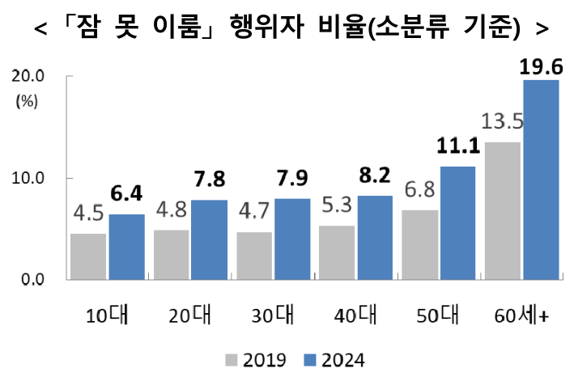

*2019년과 2024년의 연령대별 비교. [통계청 2024년 생활시간조사 결과, 9쪽](https://mods.go.kr/boardDownload.es?bid=220&list_no=437764&seq=9#page=16)*

**사례 2. 충분히 잤다고 느껴도 피곤했습니다**

KB경영연구소의 2026년 조사에서 수면의 질을 나쁘다고 답한 **671명**에게 불편한 상황을 물었습니다. 45.3%는 쉽게 잠들지 못하는 상황을, 43.1%는 충분히 자도 피곤한 상황을 꼽았습니다. [2026 한국 웰니스 보고서, 그림 III-14](https://www.kbfg.com/kbresearch/cmm/fms/FileDown.do?atchFileId=FILE_000000002001580&fileSn=0)

  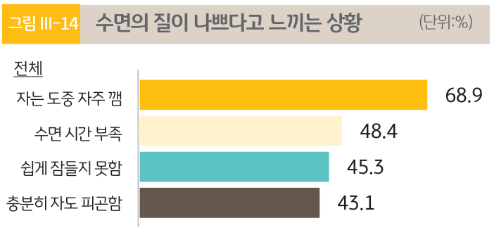

*수면의 질을 나쁘게 평가한 응답자 671명의 전체 응답 그래프. [KB경영연구소 2026 한국 웰니스 보고서, 37쪽](https://www.kbfg.com/kbresearch/cmm/fms/FileDown.do?atchFileId=FILE_000000002001580&fileSn=0#page=45)*

**사례 3. 같은 사람도 밤마다 달랐습니다**

우리 프로젝트가 사용한 국내 수면일지에서 49명이 4주 동안 남긴 기록을 사람별로 비교했습니다. **49명 중 42명**은 입면 지연이 가장 짧은 밤과 가장 긴 밤 사이에 **30분 이상 차이**가 났습니다. [국내 수면일지 전처리 자료](/데이터%28Dataset%29/전처리/test_korea.csv)

  

*참가자별로 가장 길었던 입면 지연에서 가장 짧았던 입면 지연을 뺀 값의 분포.*

#### 그래서 무엇을 살펴봤을까요?

수면일지에는 누운 시각, 잠든 시각, 일어난 시각 등이 담겨 있습니다. 우리는 최근 일지로 잠드는 데 얼마나 걸릴지 예측하고, 그 값으로 오전 8시 같은 목표 기상 시각에 맞춰 취침 시각을 계산해 보기로 했습니다. 과거 기록과 잠든 시각부터 기상까지의 간격을 바탕으로, 본인이 일지에 매긴 수면의 질 점수도 살펴봅니다.

### 1-2. 문제 정의

확인하려는 질문은 두 가지입니다.

1. 최근 수면 기록으로 다음 밤의 **입면 지연**, 즉 잠자리에 든 뒤 잠들기까지 걸리는 시간을 예측할 수 있을까요?
2. 최근 기록과 **수면 구간 길이**, 즉 잠든 시점부터 마지막으로 일어난 시점까지의 간격으로 본인이 매긴 수면의 질 점수를 예측할 수 있을까요?

첫 번째 질문은 모델 A, 두 번째 질문은 모델 B로 살펴봅니다. 여기서 **모델**은 과거 자료에서 입력과 정답의 관계를 학습해 새로운 입력의 값을 예측하는 계산 방법입니다.

  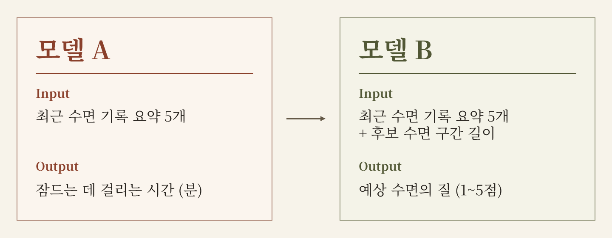

*화살표는 취침 시각 시연에서 두 모델을 사용하는 순서입니다.*

| 구분 | 모델 A | 모델 B |
| --- | --- | --- |
| 예측할 값 | 잠들기까지 걸리는 시간 | 본인이 평가한 수면의 질 |
| 단위 | 분 | 1~5점 |
| 입력 | 최근 수면 기록을 요약한 숫자 5개 | 같은 숫자 5개와 수면 구간 길이 |

수면 구간 길이에는 밤중에 깨어 있던 시간도 포함됩니다. 따라서 실제로 잠든 시간만 합한 값과는 차이가 있습니다.

두 모델을 평가할 때는 최근 수면 기록의 대표값을 그대로 쓰는 간단한 방법을 기준으로 삼았습니다. 같은 수면일지에서 두 방법의 예측값을 실제 기록과 비교해 **어느 쪽의 예측 오차가 더 작았는지** 살펴봤습니다.

학습에 사용한 수면일지는 참가자 147명분입니다. 최근 입면 지연의 중앙값과 직전 수면 구간 길이처럼 각 참가자의 수면 패턴을 보여 주는 값을 뽑고, 이렇게 만든 학습 데이터를 모아 모두에게 적용할 모델 A와 B를 만들었습니다.

**맞춤형 취침 시각**은 이 공통 모델에 각자의 최근 수면 기록을 넣어 계산합니다. 예를 들어 두 사람이 모두 오전 8시에 일어나고 잠든 뒤부터 기상까지 7시간 30분을 확보하고 싶다고 해 볼게요. 모델 A가 한 사람은 잠드는 데 10분, 다른 사람은 30분이 걸릴 것으로 예측했다면, 두 사람이 잠자리에 들 시각은 각각 00:20과 00:00으로 계산됩니다.

확보할 수면 구간을 여러 가지로 두면, 모델 B가 각 후보에서 예상되는 수면의 질을 점수로 매깁니다. 이 점수를 바탕으로 최소 수면 구간을 충족하는 후보 중 예상 점수가 가장 높은 취침 시각을 고릅니다. 실제로 그 시각에 잠자리에 들었을 때 수면의 질이 좋아지는지는 별도의 실험으로 확인해야 합니다.

### 1-3. 프로젝트 목표와 전체 흐름

아침 8시에 일어나려면 오늘 몇 시에 누워야 할까요? 이 질문에 답하려면 먼저 **누운 뒤 잠들기까지 얼마나 걸리는지** 추정해야 합니다. 과거 수면일지에서 그 값을 예측하고, 따로 둔 자료로 얼마나 잘 맞는지 확인한 뒤 취침 시각을 계산했습니다.

  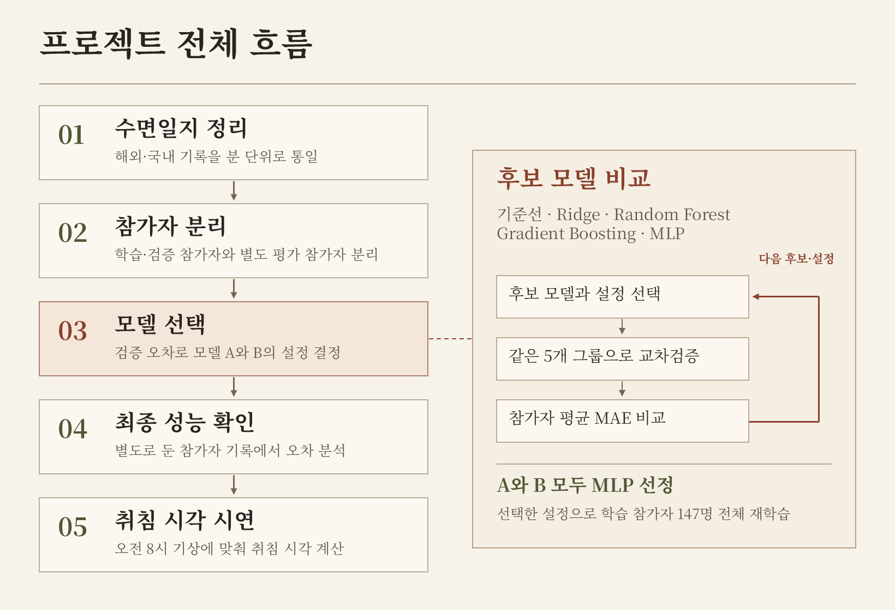

*되돌아오는 화살표는 후보 모델과 설정을 바꿔 가며 검증 오차를 비교하는 과정입니다. 모델을 확정한 뒤 별도로 둔 참가자의 기록에서 최종 성능을 확인했습니다.*

| 단계 | 하는 일 | 다음 단계에 쓰는 결과 |
| :--- | :--- | :--- |
| **01 · 일지 정리** | 해외·국내 기록을 같은 기준으로 맞추기 | 분 단위로 정리한 수면 기록 |
| **02 · 참가자 분리** | 학습할 사람과 평가할 사람을 나누기 | 해외 학습 147명 · 해외 평가 37명 · 국내 평가 49명 |
| **03 · 모델 선택** | 같은 조건에서 여러 예측 방법을 비교하기 | 입면 지연 모델 A · 수면의 질 모델 B |
| **04 · 성능 확인** | 따로 둔 기록으로 오차를 계산하고 살펴보기 | 어떤 밤에 잘 맞고, 어떤 밤에 크게 틀렸는지 확인 |
| **05 · 취침 시각 시연** | 목표 기상 시각으로부터 거꾸로 계산하기 | 잠자리에 들 시각의 후보 |

1. **수면일지를 같은 기준으로 정리했습니다.**

   해외와 국내 일지는 시간을 적는 형식과 단위가 달랐습니다. 잠자리에 든 뒤 잠들 때까지의 시간과 잠든 뒤 기상까지의 간격을 분 단위로 맞췄습니다. 이렇게 정리한 기록으로 사람별 최근 입면 지연과 수면 구간을 계산했습니다.

2. **학습할 사람과 평가할 사람을 나눴습니다.**

   한 사람의 월요일 일지를 학습에 쓰고 화요일 일지를 평가에 쓰면, 모델이 처음 보는 사람에게 얼마나 잘 맞는지 알기 어렵습니다. 그래서 한 사람의 일지를 한 묶음으로 두고 참가자 단위로 나눴습니다. 빈 값을 채우는 기준도 학습 자료에서 정했습니다.

3. **간단한 예측과 여러 학습 모델을 비교했습니다.**

   해외 학습 대상 147명을 다섯 그룹으로 나눠, 매번 네 그룹으로 학습하고 남은 한 그룹으로 확인했습니다. 같은 그룹 배정으로 여러 방법을 비교해 입면 지연을 예측하는 모델 A와 일지의 수면 점수를 예측하는 모델 B의 최종 설정을 골랐습니다.

4. **따로 둔 일지에서 얼마나 틀렸는지 확인했습니다.**

   설정을 확정한 모델의 예측값을 실제 일지와 비교했습니다. 평균 오차를 계산하고, 잠드는 데 오래 걸린 밤이나 이전 기록이 적은 밤처럼 상황을 나눠 어떤 경우에 차이가 커졌는지 살펴봤습니다.

5. **오전 8시 기상을 예로 취침 시각을 계산했습니다.**

   가상의 최근 일지를 넣어 모델 A로 입면 지연을 구했습니다. 목표 기상 시각에서 후보 수면 구간과 입면 지연을 빼면 잠자리에 들 시각이 나옵니다. 모델 B로 후보별 수면 점수도 계산했습니다.

프로젝트의 목표는 **원하는 시각에 좋은 컨디션으로 일어나려면 오늘 밤 몇 시에 잠자리에 들면 좋을지** 추정하는 것입니다. 각자의 최근 수면일지에서 예측한 입면 지연을 반영해 목표 기상 시각에 맞는 후보를 계산하고, 최소 수면 구간을 충족하는 후보 중 **예상 수면의 질 점수가 가장 높은 취침 시각**을 제안합니다. 이 점수는 참가자가 수면일지에 직접 매긴 수면의 질을 바탕으로 예측한 값입니다. 실제로 잠자리에 드는 시각을 바꿨을 때 다음 날 컨디션이 좋아질지, 나빠질지는 별도의 실험으로 확인해야 합니다.

## 2. 수면일지 데이터와 전처리 (Dataset)

### 2-1. 데이터 수집과 구성

수면일지만으로 입면 지연과 수면의 질을 예측할 수 있는지 확인하기 위해, 9개 지역에서 수집한 해외 MeLiDos 수면일지와 국내 참가자가 4주 동안 작성한 수면일지를 사용했습니다. 두 자료를 비교할 수 있도록 입면 지연과 수면 구간 길이를 같은 기준으로 계산하고 분 단위로 맞췄습니다.

아래 표는 자료별 구성과 각 모델에 사용할 수 있는 기록 수를 보여 줍니다.

| 자료 | 참가자 수 | 전체 기록 수 | A 평가에 쓸 수 있는 기록 | B 평가에 쓸 수 있는 기록 |
| --- | ---: | ---: | ---: | ---: |
| 해외 학습 대상 | 147명 | 1,020건 | 1,007건 | 1,001건 |
| 해외 별도 평가 | 37명 | 262건 | 259건 | 259건 |
| 국내 외부 평가 | 49명 | 1,372건 | 1,372건 | 없음 |

해외 자료에는 입면 지연과 수면의 질 점수가 모두 있어 두 모델을 학습·검증하고, 따로 둔 해외 참가자의 기록으로 평가했습니다. 국내 자료는 해외 자료로 학습한 모델을 다른 집단에 적용했을 때 오차가 어느 정도인지 확인하는 데 사용했습니다. 국내 일지에는 수면의 질 점수가 없어 모델 A만 평가했습니다.

모델 A를 학습하거나 평가하려면 실제 입면 지연이 필요합니다. 모델 B에는 해당 밤의 수면 구간 길이와 참가자가 매긴 수면의 질 점수가 모두 필요합니다. 이 조건을 충족하는 기록이 모델마다 달라 사용할 수 있는 기록 수도 달랐습니다. 원자료의 공개 위치는 [데이터 출처](/데이터%28Dataset%29/출처.md)에 정리했습니다.

**공개 자료에서 이번에 사용한 범위**

MeLiDos는 빛 노출 측정값과 수면일지 등을 함께 제공하는 연구 자료입니다. 분석에는 표에 나온 해외 참가자의 수면일지를 사용했습니다. [MeLiDos 공식 소개](https://github.com/MeLiDosProject/melidosData)

국내 자료도 스마트워치 측정값과 일지를 함께 수집한 연구에서 공개한 것입니다. 두 연구에서 공통으로 활용할 수 있는 수면일지 항목으로 모델 입력을 구성했습니다. [Baigutanova 등의 데이터 소개 논문](https://doi.org/10.1038/s41597-025-05801-3)

### 2-2. 사용 변수와 예측 대상

모델 A는 잠자리에 든 뒤 실제로 잠들기까지 걸린 시간인 **입면 지연**을 분 단위로 예측합니다. 모델 B는 참가자가 일지에 직접 매긴 **수면의 질**을 1~5점 범위에서 예측합니다. 수면 구간은 잠든 시각부터 마지막으로 일어난 시각까지의 간격이며, 밤중에 깨어 있던 시간도 포함합니다. 두 모델이 공통으로 쓰는 다섯 가지 입력과 모델 B에 추가한 입력을 아래 표에 정리했습니다.

| 입력 변수 | 뜻 | 사용 모델 |
| --- | --- | --- |
| 최근 입면 지연의 중앙값 | 이전 기록 중 값이 있는 최근 최대 3건의 대표값 | A·B |
| 입면 지연 기록 수 | 위 대표값에 사용한 기록 수, 0~3개 | A·B |
| 바로 앞 기록의 수면 구간 | 가장 최근 기록에서 잠든 시점부터 기상까지의 간격 | A·B |
| 최근 수면 구간의 중앙값 | 이전 기록 중 값이 있는 최근 최대 3건의 대표값 | A·B |
| 수면 구간 기록 수 | 위 대표값에 사용한 기록 수, 0~3개 | A·B |
| 해당 밤의 수면 구간 길이 | 평가에서는 실제 관찰값, 취침 시각 계산에서는 비교할 후보값 | B |

두 중앙값은 최근에 잠드는 데 대체로 얼마나 걸렸는지, 수면 구간은 대체로 얼마나 길었는지 보여 줍니다. 중앙값을 쓰면 유난히 크거나 작은 기록이 최근의 대표값에 미치는 영향을 줄일 수 있습니다. 직전 수면 구간은 최근 패턴과 함께 바로 앞 기록의 상태를 알려 줍니다. 두 기록 수는 각 중앙값이 하루치 기록에서 나온 값인지, 여러 날의 기록을 요약한 값인지 구분하는 데 썼습니다.

최근 이력이 같아도 해당 밤의 수면 구간 길이에 따라 참가자가 매긴 점수가 달라질 수 있습니다. 이를 반영하기 위해 해당 밤의 수면 구간을 모델 B에 추가했습니다. 같은 MLP의 내부 교차검증에서 이 변수를 추가하자 평균 절대 오차가 0.823점에서 0.778점으로 줄었습니다. 학습·평가에서는 일지에 기록된 실제 수면 구간을 사용했습니다. 취침 시각 시연에서는 7시간 30분이나 8시간 같은 후보값을 넣어 예상 점수를 비교했습니다.

**실제 입력이 만들어지는 예시**

아래 표의 세 기록이 날짜순으로 있고, 그다음 밤을 예측한다고 가정했습니다.

| 과거 기록 순서 | 입면 지연 | 수면 구간 |
| --- | ---: | ---: |
| 첫 번째 | 20분 | 420분 |
| 두 번째 | 30분 | 450분 |
| 세 번째 | 25분 | 480분 |

표의 기록으로 만든 모델 A의 입력은 [25, 3, 480, 450, 3]입니다. 마지막 세 값은 직전 수면 구간, 최근 수면 구간 중앙값, 그 중앙값을 계산하는 데 사용한 기록 수입니다. 모델 B로 8시간 후보를 비교할 때는 이 다섯 값 뒤에 480분을 추가합니다. 이 가상 이력은 4장의 시연에서도 사용합니다.

항목별로 값이 있는 이전 기록을 최신순으로 최대 세 개 골랐습니다. 일지가 빠지면 연속 3일과 다를 수 있습니다. 직전 기록의 수면 구간이 비어 있으면 해당 입력도 빈 값으로 남겼습니다.

### 2-3. 데이터 탐색

입면 지연과 수면의 질 점수가 주로 어디에 모이는지 확인했습니다. 기록이 많은 구간과 드문 구간을 함께 살펴보면 전체 평균 오차에 어떤 기록이 많이 반영됐는지 해석할 수 있습니다.

해외 학습 자료의 입면 지연은 중앙값이 30분, 평균이 46.88분이었습니다. 국내 전체 자료에서는 중앙값이 20분, 평균이 33.82분이었습니다. 두 자료 모두 입면 지연이 긴 기록이 평균을 끌어올렸습니다.

  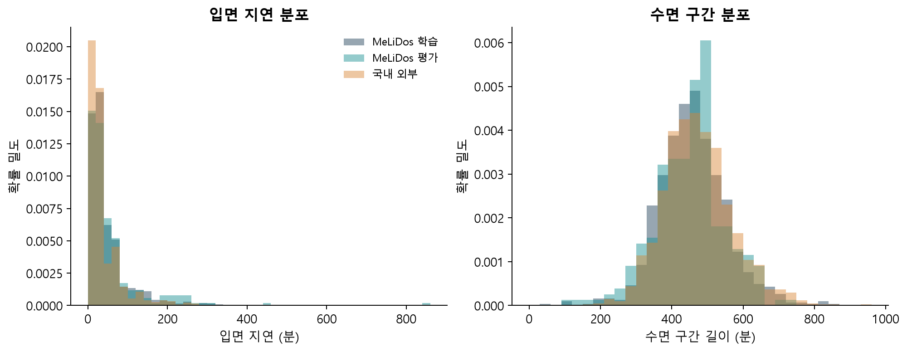

*그림 2. 자료별 시간 분포. 국내 전체 자료에는 마지막 7일 기록도 포함됩니다.*

그림 2의 가로축은 시간입니다. 같은 색의 막대가 높을수록 해당 시간 구간에 기록이 더 많이 모였습니다. 국내외 자료의 입면 지연 분포가 달라, 모델 성능은 각 평가 자료에서 같은 기록에 적용한 기준선과 비교해 해석했습니다.

해외 별도 평가의 수면의 질 기록 259건 중 3점과 4점은 194건으로 약 75%였고, 1점은 2건이었습니다. 점수별 기록 수에 차이가 있어 전체 평균 오차만으로는 드물게 나타난 점수에서 모델이 얼마나 잘 맞았는지 파악하기 어렵습니다. 그래서 실제 점수별 기록 수와 오차를 함께 살펴봤습니다.

### 2-4. 데이터 전처리

#### 전처리는 왜 필요한가요?

**전처리**는 수집한 기록을 모델이 같은 뜻으로 해석할 수 있도록 정리하는 작업입니다. 아래 그림에서 데이터 수집과 모델링 사이에 있는 **Data Preparation(데이터 준비)** 단계에 해당합니다. 우리 프로젝트에서는 이 단계에서 해외·국내 수면일지의 시간 단위를 맞추고, 어느 기록이 예측에 쓸 수 있는 정보인지 정했습니다.

  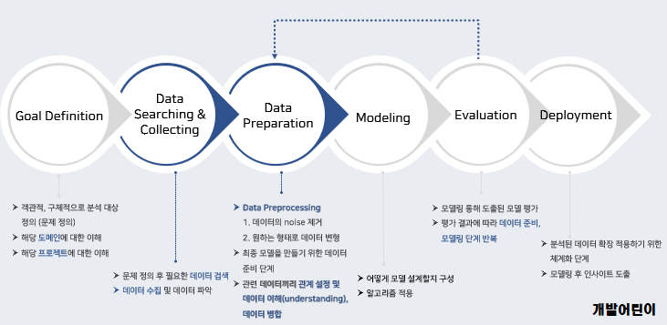

*데이터 분석에서 전처리가 들어가는 위치. [출처 · 개발어린이, 데이터 분석 과정과 전처리의 중요성](https://ahnty0122.tistory.com/61)*

예를 들어 두 사람이 모두 잠드는 데 30분이 걸렸어도, 한 일지에는 `30분`, 다른 일지에는 `0.5시간`으로 남을 수 있습니다. 단위를 맞추지 않고 숫자만 읽으면 모델은 같은 시간을 `30`과 `0.5`로 받아들입니다. 밤 11시 50분에 누워 다음 날 0시 20분에 잠든 기록도 날짜를 고려해야 30분이라는 답이 나옵니다.

빈칸도 뜻을 구분해야 합니다. ‘잠들기까지 걸린 시간’이 비어 있는데 `0분`으로 바꾸면, 실제로는 모르는 기록이 ‘눕자마자 잠들었다’는 기록이 됩니다. 또 오늘 밤을 예측할 때 오늘 밤의 결과까지 입력하면, 모델을 평가하는 점수는 좋아 보일 수 있어도 실제로 잠자리에 들기 전에는 같은 예측을 할 수 없습니다.

#### 우리 원자료는 어떻게 전처리했나요?

**1. 해외·국내 일지에서 같은 의미의 시간을 계산했습니다.**

두 예시 모두 0시 20분에 잠들어 오전 7시 50분에 일어났다고 하면, 수면 구간은 **450분**입니다. 입면 지연은 각 일지의 기록 방식에 맞춰 계산했습니다.

| 자료 | 원자료에 적힌 방식의 예 | 입면 지연 계산 |
| --- | --- | --- |
| 해외 MeLiDos | 밤 11시 50분에 누움 → 자정에 잠을 청함 → 20분 뒤 잠듦 | 잠을 청하기까지 10분 + 잠들기까지 20분 = **30분** |
| 국내 수면일지 | 밤 11시 50분에 누움 → 다음 날 0시 20분에 잠듦 | 자정을 기준으로 10분 + 20분 = **30분**. 원본의 `0.5시간 × 60`과 대조 |

해외 일지는 날짜를 포함해 시각을 읽고, 국내 일지는 자정을 넘겼는지 확인해 분 단위로 바꿨습니다. MeLiDos의 수면의 질은 **1~5점**으로 정리했습니다. 시간 관계가 맞지 않거나 점수를 확정할 수 없는 값은 빈칸으로 남겼고, 시간이 길어도 기록의 앞뒤가 맞으면 유지했습니다.

**2. 사람별로 날짜순을 정리하고, 앞선 기록에서만 입력을 만들었습니다.**

예를 들어 목요일 밤을 예측할 때 월·화·수요일의 입면 지연이 **20분, 35분, 15분**이라면, 크기순으로 줄을 세웠을 때 가운데 값인 **20분**을 입력에 씁니다. 목요일 밤의 결과는 다음 날 이후에만 과거 기록으로 쓸 수 있습니다. 이렇게 예측 시점에 알 수 없는 정보가 입력에 섞이는 **데이터 누수**를 막았습니다.

입면 지연과 수면 구간은 각각 값이 있는 최근 기록을 최대 3개 골라 중앙값과 기록 수를 구했습니다. 별도 입력인 ‘바로 앞 기록의 수면 구간’에 값이 없으면 더 오래된 기록을 가져오지 않고 빈칸으로 남겼습니다.

**3. 입력이 빠진 경우와 정답이 빠진 경우를 다르게 처리했습니다.**

빠진 값인 **결측값**이 입력에 있으면 **학습 자료의 중앙값**으로 채웠습니다. 예를 들어 학습 자료의 직전 수면 구간 중앙값이 450분이면, 검증·평가 자료에서도 그 항목이 빈칸일 때 450분을 썼습니다.

정답이 빈 기록은 학습과 오차 계산에서 제외했습니다. 해외 학습 기록 **1,020건** 중 모델 A는 입면 지연이 있는 **1,007건**, 모델 B는 실제 수면 구간과 수면의 질 점수가 모두 있는 **1,001건**을 썼습니다. [기록 수와 결측값 확인](/데이터%28Dataset%29/전처리/summary.json)

**4. 일부 모델에 넣는 숫자의 크기를 맞췄습니다.**

기록 수는 0~3이고 수면 구간은 450분처럼 수백 단위입니다. 이 차이를 줄이려고 신경망과 일부 비교 모델에 **표준화**를 적용했습니다. 예를 들어 평균이 30분이고 값의 퍼짐 정도인 표준편차가 10분이면, 40분은 `(40 − 30) ÷ 10 = 1`로 바뀝니다. 평균과 표준편차는 학습 자료에서만 구했습니다. [원자료 전처리 코드](/코드%28Code%29/prepare.py) · [신경망의 입력 처리 코드](/코드%28Code%29/mlp.py)

### 2-5. Train / Validation / Test 데이터 분할

학습(Train)에서는 모델이 입력과 정답의 관계를 배웠습니다. 검증(Validation)에서는 후보 모델과 설정을 비교했습니다. 평가(Test)에서는 설정을 확정한 모델을 별도 자료에 적용해 오차를 확인했습니다.

| 단계 | 참가자 | 사용 방식 |
| --- | --- | --- |
| 해외 학습·검증 | 147명 | 기존 참가자 배정에 따라 5개 그룹으로 나눠 사용 |
| 해외 별도 평가 | 37명 | 모델 선택을 마친 뒤 성능 확인 |
| 국내 외부 평가 | 49명 | 해외 자료로 학습한 A의 성능 확인 |

**하루치 기록을 섞는 대신 사람을 나눈 이유**

한 사람의 월요일 기록을 학습에, 화요일 기록을 평가에 넣으면 모델이 평가 전에 그 사람의 수면 패턴을 이미 접하게 됩니다. 처음 보는 참가자에게 적용하는 상황에 맞추기 위해 같은 참가자의 일지를 한 묶음으로 다뤘습니다. 교차검증의 각 회차에서도 한 참가자의 기록은 학습과 검증 중 한쪽에만 넣었습니다.

해외 학습·검증 대상 147명을 5개 그룹으로 나눴습니다. 매 회차 4개 그룹으로 학습하고 남은 1개 그룹으로 검증했습니다. 검증 그룹을 바꿔 총 5회 교차검증을 진행했습니다. 후보 모델과 설정을 비교해 최종 설정을 확정한 뒤 147명 전체로 두 모델을 다시 학습했습니다. 해외 별도 평가 대상 37명의 기록은 최종 모델 A와 B의 오차를 확인하는 데 사용했습니다. 그룹별 실제 파일은 [분할 데이터](/데이터%28Dataset%29/분할)에 있습니다.

국내 49명의 기록은 모델 A의 외부 평가에 사용했습니다. 참가자별 마지막 7일에 해당하는 총 343건을 주요 평가 구간으로 삼았고, 28일 전체 결과도 보조적으로 확인했습니다. 각 날짜를 예측할 때는 해당 참가자가 그 날짜보다 앞서 작성한 일지로 최근 이력을 만들었습니다. 예를 들어 22일차는 21일차까지의 일지에서 이력을 가져와 예측했습니다. 해외 자료로 학습한 모델 가중치를 고정했으며 국내 자료로 재학습하지 않았습니다.

## 3. 모델 설계와 학습 (Methodology)

### 3-1. 두 모델이 해결하는 문제

우리는 두 가지 숫자를 예측합니다. 모델 A는 침대에 들어간 뒤 잠들기까지 걸리는 시간을 분 단위로 예측합니다. 모델 B는 특정 수면 구간에서 예상되는 주관적 수면의 질을 1~5점으로 예측합니다. 숫자를 예측하는 이런 문제를 **회귀**라고 합니다. 수면의 질도 3.7점처럼 소수로 예측했습니다.

| 구분 | 모델 A | 모델 B |
|---|---|---|
| 입력 | 과거 수면 이력 5개 | 같은 이력 5개와 수면 구간 길이 |
| 정답 | 실제 입면 지연, 분 | 실제 수면의 질, 1~5점 |
| 출력 예시 | 약 24분 | 약 3.7점 |
| 활용 | 취침 시각 역산 | 후보 수면 구간의 예상 점수 비교 |

공통 입력은 최근 최대 3건의 입면 지연 중앙값과 기록 수, 바로 앞 기록의 수면 구간, 최근 최대 3건의 수면 구간 중앙값과 기록 수입니다. 각 밤보다 앞선 기록으로만 이력을 만듭니다.

예를 들어 최근 입면 지연이 20·30·25분, 수면 구간이 420·450·480분이었다면 A의 입력은 `[25, 3, 480, 450, 3]`입니다. B에는 비교하려는 수면 구간 길이 하나를 더 넣습니다. 숫자 3은 기록 세 건을 사용했다는 뜻입니다.

A와 B는 따로 학습했습니다. B를 학습하고 평가할 때는 그날 밤에 관찰한 수면 구간을 입력했습니다. 취침 시각 시연에서는 후보 구간을 넣어 예상 점수의 변화를 살펴봤습니다. 시연에서 A의 예측은 각 후보의 취침 시각을 계산하는 데, B의 예측은 후보를 비교하는 데 사용했습니다.

### 3-2. 비교 방법과 공통 기준

복잡한 모델의 이득을 판단하기 위해 간단한 기준선부터 선형 회귀, 결정나무, 신경망을 비교했습니다. 학습 참가자 147명의 그룹 배정과 평가 지표를 동일하게 적용했습니다. 아래 흐름에서 내부 검증으로 모델과 설정을 골랐고, 선택을 마친 뒤 4장의 별도 평가로 넘어갔습니다.

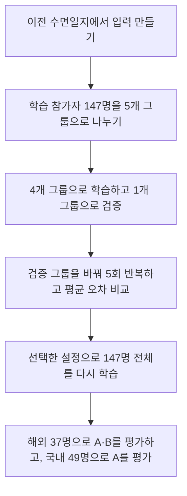

실제 30분을 20분으로 예측하면 절대 오차는 10분입니다. 이처럼 예측값과 실제값의 차이에서 부호를 빼고 평균한 값을 **평균 절대 오차(MAE)**라고 합니다. 아래 표와 그림은 방법별로 가장 좋은 설정의 **참가자 평균 MAE**를 비교했습니다. 참가자마다 같은 비중을 주기 위해 각 사람의 MAE를 먼저 구한 뒤 사람들 사이에서 다시 평균했습니다.

| 방법 | A 검증 오차, 분 | B 검증 오차, 점 |
|---|---:|---:|
| 기준선 | 31.71 | 0.822 |
| Ridge Regression | 32.43 | 0.785 |
| Random Forest | 31.79 | 0.779 |
| Gradient Boosting | 29.26 | 0.783 |
| MLP | **29.07** | **0.778** |
| XGBoost, 추가 실험 | 29.29 | 0.783 |

  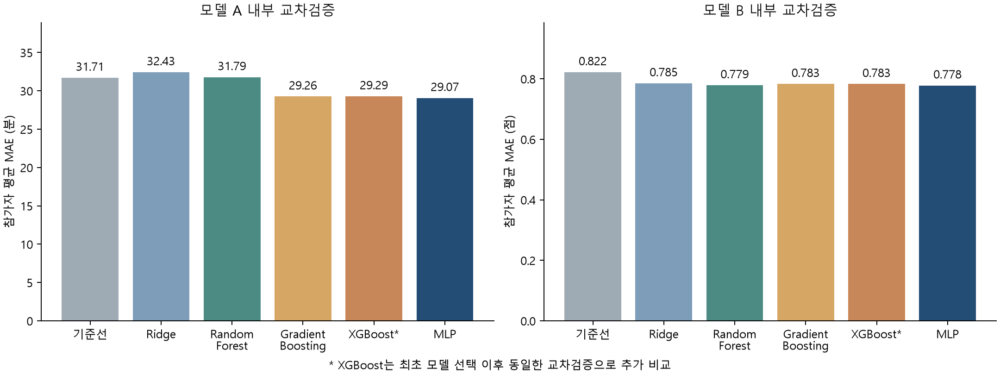

*그림 3. 방법별로 가장 좋았던 설정의 내부 교차검증 결과. A는 분, B는 점 단위입니다.*

막대가 짧을수록 평균 오차가 작습니다. 최초 후보에서는 MLP가 A와 B 모두 가장 낮았고, B에서 Random Forest와 MLP의 막대는 거의 같은 높이였습니다. 별표가 붙은 XGBoost는 최초 모델 선택과 평가를 마친 뒤, 같은 내부 교차검증 조건으로 추가 비교했습니다. [검증·평가 결과 Excel](/실험결과%28Experiment%20Results%29/model_evaluation_comparison.xlsx) · [교차검증 원본 CSV](/실험결과%28Experiment%20Results%29/교차검증/cv_summary.csv) · [추가 트리 비교 CSV](/실험결과%28Experiment%20Results%29/추가트리비교/cv_summary.csv)

### 3-3. 기준선

**한 줄 요약.** A는 최근 입면 지연의 가운데 값을, B는 학습 자료의 평균 점수를 예측값으로 사용했습니다.

A의 기준선은 개인의 최근 최대 3개 유효 입면 지연 기록의 중앙값입니다. 예를 들어 20분, 25분, 30분 가운데 25분을 예측값으로 사용했습니다. 과거 이력이 없으면 해당 학습 자료의 중앙값을 사용합니다. B는 학습 자료의 수면의 질 평균을 모든 기록에 동일하게 예측합니다.

이 방법을 넣은 이유는 최근 개인 이력만으로 어느 정도 예측할 수 있는지 확인하기 위해서입니다. 특히 A의 기준선은 그 사람의 평소 패턴을 직접 반영하므로 학습 모델이 넘어야 할 비교 기준이 됩니다.

내부 검증에서 A의 오차는 31.71분, B는 0.822점이었습니다. 이후 각 모델이 이 값에서 얼마나 오차를 줄였는지 비교했습니다.

### 3-4. Ridge Regression

**한 줄 요약.** 입력마다 비중을 곱해서 더하고, 한 입력의 비중이 너무 커지지 않도록 제한했습니다.

여기서 **가중치**는 각 입력을 얼마나 반영해야 하는지 학습 자료에서 구한 숫자입니다. 합산하는 값을 예측에 사용하기 때문에 이 방식을 선형 모델이라고 부릅니다.

Ridge를 선택한 이유는 입력과 정답의 선형 관계만으로 충분히 예측되는지 확인하기 위해서입니다. 제한 강도 0.1·1·10·100을 비교했고, 입력은 학습 부분의 기준으로 표준화했습니다.

A의 검증 오차는 32.43분으로 기준선보다 컸습니다. B는 0.785점으로 평균 점수 기준선보다 작았습니다. 이번 변수 구성에서는 B의 점수에 선형적으로 활용할 수 있는 정보가 있음을 보여 주지만, 개별 변수의 원인 효과까지 확인한 결과는 아닙니다.

### 3-5. Random Forest

**한 줄 요약.** 입력 조건으로 기록을 나눠 예측한 여러 결정나무의 답을 평균했습니다.

결정나무는 “최근 입면 지연의 중앙값이 30분 이하인가?”처럼 조건을 정해 비슷한 기록끼리 묶고 값을 예측합니다. Random Forest는 학습 기록을 중복을 허용해 무작위로 다시 뽑고, 그렇게 뽑은 기록으로 서로 다른 나무를 만들었습니다.

수면 패턴에 따라 입력의 관계가 달라질 수 있어 비선형 비교 모델로 사용했습니다. 나무 300개를 만들고, 최대 깊이 3·6과 잎의 최소 기록 수 5·15를 조합했습니다. 깊이는 조건을 얼마나 여러 단계로 나눌지, 잎의 최소 기록 수는 마지막 묶음이 얼마나 작아질 수 있는지를 정합니다.

A의 검증 오차는 31.79분, B는 0.779점이었습니다. A에서는 기준선 대비 개선이 없었지만, B에서는 MLP와 매우 가까운 점수를 보였습니다.

### 3-6. Gradient Boosting

**한 줄 요약.** 앞선 예측에서 남은 오차를 다음 결정나무가 줄이도록 차례로 학습했습니다.

예를 들어 앞선 나무의 예측이 어떤 기록에서 낮게 나왔다면, 다음 나무는 남은 오차를 보고 그 예측을 보완하는 방향으로 학습했습니다.

작은 결정나무를 차례로 결합하는 방식이 수면일지에 도움이 되는지 확인했습니다. 최대 깊이 1·2, 나무 수 60·150을 비교했습니다. A는 절대 오차, B는 제곱 오차를 줄이도록 학습했습니다.

검증 오차는 A 29.26분, B 0.783점이었습니다. 특히 A는 기준선 31.71분보다 오차가 작아 부스팅 방식의 활용 가능성을 확인했습니다.

### 3-7. MLP (다층 퍼셉트론)

**한 줄 요약.** 입력 숫자를 여러 계산 층에 통과시키면서 값들 사이의 복잡한 관계를 학습했습니다.

입력이 5~6개의 요약 변수이므로 작은 신경망에서 시작했습니다. 앞 층의 값들을 모두 받아 계산하는 층을 **완전연결층**이라고 부릅니다. 입력과 최종 출력 사이의 계산층은 **은닉층**이라고 부릅니다.

최종 구조는 다음과 같습니다.

  

*그림 4. 선택된 A·B 모델 구조. 입력 수와 중간 계산 층의 크기를 구분했습니다.*

| 구성 | 사용 목적 |
|---|---|
| 완전연결층 | 이전 층의 값을 가중합해 새로운 표현을 계산 |
| ReLU | 음수를 0으로 바꿔 입력값에 따라 계산이 달라지게 함 |
| Dropout 0.1 | 학습 중 중간 출력 일부를 무작위로 0으로 만들어 과도한 의존을 줄임 |
| A 출력 변환 | Softplus로 출력이 0분보다 작아지지 않게 변환 |
| B 출력 변환 | Sigmoid로 0과 1 사이의 값을 구한 뒤 1점에서 5점 범위로 환산 |

첫 은닉층 크기 16·32와 학습 횟수 60·160 epoch를 조합한 네 설정을 비교했습니다. A·B 모두 16→8 구조와 60 epoch가 선택됐습니다. A는 29.07분, B는 0.778점으로 최초 후보 중 검증 오차가 가장 작았습니다. B와 Random Forest의 차이는 0.001점 미만이므로 큰 우위라고 해석하지 않았습니다.

### 3-8. XGBoost

**한 줄 요약.** 결정나무를 차례로 더해 예측을 보완하고, 나무가 지나치게 복잡해지지 않도록 제한했습니다.

Gradient Boosting과 같은 계열의 방법으로, 최초 평가 이후에 다른 트리 방식과 MLP의 결과를 한 번 더 비교하기 위해 추가했습니다.

최대 깊이 1·2·3, 나무 수와 학습률 조합 80개·0.05 및 180개·0.03을 비교했습니다. A의 손실은 절대 오차, B의 손실은 제곱 오차였습니다. A는 최대 깊이 1, B는 2가 선택됐고 두 모델 모두 나무 80개, 학습률 0.05를 사용했습니다.

검증 오차는 A 29.29분, B 0.783점이었습니다. 최초 선택한 MLP의 검증 오차보다 작아지지는 않았습니다. XGBoost의 별도 평가 결과는 5장의 추가 실험에서 살펴봤습니다. [5-3. 오차가 큰 사례와 결과 해석](#5-3-오차가-큰-사례와-결과-해석)

### 3-9. 실제 학습 설정

| 항목 | 적용 설정 |
|---|---|
| 입력 결측 | 각 학습 부분의 변수별 중앙값으로 대체 |
| 입력 표준화 | Ridge·MLP에 적용. 각 학습 부분에서 구한 기준 사용 |
| A 손실 | MAE Loss |
| B 손실 | MSE Loss |
| MLP 최적화 | Adam, 학습률 0.001 |
| 배치 크기 | 32건 |
| 가중치 감쇠 | 0.0001 |
| 최종 MLP 학습 횟수 | 60 epoch |
| 최종 예측 | 시드 42·7·17로 학습한 세 MLP의 예측 평균 |

학습할 때는 일지 32건씩 묶어 값을 조정했습니다. 학습 자료 전체를 한 번 사용하는 단위를 **에포크(epoch)**라고 부릅니다. 시작 가중치를 정하는 번호인 **시드**를 세 가지로 바꿔 각각 학습하고, 최종 예측값은 세 결과를 평균했습니다. 이렇게 한 가지 시작값에 결과가 좌우되는 정도를 줄였습니다.

A 정답은 학습 시 30으로 나누고 예측 후 다시 30을 곱해 분 단위로 복원합니다. B 정답은 (점수−1)/4로 변환해 학습한 뒤 1+4×출력으로 복원합니다. 학습 곡선의 손실은 변환된 척도이고, 본문의 MAE는 복원한 분·점 단위입니다.

  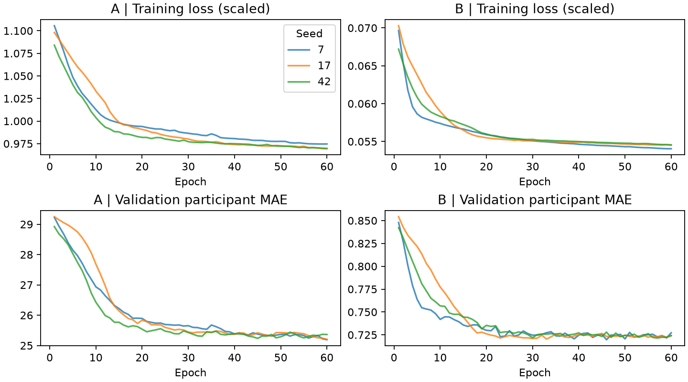

*그림 5. 첫 교차검증 회차의 학습 과정. 위쪽은 변환한 정답 척도의 학습 오차, 아래쪽은 참가자 평균 MAE입니다.*

그림 5의 가로축은 학습 횟수입니다. 첫 회차에서 학습 오차와 검증 오차는 모두 초반에 줄었고, 뒤로 갈수록 변화가 완만했습니다. 최종 학습 횟수는 60회와 160회 설정을 다섯 검증 회차에 걸쳐 비교해 60회로 정했습니다. [학습 코드](/코드%28Code%29/evaluate.py) · [MLP 코드](/코드%28Code%29/mlp.py) · [실행 환경](/실행환경%28Runtime%20Environment%29/실행환경%20안내.md)

### 3-10. 참가자 단위 Validation과 최종 선택

MeLiDos 학습 참가자 147명을 5개 그룹으로 나눴습니다. 매번 4개 그룹으로 학습하고 나머지 1개로 검증했으며, 같은 회차의 학습과 검증에는 같은 사람이 들어가지 않습니다. 각 참가자는 한 번 검증 대상이 됩니다.

결측 대체와 표준화도 회차별 학습 자료에서만 기준을 계산했습니다. 평가 대상 밤의 이력에는 그보다 앞선 날짜의 일지만 사용했습니다.

아래 표에서 한 회차는 한 그룹을 검증에 사용한 결과입니다. 모두 같은 MLP 설정으로 검증했어도, 어느 참가자를 검증에 두었는지에 따라 오차가 달랐습니다.

| 회차 | 학습 인원 | 검증 인원 | A 검증 MAE, 분 | B 검증 MAE, 점 |
| --- | ---: | ---: | ---: | ---: |
| 1 | 117명 | 30명 | 25.23 | 0.725 |
| 2 | 118명 | 29명 | 35.59 | 0.726 |
| 3 | 118명 | 29명 | 23.79 | 0.796 |
| 4 | 118명 | 29명 | 23.71 | 0.803 |
| 5 | 117명 | 30명 | 36.87 | 0.839 |

예를 들어 A의 검증 오차는 회차에 따라 23.71~36.87분이었습니다. 그림 3의 A 29.07분은 다섯 회차에서 검증한 참가자 147명의 오차를 한 사람씩 같은 비중으로 평균한 값입니다. 이 기준에서 평균 오차가 가장 낮았던 MLP를 A·B에 선택했습니다. 이후 설정을 고정하고 147명 전체로 다시 학습해 해외 별도 평가와 국내 외부 평가에 사용했습니다. 결과적으로 개인의 과거 이력을 이용하는 두 예측 모델을 학습하고, 입력 변환과 가중치를 저장해 새로운 입력을 계산할 수 있는 단계까지 구현했습니다.

[교차검증 설정과 회차별 결과](/실험결과%28Experiment%20Results%29/교차검증) · [전처리·학습·평가 재현 안내](/코드%28Code%29/Sleep_Model_Reproduction/REPRODUCE.md)

## 4. 최종 모델 테스트 (Test Results)

### 4-1. 테스트 방법과 조건

선택을 마친 모델에 해외 별도 평가 37명과 국내 49명의 일지를 입력했습니다. 모델은 입력만 보고 값을 예측하고, 이후 실제 정답과 비교해 오차를 계산했습니다. 이 과정에서 평가 자료로 가중치를 다시 학습하지 않았습니다.

| 자료 | 사용 모델 | 유효 기록 | 평가 질문 |
|---|---|---:|---|
| MeLiDos 별도 참가자 37명 | A·B | 각각 259건 | 모델 학습에 사용하지 않은 참가자의 기록에 얼마나 잘 맞는가? |
| 국내 49명의 마지막 7일 | A | 343건 | 해외 자료로 학습한 입면 지연 모델이 국내 기록에도 적용되는가? |
| 국내 전체 28일 | A | 1,372건 | 기록이 적은 초기 구간까지 포함하면 성능이 어떠한가? |

국내 자료에는 수면의 질 정답이 없어 A만 평가했습니다. 국내 마지막 7일은 이전까지의 실제 일지를 이용할 수 있는 조건이며, 전체 1,372건 안에 포함되는 부분집합입니다.

MeLiDos 37명은 현재 실행 코드에서 모델 선택 이후 평가했습니다. 팀의 그 이전 사용 이력까지 파일만으로 확인할 수 없어 해외 별도 평가로 표기했습니다.

### 4-2. 테스트 결과

표의 변화는 **MLP의 참가자 평균 MAE에서 기준선의 MAE를 뺀 값**입니다. 반올림하기 전의 원래 오차로 계산했습니다.

| 모델·자료 | MLP 참가자 평균 MAE | 기준선 | 수치상 변화 |
|---|---:|---:|---|
| A · 해외 별도 평가 | 38.14분 | 40.91분 | 약 2.78분 감소 |
| A · 국내 마지막 7일 | 20.25분 | 20.06분 | 약 0.19분 증가 |
| A · 국내 전체 | 21.31분 | 21.21분 | 약 0.10분 증가 |
| B · 해외 별도 평가 | 0.700점 | 0.750점 | 약 0.050점 감소 |

  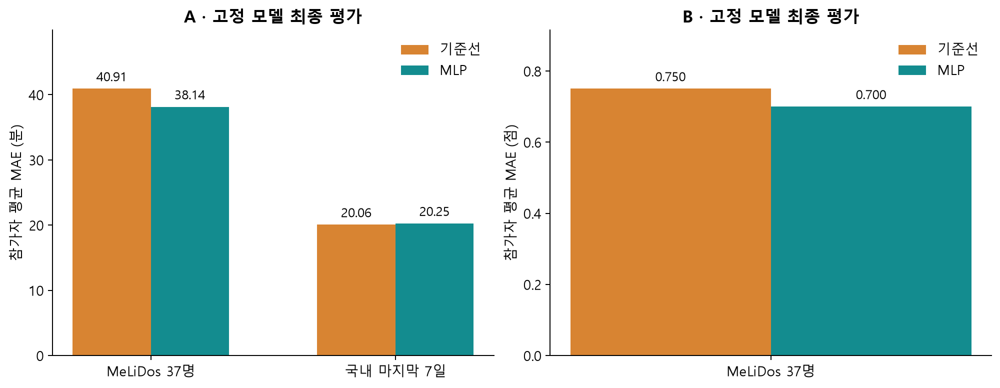

*그림 6. 선택을 마친 모델과 기준선의 별도 평가 오차. 작을수록 좋습니다.*

해외 별도 평가에서 A와 B는 모두 기준선보다 평균 오차가 작았습니다. B에 수면 구간 길이를 넣었을 때의 효과는 같은 MLP의 내부 교차검증으로 확인했습니다. 구간 길이를 뺀 경우의 MAE는 0.823점, 넣은 경우는 0.778점이었습니다. 실험 조건은 5장의 B 입력 비교에 정리했습니다.

국내 A에서는 기준선의 MAE가 근소하게 낮았습니다. 해외 A·B에서도 참가자를 다시 뽑아 계산한 MAE 차이의 95% 구간에 0이 들어 있어, 성능 차이에는 불확실성이 남았습니다. [참가자 단위 재표집과 결과 해석](#5-3-오차가-큰-사례와-결과-해석)

우리는 이 평가로 개인의 수면 이력을 숫자 입력으로 만들고, 입면 지연과 수면 점수를 예측하는 전체 과정을 확인했습니다. 이어서 저장 모델에 새로운 가상 이력을 입력해 취침 후보 시각을 계산했습니다.

최종 평가 수치는 [평가 결과표](/실험결과%28Experiment%20Results%29/테스트/holdout_metrics.csv), 각 기록의 실제값과 예측값은 [기록별 예측 결과](/실험결과%28Experiment%20Results%29/테스트/holdout_predictions.csv)에 있습니다.

### 4-3. 취침 시각 추정 예시

저장된 A·B 모델에 가상 이력 3건을 넣어 실행했습니다. 입력의 입면 지연은 20·30·25분, 수면 구간은 420·450·480분입니다. 실제 참가자의 기록을 사용한 예시는 아닙니다.

목표 기상 시각은 **오전 8시**, 최소 수면 구간은 **7시간 30분**으로 두었습니다. A가 예측한 입면 지연은 약 **23.76분**입니다. 후보별 취침 시각은 다음 식으로 계산합니다.

**취침 시각 = 목표 기상 시각 − 후보 수면 구간 − 예상 입면 지연**

| 후보 수면 구간 | B의 예상 수면의 질 | 계산된 취침 시각 | 최소 구간 조건 |
| --- | ---: | --- | --- |
| 7시간 | 3.612점 | 당일 00:36 | 충족하지 않음 |
| 7시간 30분 | 3.706점 | 당일 00:06 | 충족 |
| 8시간 | 3.764점 | 전날 23:36 | 충족 |

시각은 분 단위로 반올림해 표시했습니다. 이번 입력에서는 조건을 만족하는 후보 중 8시간의 예상 점수가 가장 높았습니다. 이는 **모델이 어떻게 계산하는지 보여 주는 결과**이며, 그 시각에 자면 실제 수면이 좋아진다는 확인 결과는 아닙니다.

[입력 예시](/예측시연%28Prediction%20Demo%29/입력예시.json)와 [실행 결과](/예측시연%28Prediction%20Demo%29/예측결과.json)를 함께 저장했습니다. 실행 방법은 [예측 시연 설명](/예측시연%28Prediction%20Demo%29/예측시연%20파일%20설명.md)에 있습니다.

**왜 이번 예시에서는 가장 긴 후보가 선택되었을까요?**

후보를 길게 넣을수록 B의 예상 점수가 계속 높아지면, 점수만 최대화하는 계산은 허용한 후보 중 가장 긴 것을 고를 수 있습니다. 이를 살펴보기 위해 학습 자료의 중앙값 이력을 고정한 가상 입력에서 수면 구간만 바꾼 저장 분석도 확인했습니다.

  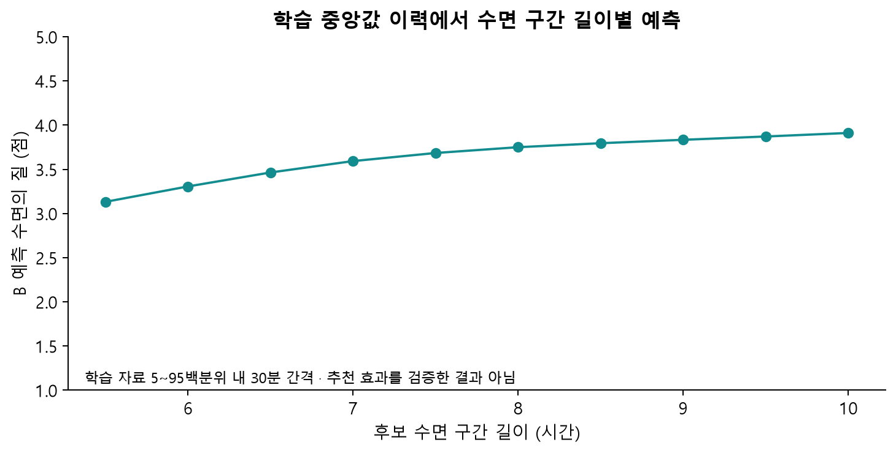

*그림 7. 학습 중앙값 이력에서 후보 길이만 바꾼 B의 예측. 실제 추천 효과를 측정한 결과는 아닙니다.*

이 그림은 학습 수면 구간의 가운데 90% 범위 안에서 후보를 30분 간격으로 바꾼 결과입니다. 세로축의 점수가 높아지는 모습은 **모델의 계산 특성**을 보여 줍니다. 10시간이 사람에게 가장 좋은 수면 시간이라는 뜻은 아닙니다. 실제로 적용할 기능에서는 가능한 후보 범위와 사용자의 조건을 정하고, 추천 효과를 별도로 확인해야 합니다.

#### 모델을 이용한 취침 시각 계산까지 연결

저장한 모델에 새로운 가상 이력을 입력하고, A의 예상 입면 지연과 B의 후보별 점수를 함께 계산했습니다. 오전 8시 기상과 최소 7시간 30분의 수면 구간이라는 시연 조건에서, 비교한 후보 중 8시간의 예상 점수가 가장 높았고 취침 시각은 전날 23시 36분으로 계산됐습니다.

이 시연을 통해 수면일지 입력에서 두 모델의 예측, 조건을 만족하는 후보 비교, 취침 시각 출력까지 연결할 수 있음을 확인했습니다. 실제로 취침 시각을 바꿨을 때 수면의 질이 개선되는지는 후속 사용자 평가에서 확인할 과제입니다. [저장 모델 출력 재확인 JSON](/예측시연%28Prediction%20Demo%29/demo_rechecked.json)

## 5. 모델 평가와 오차 분석 (Evaluation & Analysis)

### 5-1. 평가 지표와 성능 비교

모델 A는 과거 수면일지로 잠자리에 든 뒤 잠들기까지 걸리는 시간인 **입면 지연**을 예측했습니다. 모델 B는 과거 일지와 그날 잠든 시각부터 최종 기상까지의 **수면 구간 길이**를 바탕으로, 참가자가 일지에 매긴 수면의 질(1~5점)을 예측했습니다. 해외 MeLiDos 별도 평가에서는 참가자 37명의 기록으로 A와 B를 각각 259건씩 평가했습니다. 국내 자료에는 수면의 질 점수가 없어 A만 평가했고, 주 평가에는 49명의 마지막 7일 기록 343건을 사용했습니다.

예를 들어 A가 잠들기까지 20분 걸린다고 예측했는데 실제로는 30분이 걸렸다면, 두 값의 차이는 10분입니다. 차이가 어느 방향이든 크기만 평균한 값이 **평균 절대 오차(MAE)**입니다. 참가자마다 같은 비중을 주기 위해 먼저 각 참가자의 MAE를 구하고, 그 값을 참가자 간에 다시 평균했습니다.

**기준선**은 모델의 성능을 판단하기 위해 함께 평가한 간단한 예측 방법입니다. A의 기준선은 입면 지연 값이 있는 이전 기록 중 최근 최대 3건의 중앙값을 사용했습니다. 예를 들어 최근 기록이 10분, 20분, 30분이라면 가운데 값인 20분을 예측했습니다. 이전 기록이 없으면 학습 자료의 중앙값을 사용했습니다. B의 기준선은 매번 학습 자료의 평균 수면의 질 점수를 예측했습니다.

평균 오차에 더해 큰 오차의 영향과 예측이 한쪽으로 치우치는지도 아래 지표로 확인했습니다.

| 지표 | 뜻 |
| --- | --- |
| MAE | 예측값과 실제값의 차이에서 부호를 빼고 평균한 값입니다. |
| RMSE | 차이를 제곱해 평균한 뒤 제곱근을 구하는 오차입니다. 큰 실수가 결과에 더 크게 반영됩니다. |
| 예측−실제의 평균 | 음수면 평균적으로 낮게, 양수면 높게 예측했다는 뜻입니다. |
| 허용 오차 이내 비율 | 예측값과 실제값의 차이가 A는 10분 이내, B는 1점 이내인 기록의 비율입니다. |

RMSE의 ‘제곱근’은 자기 자신을 곱했을 때 원래 수가 되는 값입니다. 예를 들어 9의 제곱근은 3입니다. 이 지표는 MAE와 함께 큰 오차의 영향을 살펴보는 데 사용했습니다.

| 자료·방법 | 참가자 평균 MAE | 기록별 RMSE | 예측−실제의 평균 | 허용 오차 이내 비율 |
| --- | ---: | ---: | ---: | ---: |
| A 해외 · 기준선 | 40.91분 | 79.36분 | −6.87분 | 33.6% |
| A 해외 · MLP | 38.14분 | 78.51분 | −19.54분 | 30.9% |
| A 국내 마지막 7일 · 기준선 | 20.06분 | 36.17분 | −2.28분 | 60.6% |
| A 국내 마지막 7일 · MLP | 20.25분 | 34.09분 | −3.59분 | 40.5% |
| B 해외 · 기준선 | 0.750점 | 0.894점 | +0.136점 | 74.9% |
| B 해외 · MLP | 0.700점 | 0.849점 | +0.094점 | 76.1% |

해외 별도 평가에서는 A와 B 모두 딥러닝 모델인 MLP(다층 퍼셉트론)의 참가자 평균 MAE가 기준선보다 낮았습니다. 국내 A에서는 참가자 평균 MAE가 기준선 20.06분, MLP 20.25분으로 비슷했습니다. 같은 국내 기록에서 예측값과 실제값의 차이가 10분 이내인 경우는 기준선 208건(60.6%), MLP 139건(40.5%)이었습니다. 큰 오차를 더 크게 반영하는 RMSE는 MLP가 더 낮았습니다. 국내 A에서는 어떤 지표로 보느냐에 따라 결과가 달랐습니다. 10분과 1점은 이번 분석에서 정한 비교 기준입니다.

  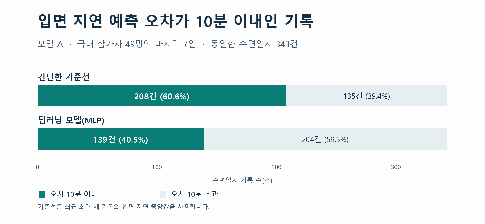

*추가 그림. 국내 마지막 7일의 수면일지 343건에서 입면 지연 예측 오차가 10분 이내였던 기록 수를 비교했습니다.* [기록별 예측 CSV](/실험결과%28Experiment%20Results%29/테스트/holdout_predictions.csv)

### 5-2. 실제값과 예측값 비교

  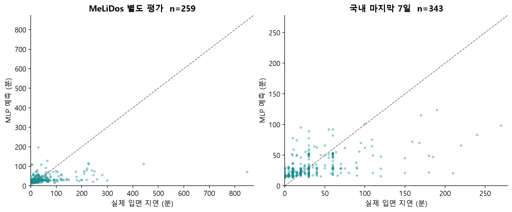

*그림 8. A 실제값과 예측값. 점선은 정확한 예측 위치이며, 좌우 그림의 축 범위가 다릅니다.*

그림 8에서 점 하나는 수면일지 한 건을 나타냅니다. 가로축은 실제값, 세로축은 예측값입니다. 점선에 가까울수록 두 값이 비슷하고, 점선 아래의 점은 모델이 실제보다 입면 지연을 짧게 예측한 기록입니다. 해외 별도 평가에서 입면 지연이 60분을 넘은 64건을 모아 보니, 실제 평균은 150.64분(약 151분)이었고 MLP의 예측 평균은 45.60분(약 46분)이었습니다. 잠들기까지 오래 걸린 경우에 A는 걸리는 시간을 실제보다 크게 짧게 잡는 경향을 보였습니다.

해외 별도 평가에서 모델 B의 예측과 오차를 실제 수면의 질 점수별로 나눠 살펴봤습니다.

| 실제 수면의 질 | 기록 수 | MLP 평균 예측 | 기록별 MAE |
| --- | ---: | ---: | ---: |
| 1점 | 2건 | 2.483점 | 1.483점 |
| 2점 | 38건 | 3.431점 | 1.431점 |
| 3점 | 86건 | 3.516점 | 0.553점 |
| 4점 | 108건 | 3.582점 | 0.418점 |
| 5점 | 25건 | 3.708점 | 1.292점 |

  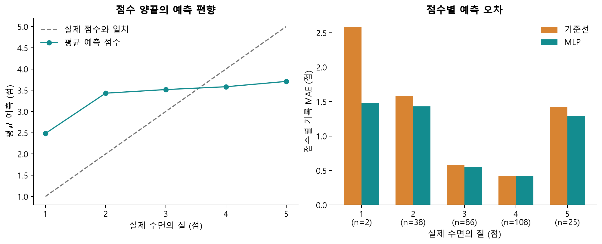

*그림 9. 실제 점수별 B의 예측과 기록별 오차. 1점은 2건뿐이라는 점에 주의해야 합니다.*

그림 9 왼쪽에서 실제 2점인 기록의 평균 예측은 약 3.43점, 실제 5점인 기록의 평균 예측은 약 3.71점이었습니다. 실제 점수는 3점 차이였지만 두 그룹의 평균 예측은 약 0.3점 차이였습니다. B는 이렇게 낮은 점수는 높여서, 높은 점수는 낮춰서 가운데에 가까운 점수를 내는 경향을 보였습니다. 오른쪽 막대에서도 MLP의 오차는 실제 3~4점인 기록에서 양끝 점수대보다 작았습니다.

### 5-3. 오차가 큰 사례와 결과 해석

  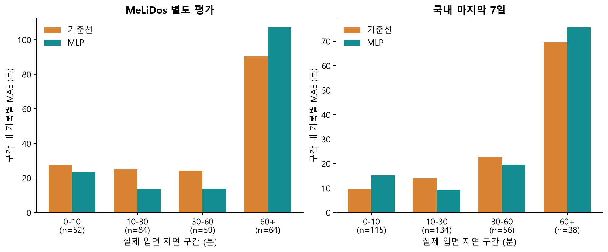

*그림 10. 입면 지연 구간별 기록 수와 기록별 MAE. 참가자 평균 MAE와는 계산 비중이 다릅니다.*

그림 10에서는 실제로 잠드는 데 걸린 시간으로 기록을 나누고, 구간마다 각 기록에 같은 비중을 주어 MAE를 계산했습니다. 해외 별도 평가의 입면 지연 60분 초과 구간에서 MLP의 기록별 MAE는 107.05분이었습니다. 국내 마지막 7일에서도 입면 지연이 60분을 넘은 38건의 실제 평균은 124.39분이었고 MLP의 예측 평균은 48.84분이었습니다. 국내에서 실제 입면 지연이 0~10분인 기록의 경우 MLP는 평균 20.97분으로 더 길게 예측했습니다. [입면 지연 구간별 결과 CSV](/실험결과%28Experiment%20Results%29/상세분석/latency_bands.csv)

**가상 계산 예시.** 오전 8시 기상과 수면 구간 7시간 30분을 고정했습니다. 오전 8시에서 7시간 30분을 빼면 잠들어야 하는 시각은 00:30입니다. 입면 지연을 40분으로 잡으면 여기서 40분을 더 빼 취침 시각이 전날 23:50이 됩니다. 입면 지연을 20분으로 짧게 잡으면 계산된 취침 시각은 자정 이후 00:10으로 20분 늦어집니다. 저장 모델을 실행한 결과는 4장의 시연에 정리했습니다. [4-3. 취침 시각 추정 예시](#4-3-취침-시각-추정-예시)

**참가자 단위 재표집**은 같은 참가자가 여러 번 뽑힐 수 있게, 기존 참가자 중에서 원래와 같은 수를 다시 뽑는 방법입니다. 뽑힌 참가자마다 기준선과 MLP의 결과를 한 쌍으로 묶어 두 방법의 평균 오차 차이를 계산했습니다. 이 과정을 10,000번 반복해 참가자 구성에 따라 오차 차이가 얼마나 달라지는지 확인했습니다.

| 평가 | MLP 오차 − 기준선 오차 | 재표집 결과의 가운데 95% 구간 |
| --- | ---: | --- |
| A · 해외 별도 평가 | −2.78분 | −7.03 ~ +1.97분 |
| A · 국내 마지막 7일 | +0.19분 | −1.26 ~ +1.69분 |
| B · 해외 별도 평가 | −0.050점 | −0.098 ~ +0.004점 |

음수는 MLP의 오차가 더 작고, 0은 두 방법의 오차가 같다는 뜻입니다. 세 비교 모두 재표집 결과의 가운데 95% 구간에 0이 포함됐습니다. 이번 자료로 어느 방법의 오차가 더 작다고 판단하기에는 불확실성이 남았습니다.

참가자·지역·과거 기록 수별 분석과 큰 오차 사례는 [상세 분석 결과](/실험결과%28Experiment%20Results%29/상세분석)에 남겼습니다. 저장 모델의 예측과 평가 숫자가 맞는지도 다시 계산했으며, 확인 범위는 [검산 기록](/실험결과%28Experiment%20Results%29/재검증/실행확인.json)에 기록했습니다. 이 확인은 모델 전체를 새로 학습한 결과는 아닙니다.

**추가 확인 1. B에 수면 구간을 넣는 것이 도움이 되었을까요?**

입력 하나의 역할을 살펴보기 위해 같은 MLP에서 수면 구간을 넣은 경우와 뺀 경우를 비교한 기존 실험을 확인했습니다. 동일한 1,001건과 같은 참가자 그룹을 사용했고, 두 경우 모두 선택된 설정은 은닉층 16·8개, 학습 60회였습니다.

| B 입력 구성 | 내부 교차검증 MAE |
| --- | ---: |
| 과거 이력 5개 | 0.823점 |
| 과거 이력 5개 + 수면 구간 길이 | 0.778점 |

수면 구간 길이를 제외한 경우와 포함한 경우를 비교했을 때, 포함한 쪽의 내부 교차검증 MAE가 약 0.045점 낮았습니다. 수면 구간 길이가 점수 예측에 도움이 될 수 있다는 결과입니다. 실제로 수면 시간을 바꾸면 점수가 달라지는지는 별도 실험으로 확인해야 합니다. [같은 MLP의 입력 제외 비교 결과](/실험결과%28Experiment%20Results%29/상세분석/b_same_mlp_ablation_cv.csv)

**추가 확인 2. 다른 모델에서도 같은 결과가 나왔을까요?**

최초 평가 이후 Random Forest와 XGBoost를 추가로 비교한 저장 결과도 살펴봤습니다. 아래 값은 모두 참가자 평균 MAE입니다.

| 평가 자료 | 기준선 | MLP | Random Forest | XGBoost |
| --- | ---: | ---: | ---: | ---: |
| A · 해외 별도 평가, 분 | 40.91 | 38.14 | 41.45 | 37.89 |
| A · 국내 마지막 7일, 분 | 20.06 | 20.25 | 25.25 | 20.59 |
| B · 해외 별도 평가, 점 | 0.750 | 0.700 | 0.692 | 0.694 |

해외 A에서는 XGBoost, B에서는 Random Forest의 오차가 조금 더 작았습니다. 그러나 이미 확인한 같은 평가 자료를 다시 사용한 비교여서, 이 점수만 보고 최종 모델을 바꾸지 않았습니다. 국내 A에서는 여기에서도 간단한 기준선이 가장 낮은 오차를 보였습니다. [추가 비교 결과](/실험결과%28Experiment%20Results%29/추가트리비교/RESULTS.md)

**추가 확인 3. 과거 일지가 적을 때는 어떨까요?**

  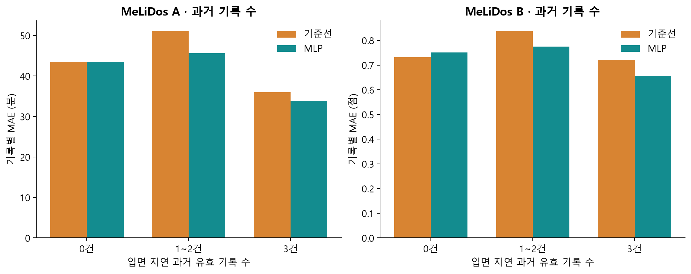

*그림 11. 이전 유효 입면 지연 기록 수별 기록 MAE. 해외 별도 평가를 사용했으며 A·B의 단위는 다릅니다.*

그림 11에서 해외 A와 B 모두 이전 기록이 한두 개일 때 MLP의 기록별 MAE가 이전 기록이 없을 때보다 컸습니다. B의 경우 이전 기록이 없는 37건에서는 0.751점, 한두 개 있는 기록에서는 0.775점, 세 개 있는 148건에서는 0.656점이었습니다. 기록 수에 따라 나눈 그룹은 날짜와 실제 점수의 분포도 달랐습니다. [이전 기록 수별 결과 CSV](/실험결과%28Experiment%20Results%29/상세분석/history_bands.csv)

**큰 오차가 발생한 개별 기록**

| 평가 자료 | 정답으로 사용한 기록값 | A 예측 | 절대 오차 |
| --- | ---: | ---: | ---: |
| 해외 별도 평가 · 사례 1 | 848분 | 70.96분 | 777.04분 |
| 해외 별도 평가 · 사례 2 | 443분 | 110.89분 | 332.11분 |
| 국내 전체 평가 · 사례 3 | 325분 | 37.98분 | 287.02분 |

이런 사례는 평균 오차가 왜 커지는지 보여 줍니다. 특히 848분처럼 매우 긴 값은 특이한 수면 기록인지 작성 오류인지 원자료를 따로 확인할 필요가 있습니다. 값이 길다는 이유로 임의로 제외하지 않고 평가에 남겼으며, 실제 생활에서의 참값까지 확인했다는 의미는 아닙니다. [오차가 큰 기록과 원본 위치](/실험결과%28Experiment%20Results%29/상세분석/largest_error_examples.csv)

이전 일지 수에 따라 기록을 나눠 보니, 이전 일지가 많을수록 오차가 꾸준히 줄어드는 흐름은 확인되지 않았습니다. 취침 시각을 추정할 때는 두 모델의 오차가 서로 다른 단계에 영향을 줄 수 있습니다. A가 입면 지연을 짧게 예측하면 같은 기상 목표에서도 계산된 취침 시각이 늦어질 수 있습니다. B가 서로 다른 수면의 질 점수를 비슷하게 예측하면 후보 수면 구간의 점수 차이가 작아져 어떤 후보를 고를지에 영향을 줄 수 있습니다.

## 6. 고찰 (Conclusion & Discussion)

  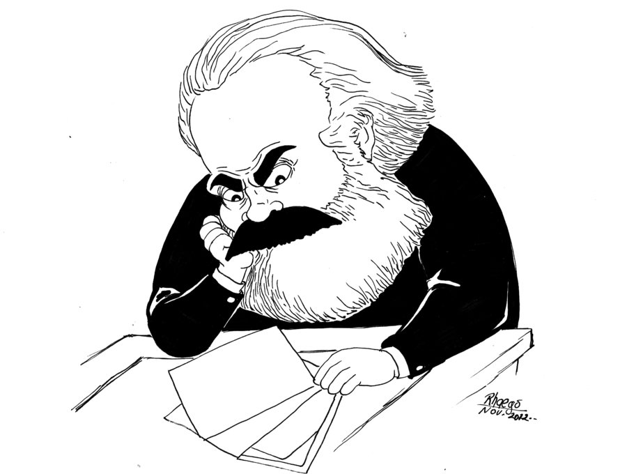

*삽화 출처 · [La Izquierda Diario](https://www.laizquierdadiario.com/Los-planes-de-estudios-las-ciencias-sociales-y-el-marxismo)*

### 6-1. 프로젝트 결론

각자의 최근 수면일지를 바탕으로 **목표 기상 시각에 맞는 취침 시각을 제안하는 과정**을 구현했습니다. 모델 A는 잠드는 데 걸리는 시간을 예측해 취침 시각 후보를 계산하는 데 쓰고, 모델 B는 후보별 수면의 질을 예측해 어떤 시각을 제안할지 결정하는 데 쓰입니다.

해외 참가자 37명의 수면일지 259건을 따로 평가한 결과, 각 모델은 간단한 기준선보다 평균 오차를 줄였습니다.

- **모델 A**는 잠들기까지 걸리는 시간의 평균 오차를 기준선보다 **6.8%** 줄였습니다.
- **모델 B**는 수면의 질 점수의 평균 오차를 기준선보다 **6.7%** 줄였습니다. 평가 기록의 <strong>76.1%</strong>에서 참가자가 매긴 1~5점 점수와의 차이가 1점 이내였습니다. 기준선에서는 이 비율이 74.9%였습니다.

해외와 국내의 평균 오차는 [4-2. 테스트 결과](#4-2-테스트-결과)에 정리했습니다.

가상의 수면일지로 **오전 8시 기상**을 시연했을 때, 모델 A는 잠드는 데 약 **24분**이 걸릴 것으로 예측했습니다. 최소 7시간 30분의 수면 구간을 확보하는 후보 가운데 **전날 밤 11시 36분**에 잠자리에 드는 경우가 모델 B에서 가장 높은 예상 점수를 받았습니다.

### 6-2. 한계

1. **평소와 크게 다른 밤에 예측이 빗나갔습니다.** 해외 평가에서 실제로 잠드는 데 60분을 넘긴 기록은 평균 약 151분이었지만, 모델 A는 약 46분으로 예측했습니다. 잠드는 시간을 이만큼 짧게 잡으면, 목표 기상 시각에 필요한 수면 구간을 확보하기에는 너무 늦은 취침 시각을 제안할 수 있습니다. 모델 B도 낮거나 높은 점수를 중간에 가깝게 예측하는 경향이 있었습니다.

2. **평가 대상에 따라 더 잘 맞는 방법이 달랐습니다.** 국내 참가자의 마지막 7일에서는 모델 A의 평균 오차가 **20.25분**, 기준선은 **20.06분**이었습니다. 추가 비교에서는 해외 A의 XGBoost와 해외 B의 Random Forest가 MLP보다 오차가 조금 작았습니다. 다만 이미 평가한 자료에서 나온 작은 차이여서 새 참가자에게도 같은 이점이 있는지 확인해야 합니다. 해외 37명의 결과를 프로젝트 초기에 모델 선택에 참고했는지도 확인이 필요합니다.

3. **수면일지의 기간과 기록 항목이 제한적이었습니다.** 해외에서는 한 사람당 주로 일주일가량, 국내에서는 4주 동안 기록했습니다. 직접 적은 시각에는 기억에 따른 차이가 있을 수 있고, 최근 기록만으로는 그날 평소와 달라진 상황을 설명하기 어렵습니다. 또 국내 일지에는 수면의 질 점수가 없어 모델 B를 평가할 수 없었고, 해외 일지에서도 낮은 점수의 기록이 적었습니다.

4. **취침 시각을 바꿨을 때의 효과는 확인이 필요합니다.** 모델 B는 참가자가 수면일지에 매긴 점수를 예측합니다. 예상 점수가 높은 시각에 실제로 누웠을 때 다음 날 컨디션이 좋아질지, 나빠질지는 별도의 실험으로 확인해야 합니다.

### 6-3. 개선 방향

1. **모델이 자주 틀리는 밤부터 살펴보기.** 잠드는 데 오래 걸린 기록의 원본 시각을 다시 확인하고, 낮잠이나 저녁 카페인 섭취처럼 잠자리에 들기 전에 알 수 있는 정보를 더했을 때 예측이 나아지는지 비교할 수 있습니다. 전체 평균 오차와 함께 **잠드는 데 60분을 넘긴 밤**이나 **수면의 질이 낮았던 밤**의 오차도 따로 보겠습니다.
2. **자료를 더 모으고, 새로운 참가자로 모델 비교하기.** 더 긴 기간의 일지를 모으고 국내 자료에도 수면의 질 점수를 기록하면, 수면 패턴이 시간에 따라 어떻게 바뀌는지 살펴보고 국내 참가자에게도 모델 B를 평가할 수 있습니다. 기준선, MLP, XGBoost, Random Forest의 설정은 학습 자료 안에서 비교해 확정한 뒤, 개발에 쓰지 않은 참가자의 기록에서 성능을 확인하겠습니다.
3. **제안한 취침 시각이 실제로 도움이 되는지 확인하기.** 같은 목표 기상 시각을 두고, 한 사람 안에서 평소대로 누운 날과 모델이 제안한 시각에 누운 날을 비교하는 실험을 해 볼 수 있습니다. 다음 날의 컨디션, 실제로 잠들기까지 걸린 시간, 제안한 시각을 지키기 쉬웠는지를 함께 기록하면 생활에서 쓸 만한지 판단할 수 있습니다.

## 7. 프로젝트 발표 영상 (Project Presentation Video)

발표 영상 링크는 제작 후 추가할 예정입니다.

## 8. 참고자료 (Related Work)

- **참고 논문**
  - **Carney, C. E. 외(2012), *Sleep*, 35(2), 287–302.** 표준 수면일지에서 잠자리에 든 시각과 잠을 청하기 시작한 시각을 따로 기록하는 방식을 확인했습니다. [The Consensus Sleep Diary: Standardizing Prospective Sleep Self-Monitoring](https://pmc.ncbi.nlm.nih.gov/articles/PMC3250369/)
  - **Baigutanova, A. 외(2025), *Scientific Data*, 12, 1474.** 국내 참가자 49명의 4주 수면일지가 어떻게 수집됐는지 확인했습니다. [A continuous real-world dataset comprising wearable-based heart rate variability alongside sleep diaries](https://doi.org/10.1038/s41597-025-05801-3)

- **수업교안 참고**
  - **`ai-module-03-learning.pdf` · Learning (Module 3), PDF 23쪽과 30쪽.** 결정나무가 조건에 따라 자료를 나누는 원리와 표 형태의 데이터에서 트리 모델과 신경망을 비교하는 배경을 참고했습니다(3장).
  - **`ai-module-04-1-nn.pdf` · Neural Network (Module 4-1), PDF 17쪽, 24쪽, 28쪽.** 신경망의 층 구조, Sigmoid 활성화 함수, 오차를 바탕으로 가중치를 조정하는 역전파의 원리를 참고했습니다(3장).
  - **`ai-module-04-2-nn.pdf` · Neural Network (Module 4-2), PDF 6–8쪽, 10–11쪽, 17–18쪽.** 학습과 테스트 자료를 나누는 이유, 에포크의 뜻, 가중치에 제약을 주는 방법, Dropout·ReLU·배치 학습 설명을 참고했습니다(3·4장).

- **3~5장 참고 문헌**
  - **3-2절 모델 비교 배경.** Grinsztajn, L., Oyallon, E., & Varoquaux, G.(2022), *NeurIPS*. 표 형태의 데이터에서 트리 모델과 신경망을 함께 비교한 연구입니다. [Why do tree-based models still outperform deep learning on typical tabular data?](https://papers.nips.cc/paper_files/paper/2022/hash/0378c7692da36807bdec87ab043cdadc-Abstract.html)
  - **3-4절 Ridge Regression.** Hoerl, A. E., & Kennard, R. W.(1970), *Technometrics*, 12(1), 55–67. 회귀 모델에서 계수의 크기를 제한하는 Ridge 방법의 원 논문입니다. [Ridge Regression: Biased Estimation for Nonorthogonal Problems](https://homepages.math.uic.edu/~lreyzin/papers/ridge.pdf)
  - **3-5절 Random Forest.** Breiman, L.(2001), *Machine Learning*, 45, 5–32. 무작위성을 넣어 만든 여러 결정나무의 예측을 결합하는 원리를 설명합니다. [Random Forests](https://www.stat.berkeley.edu/~breiman/randomforest2001.pdf)
  - **3-6절 Gradient Boosting.** Friedman, J. H.(2001), *The Annals of Statistics*, 29(5), 1189–1232. 예측을 보완하는 모델을 순차적으로 더하는 Gradient Boosting의 원 논문입니다. [Greedy Function Approximation: A Gradient Boosting Machine](https://doi.org/10.1214/aos/1013203451)
  - **3-7·3-9절 MLP의 학습.** Rumelhart, D. E., Hinton, G. E., & Williams, R. J.(1986)는 역전파를, Srivastava, N. 외(2014)는 Dropout을, Kingma, D. P., & Ba, J.(2015)는 Adam을 설명했습니다. [Learning representations by back-propagating errors](https://www.nature.com/articles/323533a0) · [Dropout: A Simple Way to Prevent Neural Networks from Overfitting](https://jmlr.org/papers/v15/srivastava14a.html) · [Adam: A Method for Stochastic Optimization](https://arxiv.org/abs/1412.6980)
  - **3-8·5-3절 XGBoost.** Chen, T., & Guestrin, C.(2016), *KDD*. 추가 비교에 사용한 XGBoost의 트리 부스팅 방식과 나무의 복잡도에 제약을 주는 방법을 설명합니다. [XGBoost: A Scalable Tree Boosting System](https://arxiv.org/abs/1603.02754)
  - **3-10·4-1절 모델 선택과 별도 평가.** Roberts, D. R. 외(2017)는 서로 관련된 관측값을 묶어 교차검증하는 방법을 다뤘습니다. Varma, S., & Simon, R.(2006)은 모델을 고를 때 사용한 교차검증 점수를 그대로 최종 성능으로 해석하면 오차가 작게 추정될 수 있음을 보였습니다. [Cross-validation strategies for data with temporal, spatial, hierarchical, or phylogenetic structure](https://doi.org/10.1111/ecog.02881) · [Bias in error estimation when using cross-validation for model selection](https://pmc.ncbi.nlm.nih.gov/articles/PMC1397873/)
  - **5-3절 참가자 단위 재표집.** Efron, B.(1979)는 관측값을 중복을 허용해 다시 뽑는 부트스트랩을, Field, C. A., & Welsh, A. H.(2007)는 묶음으로 구성된 자료의 재표집을 다뤘습니다. 이번 분석에서는 한 사람의 기준선 결과와 MLP 결과를 함께 유지하며 참가자를 다시 뽑았습니다. [Bootstrap Methods: Another Look at the Jackknife](https://doi.org/10.1214/aos/1176344552) · [Bootstrapping clustered data](https://doi.org/10.1111/j.1467-9868.2007.00593.x)

- **사용한 데이터 출처**
  - **해외 수면일지.** MeLiDos 공개 자료 중 9개 지역의 수면일지를 모델 학습과 해외 평가에 사용했습니다. [MeLiDos 공식 프로젝트](https://github.com/MeLiDosProject/melidosData) · [9개 지역별 원자료 목록](/데이터%28Dataset%29/출처.md) · [수면일지 변수 사전](https://github.com/MeLiDosProject/melidosData/blob/main/inst/ext/DataDictionary_sleepdiary.csv)
  - **국내 수면일지.** 공개 자료에서 참가자 49명의 4주 수면일지를 가져와 모델 A의 성능을 확인했습니다. [Figshare 공개 데이터](https://doi.org/10.6084/m9.figshare.28509740)

- **배경 조사와 기사**
  - **통계청 2024년 생활시간조사.** 잠을 이루지 못한 사람의 비율과 평균 시간을 확인하는 데 참고했습니다. [조사 결과](https://mods.go.kr/board.es?act=view&bid=220&list_no=437764&mid=a10301010000) · [한국일보 관련 보도](https://www.hankookilbo.com/news/article/A2025072810120003470)
  - **KB경영연구소 2026 한국 웰니스 보고서.** 응답자가 어떤 상황에서 수면의 질이 낮다고 느꼈는지 살펴봤습니다. [한국 웰니스 보고서](https://www.kbfg.com/kbresearch/cmm/fms/FileDown.do?atchFileId=FILE_000000002001580&fileSn=0)

- **사진·그림 출처**
  - **1-1절 알람 시계 사진.** Anastasiya Vragova 촬영. [Pexels 원본](https://www.pexels.com/photo/an-alarm-clock-on-bedside-near-a-sleeping-woman-8346006/)
  - **사례 1의 연령대별 그래프.** [통계청 2024년 생활시간조사 결과, 9쪽](https://mods.go.kr/boardDownload.es?bid=220&list_no=437764&seq=9#page=16)
  - **사례 2의 수면의 질이 낮다고 느끼는 상황 그래프.** [KB경영연구소 2026 한국 웰니스 보고서, 37쪽 그림 III-14](https://www.kbfg.com/kbresearch/cmm/fms/FileDown.do?atchFileId=FILE_000000002001580&fileSn=0#page=45)
  - **2-4절 데이터 분석 과정 그림.** [개발어린이, 데이터 분석 과정과 전처리의 중요성](https://ahnty0122.tistory.com/61)
  - **6절 고찰 첫머리의 흑백 삽화.** [La Izquierda Diario 게재 이미지](https://www.laizquierdadiario.com/Los-planes-de-estudios-las-ciencias-sociales-y-el-marxismo)
  - **팀 제작 그림.** 사례 3 그래프는 국내 수면일지를 집계해 만들었습니다. 프로젝트 흐름도, 모델 설명 그림과 성능 그래프는 팀의 구현 내용과 실험 결과를 바탕으로 제작했습니다.

- **구현·평가 자료**
  - **라이브러리 공식 문서.** 학습 중 Dropout의 동작, 같은 그룹의 기록을 함께 나누는 교차검증의 원리, MAE·RMSE의 계산법을 확인했습니다. [PyTorch Dropout](https://docs.pytorch.org/docs/2.7/generated/torch.nn.Dropout.html) · [scikit-learn GroupKFold](https://scikit-learn.org/1.7/modules/generated/sklearn.model_selection.GroupKFold.html) · [scikit-learn MAE](https://scikit-learn.org/1.7/modules/generated/sklearn.metrics.mean_absolute_error.html) · [scikit-learn RMSE](https://scikit-learn.org/1.7/modules/generated/sklearn.metrics.root_mean_squared_error.html)
  - **프로젝트 실험 결과.** [교차검증 결과](/실험결과%28Experiment%20Results%29/교차검증/cv_summary.csv) · [별도 평가 결과](/실험결과%28Experiment%20Results%29/테스트/holdout_metrics.csv) · [오차 분석](/실험결과%28Experiment%20Results%29/상세분석) · [참가자 단위 재표집 결과](/실험결과%28Experiment%20Results%29/테스트/paired_intervals.csv) · [추가 트리 비교](/실험결과%28Experiment%20Results%29/추가트리비교/RESULTS.md) · [취침 시각 시연 결과](/예측시연%28Prediction%20Demo%29/예측결과.json)
  - **과제에서 제공한 AI+X 기술 블로그 예시 PDF.** 프로젝트 배경에서 모델 선택, 결과 해석, 고찰까지 글을 이어가는 구성을 참고했습니다.
