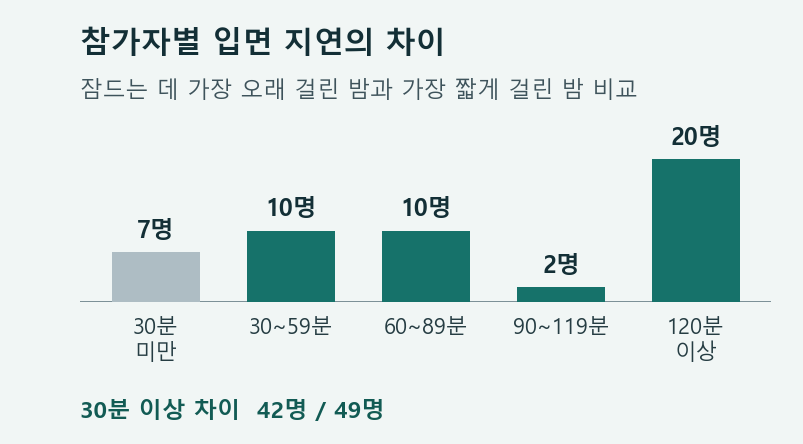
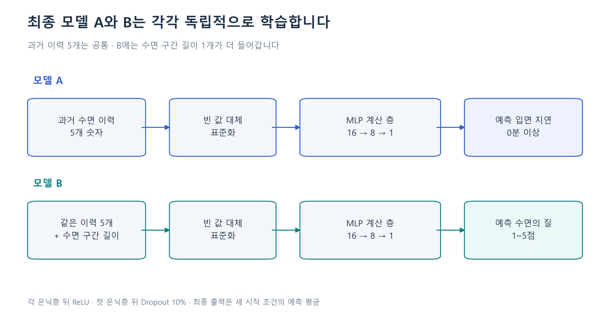
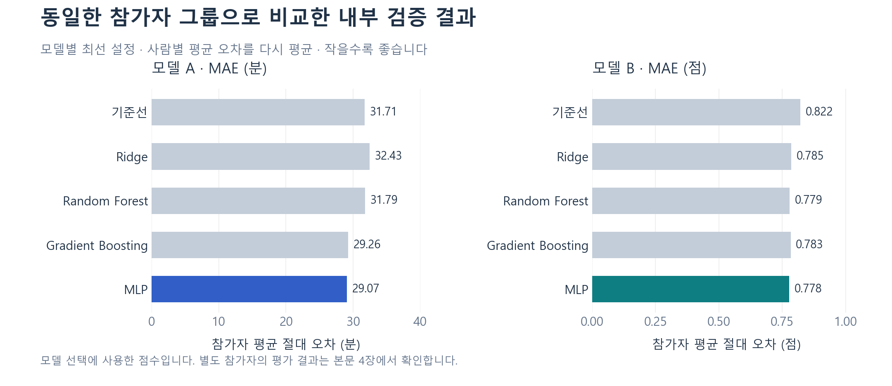

# AI+X Deep Learning Final Project

## 수면일지 기반 입면 지연 예측 및 맞춤형 취침 시각 추정 모델

> AI+X 딥러닝 기말 프로젝트 · 옵션 A

**원하는 시각에 일어나려면, 잠드는 데 걸리는 시간까지 고려해 몇 시에 잠자리에 들어야 할까?**

이 프로젝트에서는 개인별 수면일지를 바탕으로 잠자리에 든 뒤 실제로 잠들기까지 걸리는 시간인 **입면 지연**과 수면 구간에 따른 예상 수면의 질을 계산합니다.

별도로 둔 참가자의 수면일지에서 모델의 예측값을 실제 기록과 비교해 오차를 확인했습니다. 취침 시각 추정에서는 수면일지로 학습한 모델이 같은 기준으로 후보를 비교할 수 있도록 **목표 기상 시각 오전 8시**와 **최소 수면 구간 7시간 30분**을 시연의 전제조건으로 설정했습니다. 이 조건을 충족하는 후보 중에서 모델이 수면의 질을 가장 높게 예측한 취침 시각을 선택했습니다.

우리가 만들고 싶은 건 **내 수면일지에서 잠드는 패턴을 파악해, 내일 오전 8시에 더 개운하게 일어나려면 오늘 밤 몇 시에 잠자리에 들면 좋을지 알려주는 모델**입니다.

## 목차

- [0. 프로젝트 팀원 및 역할 소개](#0-프로젝트-팀원-및-역할-소개)
- [1. 프로젝트 개요와 문제 정의 (Proposal)](#1-프로젝트-개요와-문제-정의-proposal)
- [2. 수면일지 데이터와 전처리 (Dataset)](#2-수면일지-데이터와-전처리-dataset)
- [3. 모델 설계와 학습 (Methodology)](#3-모델-설계와-학습-methodology)
- [4. 최종 모델 테스트 (Test Results)](#4-최종-모델-테스트-test-results)
- [5. 모델 평가와 오차 분석 (Evaluation & Analysis)](#5-모델-평가와-오차-분석-evaluation--analysis)
- [6. 고찰 (Conclusion & Discussion)](#6-고찰-conclusion--discussion)
- [7. 프로젝트 발표 영상 (Project Presentation Video)](#7-프로젝트-발표-영상-project-presentation-video)
- [8. 참고자료 (Related Work)](#8-참고자료-related-work)

## 0. 프로젝트 팀원 및 역할 소개

| 이름 | 학번 | 소속 | 역할 |
| :---: | :---: | :--- | :--- |
| 나태우 | 2022020564 | 미래자동차공학과 (서울) | 프로젝트 팀장, 블로그 제작, 데이터 전처리 |
| 김현 | 2022071794 | 미래자동차공학과 (서울) | 프로젝트 모델 학습 및 검증 |
| 서현 | 2022014293 | 미래자동차공학과 (서울) | 프로젝트 데이터 수집 및 모델 입력 변수 분석 |
| 유민서 | 2022077429 | 미래자동차공학과 (서울) | 프로젝트 모델 테스트 및 분석 |

## 1. 프로젝트 개요와 문제 정의 (Proposal)

### 1-1. 주제 선정 배경

#### 우리의 궁금증

> **내일 아침 8시에 일어나야 한다면, 오늘 몇 시에 누워야 개운하게 일어날 수 있을까요?**

수업이나 출근, 시험이 있는 날에는 일어나야 할 시각이 이미 정해져 있습니다. 내일 8시 알람을 맞추고 ‘자정에 누우면 8시간은 자겠지’라고 생각할 수 있습니다. 그런데 누워서 한참 뒤척인다면, 일어나야 할 시각까지 남은 수면 구간은 그만큼 짧아집니다.

*그림 1. 침대 곁에 놓인 알람 시계. [Anastasiya Vragova 촬영, Pexels](https://www.pexels.com/photo/an-alarm-clock-on-bedside-near-a-sleeping-woman-8346006/)*

#### 가상 예시. 둘 다 자정에 누워 오전 8시에 일어난다면

- 5분 만에 잠들면 잠든 시각부터 기상까지 **7시간 55분**이 남습니다.
- 35분이 걸리면 잠든 시각부터 기상까지 **7시간 25분**이 남습니다.

이 프로젝트에서는 **잠자리에 든 시각(`go to bed`)부터 실제로 잠들 때까지 걸린 시간**을 **입면 지연**이라고 부릅니다. 표준 수면일지에서도 잠자리에 든 시각과 잠을 청하기 시작한 시각을 따로 기록합니다. [표준 수면일지 연구](https://pmc.ncbi.nlm.nih.gov/articles/PMC3250369/)

#### 실제 조사와 수면일지에서 확인한 사례

**사례 1. 누웠지만 잠이 오지 않았습니다**

통계청 2024년 생활시간조사에서 10세 이상 인구의 11.9%가 잠을 이루지 못한 시간을 기록했습니다. **그 시간을 기록한 사람들의 평균은 32분**이었습니다. [통계청 조사 결과](https://mods.go.kr/board.es?act=view&bid=220&list_no=437764&mid=a10301010000) · [한국일보 보도](https://www.hankookilbo.com/news/article/A2025072810120003470)

*2019년과 2024년의 연령대별 비교. [통계청 2024년 생활시간조사 결과, 9쪽](https://mods.go.kr/boardDownload.es?bid=220&list_no=437764&seq=9#page=16)*

**사례 2. 충분히 잤다고 느껴도 피곤했습니다**

KB경영연구소의 2026년 조사에서 수면의 질을 나쁘다고 답한 **671명**에게 불편한 상황을 물었습니다. 45.3%는 쉽게 잠들지 못하는 상황을, 43.1%는 충분히 자도 피곤한 상황을 꼽았습니다. [2026 한국 웰니스 보고서, 그림 III-14](https://www.kbfg.com/kbresearch/cmm/fms/FileDown.do?atchFileId=FILE_000000002001580&fileSn=0)

*수면의 질을 나쁘게 평가한 응답자 671명의 전체 응답 그래프. [KB경영연구소 2026 한국 웰니스 보고서, 37쪽](https://www.kbfg.com/kbresearch/cmm/fms/FileDown.do?atchFileId=FILE_000000002001580&fileSn=0#page=45)*

**사례 3. 같은 사람도 밤마다 달랐습니다**

우리 프로젝트가 사용한 국내 수면일지에서 49명이 4주 동안 남긴 기록을 사람별로 비교했습니다. **49명 중 42명**은 입면 지연이 가장 짧은 밤과 가장 긴 밤 사이에 **30분 이상 차이**가 났습니다. [국내 수면일지 전처리 자료](/데이터%28Dataset%29/전처리/test_korea.csv)

*참가자별로 가장 길었던 입면 지연에서 가장 짧았던 입면 지연을 뺀 값의 분포.*

#### 그래서 무엇을 살펴봤을까요?

수면일지에는 누운 시각, 잠든 시각, 일어난 시각 등이 담겨 있습니다. 우리는 최근 일지로 잠드는 데 얼마나 걸릴지 예측하고, 그 값으로 오전 8시 같은 목표 기상 시각에 맞춰 취침 시각을 계산해 보기로 했습니다. 과거 기록과 잠든 시각부터 기상까지의 간격을 바탕으로, 본인이 일지에 매긴 수면의 질 점수도 살펴봅니다.

### 1-2. 문제 정의

확인하려는 질문은 두 가지입니다.

1. 최근 수면 기록으로 다음 밤의 **입면 지연**, 즉 잠자리에 든 뒤 잠들기까지 걸리는 시간을 예측할 수 있을까요?
2. 최근 기록과 **수면 구간 길이**, 즉 잠든 시점부터 마지막으로 일어난 시점까지의 간격으로 본인이 매긴 수면의 질 점수를 예측할 수 있을까요?

첫 번째 질문은 모델 A, 두 번째 질문은 모델 B로 살펴봅니다. 여기서 **모델**은 과거 자료에서 입력과 정답의 관계를 학습해 새로운 입력의 값을 예측하는 계산 방법입니다.

*화살표는 취침 시각 시연에서 두 모델을 사용하는 순서입니다.*

| 구분 | 모델 A | 모델 B |
| --- | --- | --- |
| 예측할 값 | 잠들기까지 걸리는 시간 | 본인이 평가한 수면의 질 |
| 단위 | 분 | 1~5점 |
| 입력 | 최근 수면 기록을 요약한 숫자 5개 | 같은 숫자 5개와 수면 구간 길이 |

수면 구간 길이에는 밤중에 깨어 있던 시간도 포함됩니다. 따라서 실제로 잠든 시간만 합한 값과는 차이가 있습니다.

두 질문을 평가할 때 함께 확인할 기준도 정했습니다. **최근 기록의 대표값을 그대로 쓰는 간단한 방법보다, 학습한 모델이 얼마나 도움이 되는가?**입니다. 숫자를 예측할 수 있다는 사실과 복잡한 모델을 사용할 이득이 있다는 사실을 구분해 살펴보았습니다.

제목의 ‘맞춤형’은 사람마다 다른 최근 이력을 입력에 반영하고, 원하는 기상 시각과 수면 구간 조건으로 후보를 계산한다는 뜻입니다. 개인별로 가장 좋은 수면 시간을 알아냈다는 의미로 사용하지 않았습니다.

### 1-3. 프로젝트 목표와 전체 흐름

아침 8시에 일어나려면 오늘 몇 시에 누워야 할까요? 이 질문에 답하려면 먼저 **누운 뒤 잠들기까지 얼마나 걸리는지** 추정해야 합니다. 과거 수면일지에서 그 값을 예측하고, 따로 둔 자료로 얼마나 잘 맞는지 확인한 뒤 취침 시각을 계산했습니다.

| 단계 | 하는 일 | 다음 단계에 쓰는 결과 |
| :--- | :--- | :--- |
| **01 · 일지 정리** | 해외·국내 기록을 같은 기준으로 맞추기 | 분 단위로 정리한 수면 기록 |
| **02 · 참가자 분리** | 학습할 사람과 평가할 사람을 나누기 | 해외 학습 147명 · 해외 평가 37명 · 국내 평가 49명 |
| **03 · 모델 선택** | 같은 조건에서 여러 예측 방법을 비교하기 | 입면 지연 모델 A · 수면의 질 모델 B |
| **04 · 성능 확인** | 따로 둔 기록으로 오차를 계산하고 살펴보기 | 어떤 밤에 잘 맞고, 어떤 밤에 크게 틀렸는지 확인 |
| **05 · 취침 시각 시연** | 목표 기상 시각으로부터 거꾸로 계산하기 | 잠자리에 들 시각의 후보 |

1. **수면일지를 같은 기준으로 정리했습니다.**

   해외와 국내 일지는 시간을 적는 형식과 단위가 달랐습니다. 잠자리에 든 뒤 잠들 때까지의 시간과 잠든 뒤 기상까지의 간격을 분 단위로 맞췄습니다. 이렇게 정리한 기록으로 사람별 최근 입면 지연과 수면 구간을 계산했습니다.

2. **학습할 사람과 평가할 사람을 나눴습니다.**

   한 사람의 월요일 일지를 학습에 쓰고 화요일 일지를 평가에 쓰면, 모델이 처음 보는 사람에게 얼마나 잘 맞는지 알기 어렵습니다. 그래서 한 사람의 일지를 한 묶음으로 두고 참가자 단위로 나눴습니다. 빈 값을 채우는 기준도 학습 자료에서 정했습니다.

3. **간단한 예측과 여러 학습 모델을 비교했습니다.**

   해외 학습 대상 147명을 다섯 그룹으로 나눠, 매번 네 그룹으로 학습하고 남은 한 그룹으로 확인했습니다. 같은 그룹 배정으로 여러 방법을 비교해 입면 지연을 예측하는 모델 A와 일지의 수면 점수를 예측하는 모델 B의 최종 설정을 골랐습니다.

4. **따로 둔 일지에서 얼마나 틀렸는지 확인했습니다.**

   설정을 확정한 모델의 예측값을 실제 일지와 비교했습니다. 평균 오차를 계산하고, 잠드는 데 오래 걸린 밤이나 이전 기록이 적은 밤처럼 상황을 나눠 어떤 경우에 차이가 커졌는지 살펴봤습니다.

5. **오전 8시 기상을 예로 취침 시각을 계산했습니다.**

   가상의 최근 일지를 넣어 모델 A로 입면 지연을 구했습니다. 목표 기상 시각에서 후보 수면 구간과 입면 지연을 빼면 잠자리에 들 시각이 나옵니다. 모델 B로 후보별 수면 점수도 계산했습니다. [4-3. 취침 시각 추정 예시](#4-3-취침-시각-추정-예시)

프로젝트의 목표는 잠드는 데 걸리는 시간을 얼마나 잘 예측하고, 그 예측을 취침 시각 계산에 어떻게 쓸 수 있는지 살펴보는 것입니다. 실제로 취침 시각을 바꿨을 때 아침 컨디션이 어떤지는 별도 실험이 필요한 질문입니다.

## 2. 수면일지 데이터와 전처리 (Dataset)

### 2-1. 데이터 수집과 구성

공개된 해외 **MeLiDos 수면일지 9개 지역 자료**와 **국내 49명의 4주 수면일지**를 사용했습니다. MeLiDos는 여러 지역에서 수집한 수면일지 자료의 이름입니다.

| 자료 | 참가자 수 | 전체 기록 수 | A 평가에 쓸 수 있는 기록 | B 평가에 쓸 수 있는 기록 |
| --- | ---: | ---: | ---: | ---: |
| 해외 학습 대상 | 147명 | 1,020건 | 1,007건 | 1,001건 |
| 해외 별도 평가 | 37명 | 262건 | 259건 | 259건 |
| 국내 외부 평가 | 49명 | 1,372건 | 1,372건 | 없음 |

국내 자료에는 수면의 질 점수가 없어 모델 A만 평가했습니다. B는 점수와 수면 구간 길이가 모두 있는 기록을 사용하므로, 전체 기록 수와 실제로 사용하는 수가 다릅니다.

MeLiDos 학습 대상은 사람당 기록 수의 중앙값이 7건이고, 국내 자료는 모두 28건씩 있습니다. 수개월이나 수년 동안의 변화를 관찰한 자료로 해석하기에는 기간이 짧습니다. 원자료의 공개 위치는 [데이터 출처](/데이터%28Dataset%29/출처.md)에 정리했습니다.

**공개 자료에서 이번에 사용한 범위**

MeLiDos는 빛 노출 측정값과 수면일지 등을 함께 제공하는 연구 자료입니다. 이번 분석에서는 그중 수면일지를 사용했으며, 선택된 해외 참가자는 학습 147명과 별도 평가 37명을 합한 184명입니다. 센서 자료까지 포함한 공개 연구 전체의 규모와 구분했습니다. [MeLiDos 공식 소개](https://github.com/MeLiDosProject/melidosData)

국내 자료도 스마트워치 측정값과 일지를 함께 수집한 연구에서 공개한 것입니다. 본 프로젝트에는 수면일지 파일만 사용했고, 스마트워치 신호는 입력에 넣지 않았습니다. 따라서 아래 결과를 스마트워치 기반 예측 성능으로 해석하지 않았습니다. [Baigutanova 등의 데이터 소개 논문](https://doi.org/10.1038/s41597-025-05801-3)

### 2-2. 사용 변수와 예측 대상

모델에 넣는 각각의 정보 항목을 **변수**라고 부릅니다. 예를 들어 ‘최근 잠들기까지 걸린 시간’과 ‘그 값을 계산할 때 사용한 기록 수’가 서로 다른 변수입니다.

| 입력 변수 | 뜻 | 사용 모델 |
| --- | --- | --- |
| 최근 입면 지연의 중앙값 | 이전 기록 중 값이 있는 최근 최대 3건의 대표값 | A·B |
| 입면 지연 기록 수 | 위 대표값에 사용한 기록 수, 0~3개 | A·B |
| 바로 앞 기록의 수면 구간 | 가장 최근 기록에서 잠든 시점부터 기상까지의 간격 | A·B |
| 최근 수면 구간의 중앙값 | 이전 기록 중 값이 있는 최근 최대 3건의 대표값 | A·B |
| 수면 구간 기록 수 | 위 대표값에 사용한 기록 수, 0~3개 | A·B |
| 해당 밤의 수면 구간 길이 | 평가에서는 실제 관찰값, 취침 시각 계산에서는 비교할 후보값 | B |

**중앙값**은 숫자를 크기순으로 정렬했을 때 가운데에 오는 값입니다. 예를 들어 입면 지연이 20분, 30분, 25분이면 중앙값은 25분입니다.

A의 정답은 실제 입면 지연인 `bed_to_sleep_min`, B의 정답은 실제 수면의 질 점수인 `sleep_quality`입니다. 참가자 번호·지역·날짜는 자료 분리와 오차 분석에 쓰고, 예측 입력에는 넣지 않았습니다. A의 현재 밤 예측값을 B의 입력으로 넣는 방식도 사용하지 않았습니다.

**실제 입력이 만들어지는 예시**

다음은 계산을 설명하기 위한 가상 이력입니다. 날짜순으로 다음 세 기록이 있고, 그다음 밤을 예측한다고 가정합니다.

| 과거 기록 순서 | 입면 지연 | 수면 구간 |
| --- | ---: | ---: |
| 첫 번째 | 20분 | 420분 |
| 두 번째 | 30분 | 450분 |
| 세 번째 | 25분 | 480분 |

모델 A의 입력은 **입면 지연 중앙값 25분, 그 기록 수 3개, 직전 수면 구간 480분, 수면 구간 중앙값 450분, 그 기록 수 3개**가 됩니다. B에는 여기에 비교할 수면 구간 길이 한 개를 더 넣습니다. 이 가상 이력은 4장의 시연에서도 사용합니다.

‘최근 3개’는 값이 있는 기록을 최대 세 개 고른다는 뜻입니다. 날짜가 빠져 있으면 연속 3일과 다를 수 있고, 바로 앞 기록의 수면 구간이 비어 있으면 더 오래된 값으로 바꾸지 않고 빈 값으로 남깁니다.

### 2-3. 데이터 탐색

학습 전에 자료의 크기와 빠진 값, 값이 주로 모여 있는 구간을 확인했습니다. 이처럼 자료의 특징을 먼저 살펴보는 과정을 **데이터 탐색**이라고 합니다.

해외 학습 자료의 입면 지연 중앙값은 30분, 국내 전체 자료는 20분이었습니다. 평균도 각각 46.88분과 33.82분으로 달랐습니다. 두 자료의 수면 기록 특성이 같지 않다는 점을 평가 해석에 반영했습니다.

*그림 2. 자료별 시간 분포. 국내 전체 자료에는 마지막 7일 기록도 포함됩니다.*

위 그림의 가로축은 시간, 세로축은 값이 어느 구간에 얼마나 모여 있는지를 나타냅니다. 같은 색의 막대가 높은 구간일수록 그 주변의 기록이 많이 모여 있습니다.

수면의 질은 해외 별도 평가 259건 중 3·4점이 194건이었고, 1점은 2건뿐이었습니다. 전체 평균 오차만 보면 기록이 적은 점수에서의 실패가 가려질 수 있습니다.

### 2-4. 데이터 전처리

**전처리**는 원자료를 모델이 읽을 수 있는 형태로 정리하는 작업입니다.

먼저 시간의 기준과 단위를 맞췄습니다. MeLiDos의 입면 지연은 ‘침대에 들어간 뒤 잠을 청하기까지의 시간’과 ‘잠을 청한 뒤 잠들기까지의 시간’을 더해 계산했습니다. 국내 자료는 취침·입면 시각의 차이로 계산하고, 시간 단위로 저장된 원본 값에 60을 곱한 결과와 대조했습니다. 자정을 넘는 기록도 함께 처리했습니다.

다음으로 참가자별 기록을 밤이 끝난 아침 날짜순으로 정리했습니다. 현재 밤의 입력에는 **그 날짜보다 앞선 기록만** 사용했습니다. 정답을 미리 보고 입력을 만들면 실제 사용보다 성능이 좋아 보일 수 있기 때문입니다. 이런 문제를 **데이터 누수**라고 합니다.

빠진 값을 뜻하는 **결측값**도 구분했습니다. 입력에서 빠진 값은 학습 자료의 중앙값으로 채웠지만, 빠진 정답을 임의로 만들어 채우지는 않았습니다. 바로 앞 기록의 수면 구간이 비어 있다면 입력을 만드는 단계에서는 빈 값으로 남겼습니다.

신경망과 일부 비교 모델에는 **표준화**를 적용했습니다. 표준화는 각 입력에서 학습 자료의 평균을 빼고 값의 퍼짐 정도로 나누어, 숫자의 크기 차이를 줄이는 작업입니다. 검증·평가 자료에는 학습 자료에서 구한 기준을 그대로 적용했습니다. 자세한 처리 과정은 [전처리 코드](/코드%28Code%29/prepare.py)에 있습니다.

**처리 기준을 이렇게 정한 이유**

| 확인한 문제 | 적용한 기준 | 이유 |
| --- | --- | --- |
| 사람마다 기록 시각·단위가 다름 | 입면 지연과 수면 구간을 분 단위로 재계산 | 서로 다른 자료의 숫자를 같은 기준으로 비교하기 위해서입니다. |
| 오늘의 정답이 과거 입력에 섞일 수 있음 | 날짜가 더 앞선 기록으로 입력을 만든 뒤 오늘 기록을 이력에 추가 | 아직 모르는 정답을 미리 참고하는 일을 막기 위해서입니다. |
| 일지가 처음이거나 일부 값이 빠짐 | 학습 자료의 중앙값으로 입력 결측값 대체 | 기록이 적은 사람도 예측할 수 있게 하되 평가 자료로 대체 기준을 만들지 않기 위해서입니다. |
| 매우 긴 입면 지연이 포함됨 | 시간이 길다는 이유만으로 자르지 않음 | 어려운 사례를 임의로 빼면 실제보다 오차가 작아 보일 수 있기 때문입니다. |

해외 학습 1,020건 중 A의 입면 지연 정답이 없는 기록은 13건입니다. B는 수면 구간과 점수가 모두 있어야 하므로 사용 가능한 기록이 1,001건입니다. 입력의 빈 값을 채우는 일과, 정답이 없어 학습·평가에서 제외하는 일을 구분했습니다. 기록별 수와 빠진 값은 [전처리 요약](/데이터%28Dataset%29/전처리/summary.json)에서 확인할 수 있습니다.

### 2-5. Train / Validation / Test 데이터 분할

세 용어는 자료의 사용 목적을 구분합니다.

- **Train(학습 자료):** 모델이 입력과 정답의 관계를 배우는 자료입니다.
- **Validation(검증 자료):** 학습 방법과 설정을 고르는 데 사용하는 자료입니다.
- **Test(평가 자료):** 선택을 마친 모델이 새로운 자료에서 얼마나 맞는지 확인하는 자료입니다.

한 사람의 일지를 무작위로 섞으면 같은 사람의 기록이 학습과 평가 양쪽에 들어갈 수 있습니다. 이를 피하기 위해 **사람 단위로 자료를 분리**했습니다.

| 단계 | 참가자 | 사용 방식 |
| --- | --- | --- |
| 해외 학습·검증 | 147명 | 기존 참가자 배정에 따라 5개 그룹으로 나눠 사용 |
| 해외 별도 평가 | 37명 | 모델 선택을 마친 뒤 성능 확인 |
| 국내 외부 평가 | 49명 | 해외 자료로 학습한 A의 성능 확인 |

학습 대상 147명은 매번 4개 그룹으로 학습하고, 남은 1개 그룹으로 검증했습니다. 검증 그룹을 바꿔 5번 반복하는 방법을 **5회 교차검증**이라고 합니다. 각 사람은 검증에 한 번씩 포함됩니다. 그룹별 실제 파일은 [분할 데이터](/데이터%28Dataset%29/분할)에 있습니다.

**하루치 기록을 섞는 대신 사람을 나눈 이유**

같은 사람의 월요일 기록을 학습에, 화요일 기록을 평가에 넣으면 ‘처음 보는 사람’에 대한 평가가 되지 않습니다. 이번 참가자 단위 분할은 모델을 만들 때 사용하지 않은 사람에게도 예측이 통하는지 확인하기 위한 선택입니다. 다만 평가 대상자의 이전 실제 일지를 입력으로 받는 것은 허용했으며, 그 사람의 기록으로 모델을 다시 학습하지는 않았습니다.

교차검증이 끝나면 147명 전체로 최종 모델을 학습합니다. 따라서 **147명 전체 학습 파일과 그 안의 검증 파일을 한 회차의 학습·검증 쌍으로 사용하지 않았습니다.** 매 회차에는 같은 번호의 `train_fold_N.csv`와 `validation_fold_N.csv`를 함께 사용합니다.

## 3. 모델 설계와 학습 (Methodology)

### 3-1. 예측 방법과 전체 구조

A와 B는 모두 숫자를 예측합니다. 이렇게 연속적인 숫자값을 예측하는 문제를 **회귀 문제**라고 부릅니다. B의 1~5점도 이번 구현에서는 숫자값으로 예측했습니다.

A는 과거 이력을 요약한 숫자 5개로 입면 지연을 예측합니다. B는 같은 5개와 수면 구간 길이로 수면의 질을 예측합니다. 두 모델은 각각 따로 학습합니다.

취침 시각을 계산할 때는 A가 예상한 입면 지연을 사용하고, 여러 수면 구간 후보를 B에 넣어 예상 점수를 비교합니다. 이때 B가 평가에서 사용한 실제 수면 구간과, 시연에서 넣는 후보 구간은 구분해서 해석해야 합니다.

**B의 평가 입력과 취침 전 시연 입력은 다릅니다**

| 상황 | B에 넣는 수면 구간 | 결과가 답하는 질문 |
| --- | --- | --- |
| 학습·별도 평가 | 그날 밤 실제로 관찰된 수면 구간 | 이 구간과 과거 이력이 주어졌을 때 점수를 얼마나 잘 예측하는가? |
| 취침 시각 시연 | 7시간·7시간 30분·8시간 같은 가상 후보 | 같은 이력에서 후보값을 바꾸면 모델의 점수가 어떻게 달라지는가? |

취침 전에는 그날의 실제 수면 구간을 알 수 없습니다. 따라서 B의 평가 점수만으로 후보를 따랐을 때 수면이 좋아진다고 설명할 수는 없습니다. 이 차이를 4장의 시연과 6장의 한계에서도 함께 살펴봅니다.

### 3-2. 후보 모델 탐색과 선정

딥러닝 모델이 단순한 방법보다 도움이 되는지 확인하기 위해 다음 방법을 비교했습니다. **기준선**은 복잡한 모델의 성능을 판단할 때 출발점으로 삼는 간단한 예측 방법입니다.

| 방법 | 쉬운 설명 |
| --- | --- |
| 기준선 | A는 개인의 최근 입면 지연 중앙값, 이력이 없으면 학습 자료의 중앙값을 사용합니다. B는 학습 자료의 평균 점수를 사용합니다. |
| Ridge Regression | 입력마다 비중을 곱해 더하는 방식입니다. 특정 입력의 비중이 지나치게 커지지 않도록 제한합니다. |
| Random Forest | 조건에 따라 자료를 나누어 예측하는 ‘결정나무’를 여러 개 만들고, 결과를 평균합니다. |
| Gradient Boosting | 앞선 예측에서 남은 오차를 다음 모델이 보완하도록 차례로 학습합니다. |
| 다층 퍼셉트론, MLP | 숫자 입력을 여러 계산 층에 통과시키고, 층 사이의 연결 강도를 학습하는 신경망입니다. 이번 프로젝트의 딥러닝 후보입니다. |
| XGBoost | 오차를 차례로 보완하는 방식의 추가 비교 모델입니다. 최초 평가 이후에 따로 비교했습니다. |

Ridge의 제한 강도, 결정나무의 깊이, MLP의 계산 층 크기와 학습 횟수 등을 바꿔 검증했습니다. 이런 설정값을 **하이퍼파라미터**라고 합니다. 최종 선택은 테스트 점수가 아니라 학습 대상 안의 교차검증 결과를 기준으로 했습니다.

**이 후보들을 함께 비교한 이유**

수면 이력이 표의 숫자 몇 개로 요약되어 있기 때문에, 간단한 계산부터 신경망까지 복잡도가 다른 방법을 비교했습니다. Ridge는 입력을 비중에 따라 더하는 방법이 어느 정도 통하는지, 결정나무 계열은 조건에 따라 달라지는 관계를 학습할 때 도움이 되는지, MLP는 여러 계산 층을 학습할 이득이 있는지 확인하는 역할입니다.

| 후보 | 실제로 비교한 주요 설정 |
| --- | --- |
| Ridge | 비중이 지나치게 커지는 것을 제한하는 강도: 0.1, 1, 10, 100 |
| Random Forest | 나무가 조건을 나누는 최대 깊이: 3, 6 / 마지막 묶음에 남길 최소 기록 수: 5, 15 / 나무 300개 |
| Gradient Boosting | 최대 깊이: 1, 2 / 차례로 학습할 나무 수: 60, 150 |
| MLP | 첫 은닉층 크기: 16, 32 / 학습 횟수: 60, 160회 |

예를 들어 MLP는 층 크기 두 가지와 학습 횟수 두 가지를 조합해 네 설정을 비교했습니다. XGBoost는 최초 선택 이후 추가로 비교했으므로, 처음 모델을 고른 결과와 구분해 5장에서 해석합니다. 설정 범위는 [실제 학습 코드](/코드%28Code%29/evaluate.py)에 기록되어 있습니다.

### 3-3. 모델 구조와 학습 설정

A와 B 모두 최종적으로 MLP를 선택했습니다. 두 모델의 중간 계산 층 크기는 **16개 → 8개**, 출력은 숫자 1개입니다. 중간 계산 층을 **은닉층**이라고 부릅니다.

| 설정 | 값과 의미 |
| --- | --- |
| 입력 개수 | A 5개, B 6개 |
| 은닉층 크기 | 첫 번째 16개, 두 번째 8개 계산 단위 |
| ReLU | 중간 계산값이 음수이면 0으로 바꾸는 함수입니다. 층을 거치며 복잡한 관계를 배울 수 있게 합니다. |
| Dropout | 첫 은닉층 뒤에서 학습 중 일부 값을 무작위로 0으로 만듭니다. 비율은 10%이며, 특정 연결에만 의존하는 것을 줄이려는 설정입니다. |
| A의 학습 기준 | 예측과 실제의 차이에서 부호를 뺀 절대 오차를 줄입니다. |
| B의 학습 기준 | 예측과 실제의 차이를 제곱한 오차를 줄입니다. |
| Adam | 오차를 줄이는 방향으로 연결 강도를 조금씩 조정하는 학습 방법입니다. |
| 학습률 | 한 번에 값을 조정하는 정도로, 0.001을 사용했습니다. |

A의 최종 출력은 음수가 되지 않도록 변환하고, B는 1~5점 안에 오도록 변환했습니다. 모델 구조와 계산식은 [MLP 코드](/코드%28Code%29/mlp.py)에서 확인할 수 있습니다.

*그림 3. 선택된 A·B 모델 구조. 입력 수와 중간 계산 층의 크기를 구분했습니다.*

그림의 ‘16 → 8 → 1’은 입력 개수가 아니라 중간 계산 단위 16개, 다음 계산 단위 8개, 최종 출력 1개를 뜻합니다. A는 입력 5개, B는 입력 6개로 시작합니다. 최종 점수는 서로 다른 세 시작 조건에서 얻은 예측을 평균합니다.

여기서 **연결 강도**, 또는 **가중치**는 어떤 입력을 계산에 얼마나 반영할지 학습하는 숫자입니다. 학습할 때 너무 큰 가중치가 생기는 것을 줄이는 설정인 **가중치 감쇠(weight decay)**도 0.0001로 적용했습니다.

Dropout은 학습할 때만 값을 일부 비웁니다. 최종 예측에서는 값을 무작위로 비우지 않고 계산합니다. [PyTorch 공식 설명](https://docs.pytorch.org/docs/2.7/generated/torch.nn.Dropout.html)

### 3-4. 모델 학습 (Train)

한 번에 기록 32건씩 묶어 학습했습니다. 이 묶음을 **배치(batch)**라고 합니다. 학습 자료 전체를 한 번 사용하는 것을 **에포크(epoch)**라고 하며, 60회와 160회를 비교한 뒤 두 모델 모두 60회를 선택했습니다.

신경망은 처음 연결 강도를 정하는 무작위 값에 따라 결과가 달라질 수 있습니다. 시작 조건을 정하는 번호인 **난수 시드**를 42, 7, 17로 두어 세 모델을 학습하고, 최종 예측은 세 결과의 평균으로 계산했습니다.

*그림 4. 첫 교차검증 회차의 학습 과정. 위쪽은 변환한 정답 척도의 학습 오차, 아래쪽은 참가자 평균 MAE입니다.*

위 그림의 가로축은 학습 횟수입니다. 위쪽은 학습 중 줄이려는 오차, 아래쪽은 따로 둔 검증 자료에서의 오차입니다. A와 B는 학습할 때 정답의 숫자 크기도 다르게 변환하므로, 위쪽 두 그래프의 높이를 직접 비교하지 않았습니다. 이 그림은 첫 번째 검증 회차의 학습 과정이며, 모든 회차가 같은 모습을 보였다는 뜻은 아닙니다.

학습에 사용한 프로그램과 라이브러리 버전은 [실행 환경](/실행환경%28Runtime%20Environment%29/실행환경%20안내.md)에 기록했습니다.

**학습 곡선에서 확인한 점**

A와 B 모두 초반에 학습 오차와 검증 오차가 함께 줄고, 뒤로 갈수록 변화가 완만해집니다. 학습 자료에서만 오차가 줄고 새로운 자료에서는 오차가 커지는 현상을 **과적합**이라고 합니다. 이 첫 회차 그림에서는 검증 오차가 계속 커지는 모습이 두드러지지는 않았지만, 이것만으로 모든 참가자에서 과적합이 없다고 단정하지는 않았습니다.

최종 모델에는 가중치뿐 아니라 빈 값을 채운 기준과 표준화 기준도 함께 저장했습니다. 예측할 때 같은 입력 순서와 같은 변환을 적용하기 위해서입니다. 이 저장 모델을 다시 불러온 결과는 4장의 시연과 5장의 검산에 사용했습니다.

### 3-5. 모델 검증 (Validation)과 최종 모델 선정

비교 기준은 **MAE(평균 절대 오차)**입니다. 예측이 실제값에서 얼마나 떨어졌는지 부호를 빼고 평균한 값으로, 작을수록 좋습니다. 예를 들어 실제 30분을 20분으로 예측하면 그 기록의 절대 오차는 10분입니다.

기록이 많은 사람에게 결과가 치우치지 않도록, **사람마다 평균 오차를 먼저 구하고 그 값을 다시 평균**했습니다. 아래 표는 이 ‘참가자 평균 MAE’를 사용합니다.

| 후보 | A 오차, 분 | B 오차, 점 |
| --- | ---: | ---: |
| 기준선 | 31.71 | 0.822 |
| Ridge | 32.43 | 0.785 |
| Random Forest | 31.79 | 0.779 |
| Gradient Boosting | 29.26 | 0.783 |
| MLP | **29.07** | **0.778** |

각 후보에서 가장 좋았던 설정을 비교한 결과, A·B 모두 MLP의 오차가 가장 작았습니다. 다만 B의 MLP와 Random Forest 차이는 0.001점보다 작아서 큰 성능 차이라고 보기는 어렵습니다.

선택한 설정을 고정한 뒤 학습 대상 147명 전체로 다시 학습했습니다. 결측값을 채우는 기준과 표준화 기준도 각 검증 회차의 학습 부분에서만 계산했습니다. 최종 설정과 회차별 결과는 [교차검증 결과](/실험결과%28Experiment%20Results%29/교차검증)에 저장했습니다.

*그림 5. 모델별 최선 설정의 내부 검증 비교. A와 B는 단위가 달라 각각 표시했습니다.*

막대가 짧을수록 평균 오차가 작습니다. B의 MLP와 Random Forest 막대가 거의 같다는 점도 확인할 수 있습니다. 이 그림은 **모델 선택에 사용한 내부 검증 결과**이며, 4장의 별도 평가 결과와 구분합니다.

**최종 MLP 설정의 회차별 결과**

| 회차 | 학습 인원 | 검증 인원 | A 검증 MAE, 분 | B 검증 MAE, 점 |
| --- | ---: | ---: | ---: | ---: |
| 1 | 117명 | 30명 | 25.23 | 0.725 |
| 2 | 118명 | 29명 | 35.59 | 0.726 |
| 3 | 118명 | 29명 | 23.79 | 0.796 |
| 4 | 118명 | 29명 | 23.71 | 0.803 |
| 5 | 117명 | 30명 | 36.87 | 0.839 |

A는 검증 회차에 따라 약 23.71~36.87분으로 오차가 달랐습니다. 한 번의 좋은 분할만 보고 결론을 내리기 어려운 이유입니다. 표의 각 회차에서 A와 B는 정답이 있는 기록만 사용하므로 유효 기록 수가 다를 수 있습니다.

다섯 회차의 오차를 단순 평균하면 A는 29.04분입니다. 앞의 주 비교표 29.07분은 모든 회차의 검증 예측을 모아 사람별로 평균한 값입니다. 회차마다 사람이 29명 또는 30명이라 두 계산의 가중 방식이 조금 다릅니다.

분 단위 오차와 점수 오차를 확인하려는 문제이므로, ‘전체 중 몇 %를 정확히 맞혔는가’보다 ‘실제값에서 평균적으로 얼마나 떨어졌는가’를 주 지표로 삼았습니다. [MAE 공식 설명](https://scikit-learn.org/1.7/modules/generated/sklearn.metrics.mean_absolute_error.html)

## 4. 최종 모델 테스트 (Test Results)

### 4-1. 테스트 방법과 조건

선택을 마친 모델로 해외 별도 평가 37명과 국내 49명의 기록을 예측했습니다. A는 입면 지연 정답이 있는 기록을, B는 수면 구간과 수면의 질 정답이 모두 있는 기록을 평가했습니다.

국내 자료에서는 각 사람의 마지막 7일, 총 343건을 주요 평가 구간으로 삼았습니다. 이때 평가 당일보다 앞선 날짜의 실제 일지를 사용할 수 있다고 가정했습니다. 국내 자료로 모델을 다시 학습한 것은 아닙니다. 전체 1,372건 결과도 확인했지만, 이 안에 마지막 7일 343건이 포함되므로 별개의 독립 실험으로 세지 않았습니다.

해외 37명은 현재 코드에서 모델 선택 이후 평가에 사용합니다. 다만 과거에 팀이 이 사람들의 결과를 모델 선택에 참고했는지는 파일만으로 확인할 수 없어, 본문에서는 ‘해외 별도 평가’라고 부릅니다. 이 사용 이력은 최종 정리 전에 확인할 부분입니다.

### 4-2. 테스트 결과

표의 오차는 앞서 설명한 참가자 평균 MAE입니다. A는 분, B는 점 단위이므로 두 숫자의 크기를 직접 비교하지 않았습니다.

| 모델·평가 자료 | 참가자 / 유효 기록 | MLP 오차 | 기준선 오차 |
| --- | ---: | ---: | ---: |
| A · 해외 별도 평가 | 37명 / 259건 | 38.14분 | 40.91분 |
| A · 국내 마지막 7일 | 49명 / 343건 | 20.25분 | 20.06분 |
| A · 국내 전체, 보조 결과 | 49명 / 1,372건 | 21.31분 | 21.21분 |
| B · 해외 별도 평가 | 37명 / 259건 | 0.700점 | 0.750점 |

*그림 6. 선택을 마친 모델과 기준선의 별도 평가 오차. 작을수록 좋습니다.*

해외 자료에서는 A·B 모두 MLP의 평균 오차가 작았습니다. 국내 A에서는 개인의 최근 기록을 사용하는 기준선보다 오차가 작아지지 않았습니다. 모든 자료에서 딥러닝이 더 좋았다고 결론 내릴 수는 없습니다.

최종 평가 수치는 [평가 결과표](/실험결과%28Experiment%20Results%29/테스트/holdout_metrics.csv), 각 기록의 실제값과 예측값은 [기록별 예측 결과](/실험결과%28Experiment%20Results%29/테스트/holdout_predictions.csv)에 있습니다.

### 4-3. 취침 시각 추정 예시

저장된 A·B 모델에 가상 이력 3건을 넣어 실행했습니다. 입력의 입면 지연은 20·30·25분, 수면 구간은 420·450·480분입니다. 실제 참가자의 기록을 사용한 예시는 아닙니다.

목표 기상 시각은 **오전 8시**, 최소 수면 구간은 **7시간 30분**으로 두었습니다. A가 예측한 입면 지연은 약 **23.76분**입니다. 후보별 취침 시각은 다음 식으로 계산합니다.

**취침 시각 = 목표 기상 시각 − 후보 수면 구간 − 예상 입면 지연**

| 후보 수면 구간 | B의 예상 수면의 질 | 계산된 취침 시각 | 최소 구간 조건 |
| --- | ---: | --- | --- |
| 7시간 | 3.612점 | 당일 00:36 | 충족하지 않음 |
| 7시간 30분 | 3.706점 | 당일 00:06 | 충족 |
| 8시간 | 3.764점 | 전날 23:36 | 충족 |

시각은 분 단위로 반올림해 표시했습니다. 이번 입력에서는 조건을 만족하는 후보 중 8시간의 예상 점수가 가장 높았습니다. 이는 **모델이 어떻게 계산하는지 보여 주는 결과**이며, 그 시각에 자면 실제 수면이 좋아진다는 확인 결과는 아닙니다.

[입력 예시](/예측시연%28Prediction%20Demo%29/입력예시.json)와 [실행 결과](/예측시연%28Prediction%20Demo%29/예측결과.json)를 함께 저장했습니다. 실행 방법은 [예측 시연 설명](/예측시연%28Prediction%20Demo%29/예측시연%20파일%20설명.md)에 있습니다.

**왜 이번 예시에서는 가장 긴 후보가 선택되었을까요?**

후보를 길게 넣을수록 B의 예상 점수가 계속 높아지면, 점수만 최대화하는 계산은 허용한 후보 중 가장 긴 것을 고를 수 있습니다. 이를 살펴보기 위해 학습 자료의 중앙값 이력을 고정한 가상 입력에서 수면 구간만 바꾼 저장 분석도 확인했습니다.

*그림 7. 학습 중앙값 이력에서 후보 길이만 바꾼 B의 예측. 실제 추천 효과를 측정한 결과는 아닙니다.*

이 그림은 학습 수면 구간의 가운데 90% 범위 안에서 후보를 30분 간격으로 바꾼 결과입니다. 세로축의 점수가 높아지는 모습은 **모델의 계산 특성**을 보여 줍니다. 10시간이 사람에게 가장 좋은 수면 시간이라는 뜻은 아닙니다. 실제로 적용할 기능에서는 가능한 후보 범위와 사용자의 조건을 정하고, 추천 효과를 별도로 확인해야 합니다.

## 5. 모델 평가와 오차 분석 (Evaluation & Analysis)

### 5-1. 평가 지표와 성능 비교

평균 오차 한 가지로 설명하기 어려운 부분을 보기 위해 다음 값도 함께 확인했습니다. **평가 지표**는 성능을 숫자로 표현한 기준을 뜻합니다.

| 지표 | 뜻 |
| --- | --- |
| MAE | 실제와 예측의 차이에서 부호를 빼고 평균한 값입니다. 본문의 주요 결과는 사람별 MAE를 다시 평균했습니다. |
| RMSE | 차이를 제곱해 평균한 뒤 제곱근을 구하는 오차입니다. 큰 실수가 결과에 더 크게 반영됩니다. |
| 예측−실제의 평균 | 음수면 평균적으로 낮게, 양수면 높게 예측했다는 뜻입니다. |
| 허용 오차 이내 비율 | A는 실제값과 10분 이내, B는 1점 이내로 예측한 기록의 비율입니다. |

RMSE의 ‘제곱근’은 자기 자신을 곱했을 때 원래 수가 되는 값입니다. 예를 들어 9의 제곱근은 3입니다. 이 지표는 MAE와 함께 큰 오차의 영향을 살펴보는 데 사용했습니다.

| 자료·방법 | 참가자 평균 MAE | 기록별 RMSE | 예측−실제의 평균 | 허용 오차 이내 비율 |
| --- | ---: | ---: | ---: | ---: |
| A 해외 · 기준선 | 40.91분 | 79.36분 | −6.87분 | 33.6% |
| A 해외 · MLP | 38.14분 | 78.51분 | −19.54분 | 30.9% |
| A 국내 마지막 7일 · 기준선 | 20.06분 | 36.17분 | −2.28분 | 60.6% |
| A 국내 마지막 7일 · MLP | 20.25분 | 34.09분 | −3.59분 | 40.5% |
| B 해외 · 기준선 | 0.750점 | 0.894점 | +0.136점 | 74.9% |
| B 해외 · MLP | 0.700점 | 0.849점 | +0.094점 | 76.1% |

국내 A에서는 MLP의 RMSE가 작아졌지만 MAE는 조금 커졌고, 10분 이내로 맞힌 비율도 낮아졌습니다. 따라서 일부 큰 오차가 줄었다는 점만 보고 전체 성능이 좋아졌다고 설명하기는 어렵습니다. 허용 오차의 10분·1점은 이번 분석에서 정한 비교 기준입니다.

### 5-2. 실제값과 예측값 비교

모델 A는 실제 입면 지연이 매우 긴 기록을 충분히 따라가지 못했습니다.

*그림 8. A 실제값과 예측값. 점선은 정확한 예측 위치이며, 좌우 그림의 축 범위가 다릅니다.*

위 그림에서 가로축은 실제값, 세로축은 예측값입니다. 점선 가까이에 있을수록 정확하고, 점선 아래의 점은 실제보다 짧게 예측한 기록입니다. 실제값이 큰 쪽에서 예측이 낮게 머무는 모습을 볼 수 있습니다.

모델 B는 낮은 점수와 높은 점수를 모두 가운데 점수 쪽으로 예측하는 경향이 있었습니다.

| 실제 수면의 질 | 기록 수 | MLP 평균 예측 | 기록별 MAE |
| --- | ---: | ---: | ---: |
| 1점 | 2건 | 2.483점 | 1.483점 |
| 2점 | 38건 | 3.431점 | 1.431점 |
| 3점 | 86건 | 3.516점 | 0.553점 |
| 4점 | 108건 | 3.582점 | 0.418점 |
| 5점 | 25건 | 3.708점 | 1.292점 |

*그림 9. 실제 점수별 B의 예측과 기록별 오차. 1점은 2건뿐이라는 점에 주의해야 합니다.*

전체 평균 오차가 약 0.7점이라고 해서 모든 점수에서 비슷하게 정확한 것은 아닙니다. 특히 1점은 2건뿐이어서 안정적인 성능을 판단하기 어렵습니다.

### 5-3. 오차가 큰 사례와 원인 분석

해외 별도 평가에서 실제 입면 지연이 60분을 넘은 64건의 실제 평균은 **150.64분**이었지만, MLP의 예측 평균은 **45.60분**이었습니다. 이 구간의 기록별 MAE는 **107.05분**으로 컸습니다.

*그림 10. 입면 지연 구간별 기록 수와 기록별 MAE. 참가자 평균 MAE와는 계산 비중이 다릅니다.*

국내 마지막 7일에서도 실제 입면 지연이 60분을 넘은 38건은 실제 평균 124.39분에 비해 예측 평균이 48.84분이었습니다. 반대로 실제 입면 지연이 0~10분인 국내 기록에서는 MLP가 평균 20.97분을 예측했습니다. 매우 짧거나 긴 밤을 최근 이력 몇 개만으로 구별하기 어렵다는 한계를 보여 줍니다. 이를 특정 원인 하나의 영향으로 단정할 수는 없습니다.

기준선과의 평균 차이가 참가자 구성에 따라 얼마나 달라질지도 확인했습니다. **같은 참가자의 두 방법 결과를 한 쌍으로 유지한 채 참가자를 중복 허용해 다시 뽑는 계산**을 10,000번 반복했습니다. 이를 **참가자 단위 재표집**이라고 합니다.

| 평가 | MLP 오차 − 기준선 오차 | 재표집 결과의 가운데 95% 구간 |
| --- | ---: | --- |
| A · 해외 별도 평가 | −2.78분 | −7.03 ~ +1.97분 |
| A · 국내 마지막 7일 | +0.19분 | −1.26 ~ +1.69분 |
| B · 해외 별도 평가 | −0.050점 | −0.098 ~ +0.004점 |

음수는 MLP의 오차가 작다는 뜻입니다. 위 구간에는 모두 0이 포함되므로, 현재 자료만으로 기준선보다 확실히 더 좋다고 말할 근거는 충분하지 않습니다.

참가자·지역·과거 기록 수별 분석과 큰 오차 사례는 [상세 분석 결과](/실험결과%28Experiment%20Results%29/상세분석)에 남겼습니다. 저장 모델의 예측과 평가 숫자가 맞는지도 다시 계산했으며, 확인 범위는 [검산 기록](/실험결과%28Experiment%20Results%29/재검증/실행확인.json)에 기록했습니다. 이 확인은 모델 전체를 새로 학습한 결과는 아닙니다.

**추가 확인 1. B에 수면 구간을 넣는 것이 도움이 되었을까요?**

입력 하나의 역할을 살펴보기 위해 같은 MLP에서 수면 구간을 넣은 경우와 뺀 경우를 비교한 기존 실험을 확인했습니다. 동일한 1,001건과 같은 참가자 그룹을 사용했고, 두 경우 모두 선택된 설정은 은닉층 16·8개, 학습 60회였습니다.

| B 입력 구성 | 내부 교차검증 MAE |
| --- | ---: |
| 과거 이력 5개 | 0.823점 |
| 과거 이력 5개 + 수면 구간 길이 | 0.778점 |

수면 구간을 포함했을 때 오차가 약 0.045점 낮았습니다. 이 비교는 수면 구간 정보가 점수 예측에 도움이 될 수 있다는 근거입니다. 수면 시간을 늘리면 실제 점수가 좋아진다는 원인·결과 관계를 입증한 것은 아닙니다. [같은 MLP의 입력 제외 비교 결과](/실험결과%28Experiment%20Results%29/상세분석/b_same_mlp_ablation_cv.csv)

**추가 확인 2. 다른 모델에서도 같은 결과가 나왔을까요?**

최초 평가 이후 Random Forest와 XGBoost를 추가로 비교한 저장 결과도 살펴봤습니다. 아래 값은 모두 참가자 평균 MAE입니다.

| 평가 자료 | 기준선 | MLP | Random Forest | XGBoost |
| --- | ---: | ---: | ---: | ---: |
| A · 해외 별도 평가, 분 | 40.91 | 38.14 | 41.45 | 37.89 |
| A · 국내 마지막 7일, 분 | 20.06 | 20.25 | 25.25 | 20.59 |
| B · 해외 별도 평가, 점 | 0.750 | 0.700 | 0.692 | 0.694 |

해외 A에서는 XGBoost, B에서는 Random Forest의 오차가 조금 더 작았습니다. 그러나 이미 확인한 같은 평가 자료를 다시 사용한 비교여서, 이 점수만 보고 최종 모델을 바꾸지 않았습니다. 국내 A에서는 여기에서도 간단한 기준선이 가장 낮은 오차를 보였습니다. [추가 비교 결과](/실험결과%28Experiment%20Results%29/추가트리비교/RESULTS.md)

**추가 확인 3. 과거 일지가 적을 때는 어떨까요?**

*그림 11. 이전 유효 입면 지연 기록 수별 기록 MAE. 해외 별도 평가를 사용했으며 A·B의 단위는 다릅니다.*

해외 B에서 이전 기록이 0개인 37건의 기록별 MAE는 0.751점, 3개인 148건은 0.656점이었습니다. 다만 1~2개인 경우는 0.775점으로, 기록 수가 늘 때마다 오차가 일관되게 줄어든 것은 아닙니다. 날짜와 실제 점수의 분포도 달라지므로, 이 비교만으로 일지를 더 쓰면 반드시 성능이 좋아진다고 단정할 수는 없습니다.

**큰 오차가 발생한 개별 기록**

| 평가 자료 | 정답으로 사용한 기록값 | A 예측 | 절대 오차 |
| --- | ---: | ---: | ---: |
| 해외 별도 평가 · 사례 1 | 848분 | 70.96분 | 777.04분 |
| 해외 별도 평가 · 사례 2 | 443분 | 110.89분 | 332.11분 |
| 국내 전체 평가 · 사례 3 | 325분 | 37.98분 | 287.02분 |

이런 사례는 평균 오차가 왜 커지는지 보여 줍니다. 특히 848분처럼 매우 긴 값은 특이한 수면 기록인지 작성 오류인지 원자료를 따로 확인할 필요가 있습니다. 값이 길다는 이유로 임의로 제외하지 않고 평가에 남겼으며, 실제 생활에서의 참값까지 확인했다는 의미는 아닙니다. [오차가 큰 기록과 원본 위치](/실험결과%28Experiment%20Results%29/상세분석/largest_error_examples.csv)

## 6. 고찰 (Conclusion & Discussion)

### 6-1. 프로젝트 결론

수면일지를 공통 단위로 정리하고, 과거 이력으로 입면 지연을 예측하는 모델 A와 수면의 질을 예측하는 모델 B를 만들었습니다. 사람 단위로 자료를 나누고, 간단한 기준선과 여러 모델을 같은 조건에서 비교했습니다.

해외 별도 평가에서는 MLP의 평균 오차가 기준선보다 작았지만, 국내 A에서는 일관된 개선을 확인하지 못했습니다. 모델 A는 긴 입면 지연을 짧게 예측했고, 모델 B는 낮거나 높은 점수를 가운데로 모아 예측했습니다.

이번 프로젝트에서 확인한 것은 예측 모델의 성능과 실패하는 조건입니다. 취침 시각을 계산하는 예시도 만들었지만, 개인에게 가장 좋은 취침 시각을 찾아냈다는 결론까지 내리지는 않았습니다.

**처음의 질문으로 돌아가 보면**

| 확인하려던 질문 | 이번 자료에서 얻은 답 |
| --- | --- |
| 최근 이력으로 입면 지연을 예측할 수 있을까요? | 예측은 가능했지만 긴 입면 지연에서 큰 오차가 남았고, 국내에서는 간단한 기준선보다 낫지 않았습니다. |
| 수면 구간이 B의 점수 예측에 도움이 될까요? | 같은 MLP의 내부 검증에서 구간을 포함한 오차가 작았습니다. 실제 수면 개선 효과와는 구분해야 합니다. |
| 딥러닝을 사용할 이득이 분명했을까요? | 일부 평균 오차는 작았지만, 참가자 변화에 따른 불확실성과 국내 결과를 함께 보면 일관된 우위를 확인하기 어려웠습니다. |

이번 작업의 의미는 좋은 점수 하나를 고르는 데서 그치지 않고, 어떤 자료를 어떻게 나눴는지와 어떤 상황에서 예측이 실패하는지까지 확인했다는 데 있습니다.

### 6-2. 한계

| 한계 | 결과를 볼 때 주의할 점 |
| --- | --- |
| 짧은 기록 기간 | 해외 자료는 주로 약 일주일, 국내 자료는 4주여서 장기간의 개인 변화를 확인하기 어렵습니다. |
| 직접 작성한 수면일지 | 참가자가 시각과 점수를 기록하므로 기억이나 작성 방식에 따른 오차가 있을 수 있습니다. |
| 적은 입력 정보 | 최근 기록의 대표값만으로 당일의 큰 변화를 설명하기 어렵습니다. |
| 서로 다른 자료 특성 | 해외와 국내의 입면 지연 분포가 달라 오차 숫자만으로 두 집단의 성능을 단순 비교하기 어렵습니다. |
| B의 평가 범위 | 국내 수면의 질 정답이 없고, 해외에서도 낮은 점수의 기록이 적습니다. |
| 평가 자료의 과거 사용 이력 | 해외 37명의 결과를 이전 모델 선택에 참고했는지 팀의 확인이 필요합니다. |
| 실제 추천 효과 | 취침 시각을 바꾸는 실험을 하지 않아 수면 개선 효과는 확인하지 못했습니다. |

추가 XGBoost·Random Forest 비교는 이미 평가한 같은 자료를 다시 사용했습니다. 이를 새로운 평가 집단에서 얻은 독립적인 결과로 보지는 않았습니다.

### 6-3. 개선 방향

새로운 참가자의 기록과 더 긴 기간의 일지를 확보해 현재 결과가 다른 사람과 시기에도 이어지는지 확인할 필요가 있습니다. 잠들기 전에 알 수 있는 생활 정보도 추가 후보로 검토할 수 있습니다.

긴 입면 지연과 낮은 수면의 질처럼 오차가 큰 경우를 따로 살피고, 입력 정보나 학습 방법을 바꿨을 때 개선되는지 비교할 수 있습니다. 새 방법을 고르는 데는 학습 대상 안의 검증 자료를 사용하고, 이미 확인한 테스트 점수만 반복해서 보며 설정을 고르지 않도록 해야 합니다.

취침 시각 계산을 실제 추천으로 발전시키려면, 후보 시각을 적용했을 때의 수면 변화와 사용 가능성을 별도로 확인해야 합니다.

**한계를 다음 실험으로 연결하는 방법**

| 현재 남은 질문 | 후속 실험 제안 | 확인할 결과 |
| --- | --- | --- |
| 긴 입면 지연의 큰 오차를 줄일 수 있을까요? | 원본 시각을 다시 점검하고, 취침 전에 알 수 있는 추가 정보나 학습 기준을 비교 | 전체 오차와 60분 초과 구간의 오차가 함께 줄어드는지 확인 |
| 특정 참가자 배정에 결과가 많이 좌우될까요? | 학습 대상 안에서 사람별 그룹 배정을 바꿔 검증을 반복 | 평균 성능뿐 아니라 분할을 바꿨을 때의 변동도 확인 |
| 새 사람에게도 같은 결과가 나올까요? | 개발 과정에서 한 번도 보지 않은 새로운 참가자로 평가 | 모델·입력을 고른 뒤 고정한 상태의 오차 확인 |
| 취침 시각 계산이 생활에서 도움이 될까요? | 사용 가능한 후보를 정하고 실제로 적용하는 별도 사용자 실험 설계 | 수면 기록의 변화와 사용자가 따를 수 있는지 함께 확인 |

위 표는 후속 실험 제안이며, 현재 완료한 실험 결과에 포함하지 않았습니다.

## 7. 프로젝트 발표 영상 (Project Presentation Video)

발표 영상 링크는 제작 후 추가할 예정입니다.

## 8. 참고자료 (Related Work)

- [MeLiDos 9개 지역 원자료·변수 설명과 국내 자료 출처](/데이터%28Dataset%29/출처.md)
- [국내 49명 수면일지 공개 데이터](https://doi.org/10.6084/m9.figshare.28509740)
- [PyTorch의 Dropout 설명](https://docs.pytorch.org/docs/2.7/generated/torch.nn.Dropout.html)
- [scikit-learn의 평균 절대 오차(MAE) 설명](https://scikit-learn.org/1.7/modules/generated/sklearn.metrics.mean_absolute_error.html)
- 본문 수치의 근거: [교차검증 결과](/실험결과%28Experiment%20Results%29/교차검증/cv_summary.csv), [별도 평가 결과](/실험결과%28Experiment%20Results%29/테스트/holdout_metrics.csv), [오차 분석](/실험결과%28Experiment%20Results%29/상세분석), [시연 출력](/예측시연%28Prediction%20Demo%29/예측결과.json)

팀에서 추가로 참고한 자료는 이후 함께 정리할 예정입니다.

자료를 사용한 부분과 설명한 방법을 확인할 수 있도록 다음 자료도 함께 참고했습니다.

- [MeLiDos 공식 프로젝트와 자료 구성](https://github.com/MeLiDosProject/melidosData): 해외 원자료의 수집 배경과 지역별 공개 자료를 확인했습니다.
- [MeLiDos 수면일지 변수 사전](https://github.com/MeLiDosProject/melidosData/blob/main/inst/ext/DataDictionary_sleepdiary.csv): 원본 항목의 뜻을 확인할 수 있습니다.
- Baigutanova, A. 외(2025), [A continuous real-world dataset comprising wearable-based heart rate variability alongside sleep diaries](https://doi.org/10.1038/s41597-025-05801-3), *Scientific Data*, 12, 1474: 국내 49명·4주 자료의 수집 배경을 설명한 원 논문입니다.
- 제공받은 AI+X 프로젝트 기술 블로그 PDF: 배경 설명, 방법 선택 이유, 결과 그림의 해석, 추가 비교와 고찰을 연결하는 글의 구성에 참고했습니다. 해당 예시의 데이터·실험 수치는 본 프로젝트의 결과에 사용하지 않았습니다.
