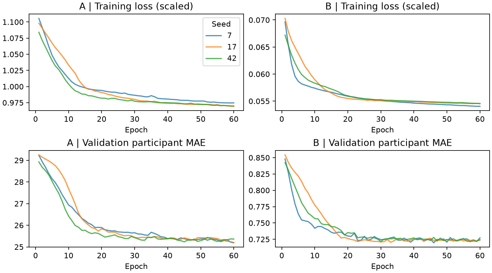
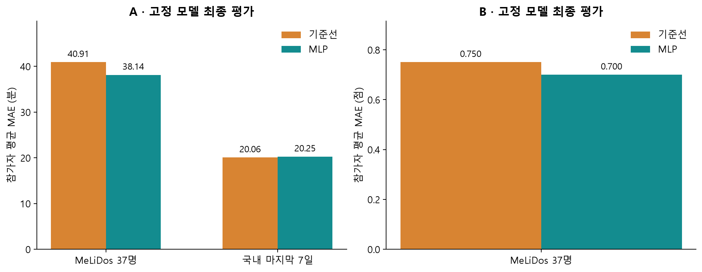
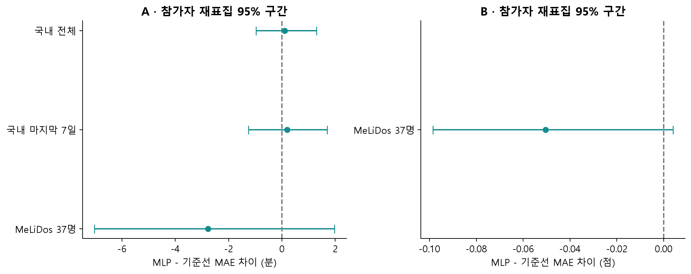
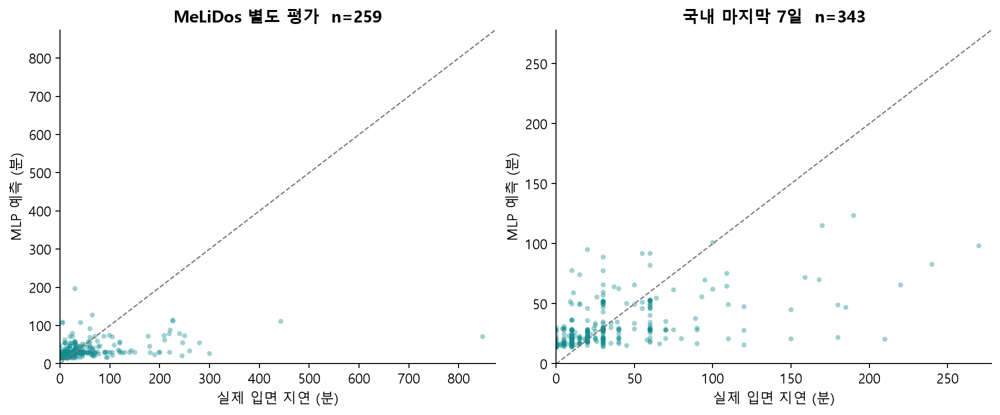
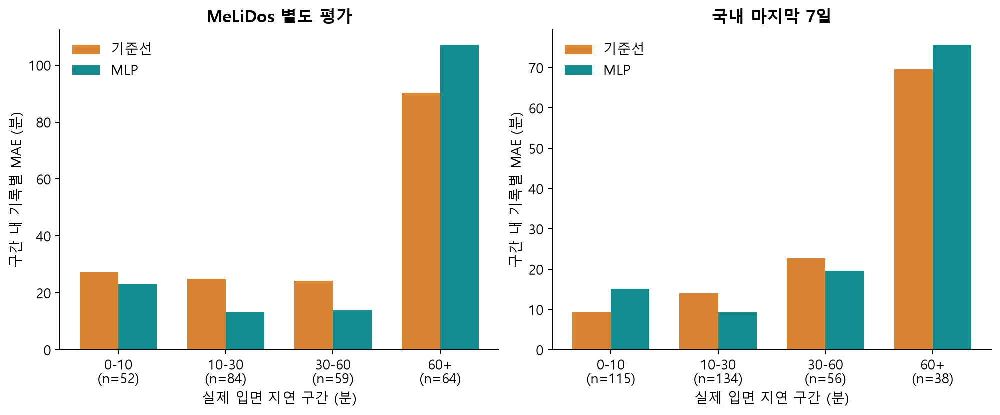
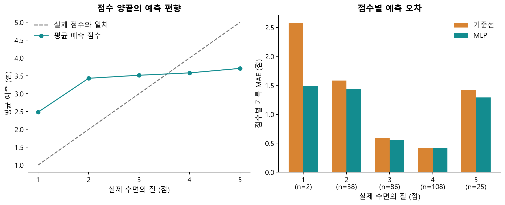
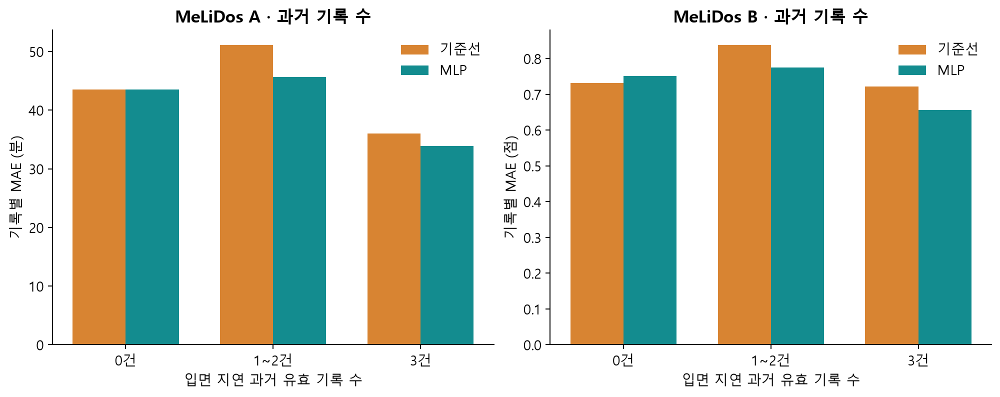
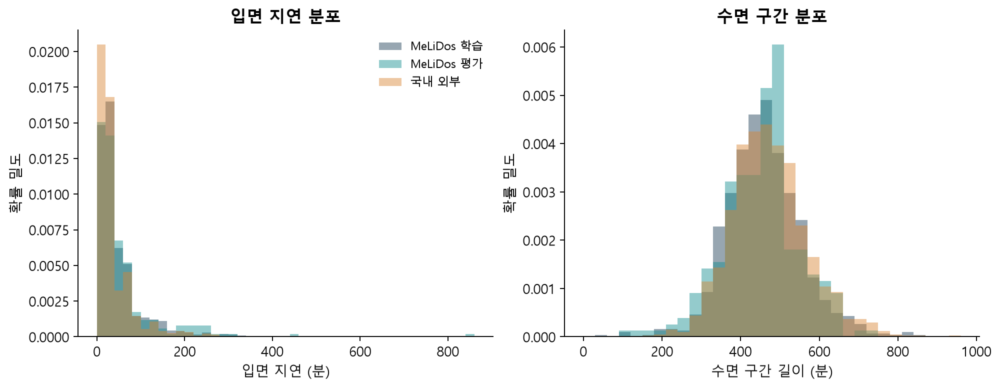
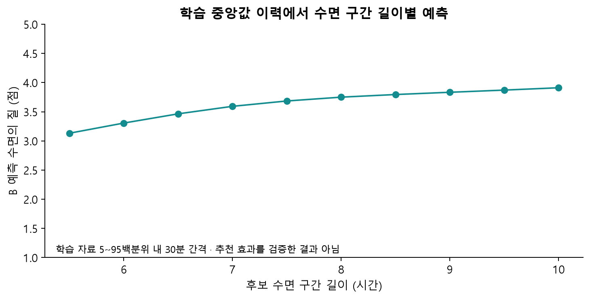

# 수면일지로 예측하는 입면 지연과 수면의 질

과거 수면 기록을 이용한 두 회귀 모델의 구현과 외부 평가

AI+X Deep Learning Final Project · Option A · 2026년 11월 18일

프로젝트의 데이터, 모델 설계, 검증과 오차 분석을 한 문서에 정리했다. 원래 통합 원고의 설명과 결과를 보존하고 저장소 경로를 맞췄다. 팀원 정보와 편집 중인 목차는 [README](README.md), 파일별 짧은 설명과 실행 방법은 [실행 환경](실행환경/README.md)에서 확인할 수 있다. 팀원별 실제 기여와 설명 영상은 확정 후 추가하며, 이 문서는 최종 제출 PDF가 아니다.

## 목차

구성도: [프로젝트 전체 흐름](그림/프로젝트_흐름.md) · [데이터 분할](그림/데이터_분할.md) · [모델 구조](그림/모델_구조.md)

1. 프로젝트 제안과 문제 정의
2. 수면일지 데이터와 변수
3. Train·Validation·Test 분할
4. 모델 예측과 취침 시각 계산
5. 모델 탐색
6. 모델 생성과 학습
7. 참가자 단위 Validation
8. 고정 모델의 Test 평가
9. 모델 평가와 오차 분석
10. 결론과 한계

## 1. 프로젝트 제안과 문제 정의

### 같은 기상 시각에도 취침 준비는 달라진다

오전 8시에 일어나야 하고 7시간 30분의 수면 구간을 확보하려는 상황을 생각해 보자. 침대에 들어가자마자 잠드는 사람과 잠들기까지 30분이 걸리는 사람에게 같은 취침 시각을 제시하면, 입면부터 기상까지의 구간은 달라질 수 있다. 이 프로젝트는 과거 수면일지가 이러한 차이를 예측하는 데 얼마나 도움이 되는지 살펴본다.

우리가 검증하는 질문은 두 가지다. 첫째, 한 사람의 최근 수면 이력으로 다음 기록의 입면 지연을 예측할 수 있는가? 둘째, 과거 이력과 수면 구간 길이를 함께 사용하면 주관적 수면의 질을 예측하는 데 도움이 되는가? 이 두 예측을 취침 시각 후보 계산의 구성 요소로 사용하는 방안도 설명한다.

### 예측 문제와 검증 범위

| 구분 | 모델 A | 모델 B |
|---|---|---|
| 예측 대상 | 침대에 들어간 뒤 잠들기까지의 시간 | 주관적 수면의 질 |
| 정답 | 입면 지연, 분 | 설문 점수, 1~5점 |
| 문제 유형 | 비음수 연속값 회귀 | 범위를 제한한 점수 회귀 |
| 핵심 질문 | 개인의 최근 중앙값보다 잘 예측하는가? | 학습 데이터 평균 점수보다 잘 예측하는가? |

최종 목표는 예측 성능과 실패 조건을 확인하는 것이다. 취침 시각을 실제로 바꾸는 실험은 수행하지 않았으므로, 이 연구에서 추천의 효과나 개인에게 가장 좋은 수면 시간을 확정하지 않는다. 질병 진단이나 치료를 목적으로 한 모델도 아니다.

## 2. 수면일지 데이터와 변수

### 여러 사람의 반복 기록을 사용했다

팀이 제공한 공개 수면일지 패키지는 MeLiDos 9개 지역 자료와 국내 49명의 4주 일지로 구성된다. MeLiDos에서 분할에 사용한 참가자는 184명이며, 학습 147명과 별도 평가 37명으로 나뉜다. 같은 사람의 여러 밤이 반복해서 등장하기 때문에 행 수와 참가자 수를 함께 표시한다.

| 자료 | 참가자 | 전체 기록 | A 유효 정답 | B 유효 입력·정답 |
|---|---:|---:|---:|---:|
| MeLiDos Train | 147명 | 1,020건 | 1,007건 | 1,001건 |
| MeLiDos 별도 평가 | 37명 | 262건 | 259건 | 259건 |
| 국내 외부 평가 | 49명 | 1,372건 | 1,372건 | 0건 |

여기서 B의 유효 건수는 수면의 질 정답과 그날의 수면 구간 길이가 모두 존재하는 건수다. 정답만 있는 행 수와 다를 수 있다. 입력 이력의 결측은 아래의 학습 전처리에서 대체하지만 정답을 만들어 채우지는 않는다.

재검산 결과 MeLiDos Train은 사람당 기록 수 중앙값 7건, 범위 2~9건이고, 날짜의 처음과 끝을 포함한 관찰 기간 중앙값은 7일, 범위 4~11일이다. 별도 평가 참가자는 6~9건이며 중앙값은 7건이다. 국내 자료는 모든 참가자가 28일 동안 28건을 기록했다. 따라서 이 자료를 개인의 수개월·수년 변화까지 관찰한 장기 추적으로 설명하지 않는다. 개인별 관측 기간은 `실험결과/상세분석/followup_by_participant.csv`에 있다.

### 시간의 시작점과 단위를 통일했다

입면 지연은 침대에 들어간 시점부터 잠든 시점까지의 시간이다. MeLiDos에서는 침대에 들어간 시각부터 잠을 청한 시각까지의 차이에 설문상 입면 지연을 더했다. 국내 자료는 취침·입면 시각 차이를 자정을 고려해 계산했다. 국내 원본의 `sleep_latency`와 `sleep_duration`은 저장값이 시간 단위여서 60을 곱해 분 단위와 대조했다.

수면 구간 길이는 잠든 시점부터 최종 기상까지의 시간이다. 이 구간에는 밤중에 깨어 있던 시간도 포함된다. 따라서 각성 시간을 제외한 순수 수면 시간이나 수면 효율과 같은 값으로 해석하면 안 된다. 날짜는 밤이 끝난 아침 기준으로 정렬한다. 국내의 아침 날짜는 설문 작성일을 사용하는 원자료 가정을 유지했다.

### 모델 입력과 분석용 정보를 분리했다

| 열 이름 | 의미 | 사용 |
|---|---|---|
| `past3_latency_median_min` | 현재 밤 이전 최대 3개 유효 입면 지연의 중앙값 | A·B 입력 |
| `past3_latency_n` | 위 중앙값에 사용한 기록 수, 0~3 | A·B 입력 |
| `prev_sleep_interval_min` | 바로 앞 기록의 수면 구간 길이 | A·B 입력 |
| `past3_sleep_interval_median_min` | 현재 밤 이전 최대 3개 유효 수면 구간 길이의 중앙값 | A·B 입력 |
| `past3_sleep_interval_n` | 위 중앙값에 사용한 기록 수, 0~3 | A·B 입력 |
| `sleep_interval_min` | 관찰된 그날의 수면 구간 길이, 추천 설계에서는 후보 길이 | B의 추가 입력 |
| `bed_to_sleep_min` | 현재 밤의 실제 입면 지연 | A 정답 |
| `sleep_quality` | 현재 밤의 주관적 수면의 질, 1~5 | B 정답 |
| `participant_id`, `site_code`, `night_date` | 참가자·지역·날짜 | 분할·집계·추적 |
| `source_file`, `source_record_number` | 원본 파일과 응답 위치 | 원자료 대조 |
| `is_korea_final7` | 국내 참가자별 마지막 7일 표시 | 외부 평가 구간 선택 |

과거 3개 유효 기록은 연속 3일과 다를 수 있다. 직전 수면 구간도 바로 전날이 아니라 바로 앞 기록을 의미한다. 바로 앞 기록의 구간이 비어 있으면 결측으로 남긴다. 해당 밤의 정답은 이력을 계산한 뒤에만 다음 기록의 이력에 추가한다.

현재 구현에는 요일, 취침 시각, 참가자 ID, A의 현재 밤 예측값이 B의 입력으로 들어가지 않는다. 초기에 작성된 팀 패키지 설명과 달라진 부분이며, 본문은 실행된 `prepare.py`와 `evaluate.py`에 맞췄다.

## 3. Train·Validation·Test 분할

### 같은 사람을 학습과 평가에 나누어 넣지 않았다

한 사람의 일지를 행 단위로 섞으면 같은 사람의 기록이 학습과 평가 양쪽에 들어갈 수 있다. 팀 패키지는 MeLiDos 참가자를 지역별로 약 80:20으로 나누었고, 현재 모델은 그 참가자 배정을 유지한다. 학습 참가자 147명과 별도 평가 참가자 37명은 겹치지 않는다. 국내 49명은 별도의 외부 평가 집단이다.

| 단계 | 데이터 | 역할 |
|---|---|---|
| Train 내부 학습 | MeLiDos 147명의 5-fold 중 4개 fold | 가중치·전처리 통계 학습 |
| Validation | 같은 147명 중 남은 1개 fold, 5회 반복 | 알고리즘·설정 선택 |
| 최종 재학습 | MeLiDos Train 147명 전체의 유효 행 | 선택한 설정으로 최종 모델 생성 |
| MeLiDos 별도 평가 | `test_melidos.csv`의 37명 (기존 별도 평가 분할) | 선택 완료 후 분리 참가자 성능 확인 |
| 외부 Test | 국내 49명 | A의 외부 자료 성능 확인 |

37명 파일은 이름에 validation이 있지만 현재 코드에서는 설정 선택 이후 평가에만 읽는다. 다만 이 코드를 실행하기 전 팀이 해당 37명의 결과를 모델 선택에 사용했는지는 자료만으로 확인할 수 없다. 이들이 이전 선택에도 사용되지 않았다는 전제가 확인될 때에만 독립적인 최종 Test로 표현할 수 있다. 확인 전에는 본문처럼 'MeLiDos 별도 평가'로 표시한다.

국내 마지막 7일 343건을 주 외부 평가로 사용한다. 앞선 기록과 평가 기간 중 이전 날짜의 실제 일지를 이용해 다음 날짜의 입력을 갱신하는 순차적 사용 조건이다. 국내 자료로 모델 가중치를 학습하는 것은 아니며, 7일 전체를 과거 관측 없이 한 번에 예측하는 조건도 아니다. 전체 1,372건 결과는 보조 평가이고 마지막 7일과 중복되므로 두 개의 독립 실험처럼 세지 않는다.

## 4. 모델 예측과 취침 시각 계산

### 두 모델은 독립적으로 학습한다

A는 이력 5개를 받아 예상 입면 지연을 출력한다. B는 같은 이력 5개와 수면 구간 길이 1개를 받아 1~5점의 예상 수면의 질을 출력한다. A의 예측값을 B에 전달하는 연결 학습은 사용하지 않는다. 따라서 연결용 OOF 예측 생성 단계도 현재 구현에는 없다.

B의 학습·오프라인 평가에는 관찰된 그날의 수면 구간 길이를 넣는다. 실제 취침 전에는 이 값을 모르므로 추천 기능에서는 비교하려는 후보 길이를 넣도록 설계한다. 관찰값에서의 예측 성능과 후보를 변경했을 때의 실제 결과는 서로 다른 검증 대상이다.

### 목표 기상 시각으로 취침 후보를 계산한다

계산식은 다음과 같다.

`추천 취침 시각 = 목표 기상 시각 - 후보 수면 구간 길이 - A의 예상 입면 지연`

예를 들어 목표 기상이 08:00이고, 후보 수면 구간이 7시간 30분이며, 예상 입면 지연이 10분이면 취침 후보는 00:20이다. 이 수치는 계산 설명을 위한 예시이며 실제 모델 예측이나 추천의 효과를 나타내지 않는다. 날짜가 전날로 넘어가는 경우도 함께 처리해야 한다.

추천 기능을 확장한다면 학습 자료에서 충분히 관찰된 구간 안의 후보를 30분 간격으로 만들고, B의 예상 점수로 정렬하는 방식을 사용할 수 있다. 이미 지난 시각과 근거가 부족한 후보를 제외하고, 유효 후보만 제시한다. 현재 전달물에서 실제 성능을 검증한 대상은 A·B 회귀 모델이며, 개인의 최적 취침 시각을 확정하는 추천 실험은 수행하지 않았다.

## 5. 모델 탐색

### 복잡한 모델이 단순한 개인 이력보다 나은지 비교했다

| 후보 | 역할 |
|---|---|
| 기준선 | A는 개인의 이전 입면 지연 중앙값, 이력이 없으면 학습 중앙값. B는 학습 평균 점수 |
| Ridge Regression | 규제를 둔 선형 관계의 비교군 |
| Random Forest | 비선형 관계와 변수 조합을 학습하는 트리 비교군 |
| Gradient Boosting | 앞선 예측 오차를 보완하는 부스팅 비교군 |
| 작은 MLP | 소수의 요약 입력으로 비선형 함수를 학습하는 딥러닝 후보 |
| XGBoost | 최초 평가 이후 추가한 부스팅 비교군, 사후 분석으로 별도 구분 |

표 형태 데이터에서 신경망이 항상 우수하다고 가정하지 않았다. Grinsztajn 등의 연구도 표 형태 자료에서 트리 모델과 딥러닝을 함께 비교할 근거를 제공한다. 이 문헌의 결과가 본 수면 데이터에서 특정 모델의 우승을 보장하는 것은 아니다. [논문 원문](https://arxiv.org/abs/2207.08815)

현재 입력은 날짜별 원시 시퀀스가 아니라 과거 이력의 요약값이다. 이 구현에서는 LSTM·GRU·Transformer를 사용하지 않았다. 초기 계획의 XGBoost는 최초 실행에서 Gradient Boosting으로 대체되었고, 이후 별도 스크립트로 XGBoost 비교를 추가했다.

| 모델 | 실제 탐색 설정 |
|---|---|
| Ridge | alpha 0.1, 1, 10, 100 |
| Random Forest | 최대 깊이 3, 6; 최소 잎 표본 수 5, 15; 트리 300개 |
| Gradient Boosting | 최대 깊이 1, 2; 트리 수 60, 150 |
| MLP | 첫 은닉층 폭 16, 32; 학습 epoch 60, 160 |

각 모델은 동일한 참가자 fold와 같은 과제의 유효 평가 행을 사용했다. A와 B의 정답 단위가 다르므로 두 모델의 MAE 숫자를 직접 비교하지 않는다.

## 6. 모델 생성과 학습

### 실제 선택한 MLP

입력 뒤에 16개 노드의 은닉층, ReLU, Dropout 0.1, 8개 노드의 은닉층, ReLU, 출력층을 둔다. A의 입력은 5개, B의 입력은 6개다.

| 설정 | A | B |
|---|---|---|
| 은닉층 | 16, 8 | 16, 8 |
| 출력 | Softplus 결과 × 30 | 1 + 4 × sigmoid 결과 |
| 출력 범위 | 0 이상, 분 단위 | 1~5 범위 점수 |
| 학습 정답 변환 | 입면 지연 ÷ 30 | (수면의 질 - 1) ÷ 4 |
| 손실 함수 | L1Loss, 절대 오차 | MSELoss, 제곱 오차 |
| Optimizer | Adam | Adam |
| 학습률 / weight decay | 0.001 / 0.0001 | 0.001 / 0.0001 |
| Batch / epoch | 32 / 60 | 32 / 60 |
| 난수 시드 | 42, 7, 17 | 42, 7, 17 |
| 최종 예측 | 세 모델 예측 평균 | 세 모델 예측 평균 |

ReLU는 비선형 관계를 표현하는 활성화 함수이고, Dropout은 학습 중 일부 값을 확률적으로 0으로 만들어 특정 경로에 의존하는 것을 줄이려는 설정이다. 평가 시에는 Dropout을 끈다. [PyTorch 2.7 Dropout 문서](https://docs.pytorch.org/docs/2.7/generated/torch.nn.Dropout.html)

### 전처리도 학습 데이터 안에서 적합했다

입력 결측은 해당 학습 부분의 열별 중앙값으로 대체한다. Ridge와 MLP는 이어서 표준화하고, 트리 모델은 입력 표준화 없이 결측 대체를 사용한다. 각 fold의 검증 행에는 학습 부분에서 구한 동일한 변환만 적용한다. 최종 모델에는 Train 전체에서 적합한 변환을 함께 저장했다.

초기 계획서에는 최대 200 epoch와 early stopping 제안이 있었지만, 실제 코드는 60·160 epoch 중 교차검증 점수가 좋은 설정을 선택한다. 별도의 early stopping이나 최적 epoch checkpoint 복원은 구현하지 않았다. 최종 60 epoch 학습을 이 방식 그대로 설명한다.

학습 곡선은 첫 fold에서의 동작 점검 자료다. 모든 fold에서 같은 일반화 양상을 보인다는 증거는 아니며, epoch를 바꾸어 Test 점수를 높이는 데 사용하지 않는다. 가중치와 전처리는 `모델/최종/model_A_selected.joblib`, `모델/최종/model_B_selected.joblib`에 저장되어 있다.

## 7. 참가자 단위 Validation

### Train 내부의 5-fold로 설정을 선택했다

기존 참가자별 그룹 배정을 재사용하여 Train 참가자 147명을 5개 fold로 나눈다. 배정은 `실험결과/교차검증/cv_groups.csv`와 `데이터/분할/split_info.json`에 저장되어 있다. 매 회차 한 참가자의 모든 행은 학습 또는 검증 중 한쪽에만 둔다. 4개 fold로 학습하고 남은 fold를 예측한 결과를 모아 모델을 비교한다. 이 분할은 새로운 참가자에 대한 예측을 확인하려는 목적이다. [scikit-learn 1.7 GroupKFold 문서](https://scikit-learn.org/1.7/modules/generated/sklearn.model_selection.GroupKFold.html)

주 지표는 참가자별 MAE의 평균이다. 참가자 p의 기록 수를 n_p라고 하면, 먼저 그 사람의 절대 오차 평균을 구하고, 이후 P명의 평균을 계산한다. 일지가 많은 사람이 결과를 지배하지 않게 하려는 선택이다.

`MAE_p = mean(|예측값 - 실제값|), macro MAE = mean(MAE_p)`

모든 행을 한 번에 평균한 전체 MAE와는 가중 방식이 다르다. 두 값을 구분해 저장했다. MAE의 기본 정의는 절대 예측 오차의 평균이다. [scikit-learn MAE 문서](https://scikit-learn.org/1.7/modules/generated/sklearn.metrics.mean_absolute_error.html)

| 후보 | A 참가자 평균 MAE, 분 | B 참가자 평균 MAE, 점 |
|---|---:|---:|
| 기준선 | 31.71 | 0.822 |
| Ridge | 32.43 | 0.785 |
| Random Forest | 31.79 | 0.779 |
| Gradient Boosting | 29.26 | 0.783 |
| MLP | 29.07 | 0.778 |

A·B 모두 MLP의 주 지표가 가장 낮아 이 설정을 선택했다. B의 MLP와 Random Forest 차이는 0.001점보다 작으므로, 신경망이 뚜렷하게 우수하다고 강조하지 않는다. 위 표는 각 모델의 가장 좋은 설정 점수이며, 모델·설정 선택에 사용한 결과다. 선택의 낙관성을 줄이기 위해 이후 별도 평가 결과를 함께 확인한다.

선택 MLP의 5개 fold MAE를 동일 가중치로 요약하면 A는 평균 29.04분, 표본 표준편차 6.61분이고 B는 평균 0.778점, 표준편차 0.050점이다. 주 표의 값은 모든 OOF 예측을 모아 참가자별로 평균한 값이어서 fold 단순 평균과 조금 다르다. A는 fold 간 변동이 적지 않다. 세 난수 시드 평균을 사용했지만 독립적으로 반복한 여러 교차검증의 안정성까지 측정한 것은 아니다.

### B의 수면 구간 변수를 같은 알고리즘에서 비교했다

동일한 행과 참가자 fold에서 MLP 입력을 비교하면, 수면 구간을 포함한 6개 입력의 교차검증 MAE는 0.778065점, 제외한 5개 입력은 0.822679점이었다. 두 구성에서 각각 설정을 탐색했으며 선택된 설정은 모두 첫 은닉층 폭 16, 60 epoch로 같았다. 수면 구간 정보가 점수 예측에 도움이 될 가능성을 보여주지만, 구간을 늘리면 실제 수면의 질이 좋아진다는 인과적 결론은 아니다. 초기 계획의 A 수면 구간 이력 제외 실험은 동봉된 결과에 없어 수행한 것으로 표시하지 않는다.

## 8. 고정 모델의 Test 평가

### 선택을 마친 모델로 별도 참가자와 국내 자료를 예측했다

모델 종류·입력·epoch를 고정하고 MeLiDos Train 전체로 다시 학습한 뒤 평가했다. 정답이 없는 행은 해당 과제의 지표 계산에서 제외한다. 국내에서는 B의 점수를 대신할 정답이 없으므로 A만 평가한다. 수면 효율을 주관적 수면의 질 라벨로 바꾸어 쓰지 않았다.

| 모델·자료 | 인원 / 유효 기록 | MLP 참가자 평균 MAE | 기준선 참가자 평균 MAE |
|---|---:|---:|---:|
| A · MeLiDos 별도 평가 | 37 / 259 | 38.14분 | 40.91분 |
| A · 국내 마지막 7일 | 49 / 343 | 20.25분 | 20.06분 |
| A · 국내 전체, 보조 | 49 / 1,372 | 21.31분 | 21.21분 |
| B · MeLiDos 별도 평가 | 37 / 259 | 0.700점 | 0.750점 |

이 표의 MAE는 참가자 평균값이다. 아래의 RMSE·평균 편향·허용 오차 비율은 행 단위로 계산한다. A와 B는 단위가 달라 같은 축에 섞지 않는다. 국내 343건은 마지막 7일의 결과이고, 1,372건에는 그 343건도 포함된다.

### 추가 트리 비교는 탐색적 결과로 남겼다

XGBoost 추가 비교에서는 A의 MeLiDos MAE가 37.89분, Random Forest의 B MAE는 0.692점이었다. 각각 기존 MLP보다 약 0.24분과 0.008점 낮지만 같은 평가 자료를 다시 사용한 사후 비교다. 이 차이로 최종 모델을 교체하거나 독립 Test에서 우승했다고 주장하지 않는다. 트리 모델의 설정 탐색은 Train fold에서 했더라도, 이 평가 자료를 여러 번 관찰했다는 점은 남는다.

## 9. 모델 평가와 오차 분석

### 9.1 저장 결과를 먼저 다시 검산했다

이번 인수인계를 위해 동봉된 원본 선택 레코드에서 전처리 데이터를 다시 만들고 저장 CSV와 대조했다. 세 분할의 참가자 중복은 0명이고, 날짜가 있는 모든 행의 이력은 현재 날짜보다 앞선 기록만 사용했다. 저장된 주 평가 13행과 추가 트리 평가 8행의 지표를 예측값에서 재계산했으며 기존 수치와 일치했다. 참가자 bootstrap 10,000회의 주 비교 구간도 다시 계산해 확인했다.

저장된 MLP의 결측 대체·표준화와 가중치를 불러와 NumPy 순전파로 A·B의 예측을 독립적으로 검증했다. 총 8개 모델·평가 자료 비교에서 기존 예측과 일치했고, 최대 절대 차이는 A에서 약 0.0000153분, B에서 약 0.000000477점이었다. 데이터·예측·지표에 대한 검증 항목이 모두 통과했다. 이는 저장 가중치의 추론과 전처리를 검증한 결과다. 이번 환경에서는 원래 PyTorch 전체 재학습과 `verify.py` 자체를 실행하지 않았으므로, 학습 전체를 새로 재현했다고 표현하지 않는다.

### 9.2 지표를 함께 보면 개선의 한계가 보인다

| 자료·모델 | 참가자 MAE | 기록별 RMSE | 평균 편향 | 허용 오차 이내 비율 |
|---|---:|---:|---:|---:|
| A MeLiDos · 기준선 | 40.91분 | 79.36분 | -6.87분 | 33.6% |
| A MeLiDos · MLP | 38.14분 | 78.51분 | -19.54분 | 30.9% |
| A 국내 마지막 7일 · 기준선 | 20.06분 | 36.17분 | -2.28분 | 60.6% |
| A 국내 마지막 7일 · MLP | 20.25분 | 34.09분 | -3.59분 | 40.5% |
| B MeLiDos · 기준선 | 0.750점 | 0.894점 | +0.136점 | 74.9% |
| B MeLiDos · MLP | 0.700점 | 0.849점 | +0.094점 | 76.1% |

편향은 예측에서 실제값을 뺀 평균이다. 음수이면 평균적으로 짧게 또는 낮게 예측했다는 뜻이다. 허용 오차는 A에서 절대 오차 10분 이내, B에서 1점 이내로 설정한 분석 기준이며 임상적 유효성 기준으로 정한 것은 아니다.

국내 A는 RMSE가 줄었지만 MAE가 조금 커졌고 10분 이내 비율은 크게 낮아졌다. 일부 큰 오차 감소와 작은 오차 구간의 정확도가 서로 다를 수 있다. 따라서 RMSE 하나만 골라 성능이 좋아졌다고 결론 내릴 수 없다. MeLiDos A에서도 MLP의 MAE는 낮아졌으나 10분 이내 비율은 기준선보다 낮고 평균 과소예측은 더 컸다.

### 9.3 기준선 대비 차이에는 불확실성이 남는다

같은 참가자에서 MLP와 기준선의 MAE 차이를 구하고, 참가자를 짝지어 10,000회 재표집했다. 같은 사람의 일지를 서로 독립적인 표본처럼 재표집하지 않았다. 아래의 차이는 MLP에서 기준선을 뺀 값으로, 음수이면 MLP의 오차가 작다.

| 평가 | MAE 차이 | 참가자 재표집 95% 구간 |
|---|---:|---|
| A · MeLiDos | -2.78분 | -7.03 ~ +1.97분 |
| A · 국내 마지막 7일 | +0.19분 | -1.26 ~ +1.69분 |
| A · 국내 전체, 보조 | +0.10분 | -0.97 ~ +1.30분 |
| B · MeLiDos | -0.050점 | -0.098 ~ +0.004점 |

모든 주 비교 구간에 0이 포함되므로, 이 표본에서 기준선보다 확실하게 우월하다는 근거는 충분하지 않다. 반대로 두 방법의 성능이 같다고 증명한 것도 아니다. 이 구간은 현재 참가자 표본에서 얻은 차이의 불확실성을 요약하며, 모델 선택 과정이나 다른 모집 집단의 차이까지 모두 반영하지 않는다. 여러 비교에 대한 보정은 하지 않았다.

### 9.4 A는 긴 입면 지연을 충분히 따라가지 못한다

MeLiDos 별도 평가에서 실제 입면 지연이 60분을 넘은 64건의 실제 평균은 150.64분이지만 MLP 예측 평균은 45.60분이었다. 이 구간의 기록별 MAE는 107.05분이다. 국내 마지막 7일의 같은 구간 38건도 실제 평균 124.39분에 대해 예측 평균은 48.84분이었다. 긴 입면 지연에서 예측이 충분히 커지지 않는 경향을 확인할 수 있다.

| 실제 입면 지연 | MeLiDos 건수 | MeLiDos 기준선 / MLP MAE | 국내 마지막 7일 건수 | 국내 기준선 / MLP MAE |
|---|---:|---|---:|---|
| 0~10분 | 52 | 27.45 / 23.18분 | 115 | 9.43 / 15.09분 |
| 10분 초과~30분 | 84 | 24.86 / 13.40분 | 134 | 14.04 / 9.25분 |
| 30분 초과~60분 | 59 | 24.19 / 13.92분 | 56 | 22.70 / 19.59분 |
| 60분 초과 | 64 | 90.23 / 107.05분 | 38 | 69.53 / 75.61분 |

이 표는 구간 안의 기록별 MAE다. 주 평가표의 참가자 평균 MAE와 가중 방식이 다르다. 구간 경계는 오차를 설명하기 위해 정한 사후 분석 구간이며 임상적 분류가 아니다. 한 참가자가 여러 구간에 등장할 수 있다.

짧은 입면 지연도 살펴볼 필요가 있다. 국내 0~10분 115건에서 MLP는 평균 20.97분을 예측했고 기록 MAE는 15.09분으로 기준선 9.43분보다 컸다. 이는 국내의 10분 이내 적중 비율이 낮아진 현상과 일관된다. 요약 입력만으로 그날의 매우 짧거나 매우 긴 입면 지연을 구별하기 어렵다는 해석이 가능하지만, 원인을 특정 변수나 알고리즘 하나로 단정할 수는 없다.

### 9.5 B는 낮은 점수와 높은 점수를 중간으로 모은다

| 실제 수면의 질 | 기록 수 | MLP 평균 예측 | MLP 기록별 MAE |
|---|---:|---:|---:|
| 1점 | 2 | 2.483점 | 1.483점 |
| 2점 | 38 | 3.431점 | 1.431점 |
| 3점 | 86 | 3.516점 | 0.553점 |
| 4점 | 108 | 3.582점 | 0.418점 |
| 5점 | 25 | 3.708점 | 1.292점 |

전체 259건 중 3·4점이 194건이다. MLP는 이 중간 점수에서 상대적으로 작은 오차를 보이지만 2점·5점은 잘 구분하지 못했다. 전체 MAE 0.700점이 모든 점수에서 그만큼 정확하다는 뜻은 아니다. 1점은 2명 각 1건에 불과해 일반화할 수 없다. 1~5점의 순서형 점수를 등간격 연속값으로 근사한 회귀 방식과 점수별 표본 불균형도 한계로 남는다.

### 9.6 과거 기록 수와 데이터 집단도 함께 확인했다

이력 수는 `past3_latency_n`을 기준으로 나누었다. MeLiDos B에서 과거 기록이 0개인 37건의 MLP 기록 MAE는 0.751점, 3개인 148건은 0.656점이었다. 국내 A는 이력 0개인 첫 기록 49건에서 MLP 26.07분과 기준선 26.08분으로 거의 같았다. 그러나 이력 수에 따라 관측 날짜와 실제 정답 분포도 달라지므로, 이 차이만으로 기록을 더 수집했을 때의 인과적 개선을 입증하지는 못한다. 국내 마지막 7일은 모두 3개 이력을 사용할 수 있는 행이다.

MeLiDos Train의 입면 지연 중앙값은 30분, 별도 평가도 30분인 반면 국내 전체는 20분이었다. 평균도 각각 46.88분, 56.08분, 33.82분으로 달랐다. 국내의 절대 오차가 작다는 사실만으로 더 잘 일반화했다고 결론 내리기 어렵다. 실제값 분포와 관측 조건이 다른 자료이기 때문이다.

지역별 오차도 `실험결과/상세분석/site_errors.csv`와 `그림/05_site_errors.png`로 남겼다. 일부 지역은 평가 참가자가 2~3명뿐이다. 지역별 점수 차이를 국적·생활양식의 영향으로 해석하거나 안정적인 순위로 제시하지 않는다. 상세 참가자별 오차도 별도 CSV로 보존했다.

### 9.7 B의 후보 길이 반응은 추천 효과와 구분한다

학습 자료의 각 이력 변수 중앙값으로 구성한 가상 입력을 고정하고, 학습 수면 구간의 5~95백분위 범위 안에서 30분 간격의 후보를 넣었다. 이 입력은 실제 특정 참가자의 기록이 아니다. 후보 5.5시간에서 B 예측은 약 3.13점, 10시간에서 약 3.91점이었다.

이 한 조건에서는 후보가 길수록 예측 점수가 높아졌다. 점수 최대화만으로 추천하면 허용한 범위의 긴 쪽 끝을 택할 수 있다는 한계를 보여준다. 후보 범위 제한만으로 실제 개인 최적점을 찾았다고 할 수 없으며, 실제 취침 시각·수면 길이를 바꾸는 실험과 실현 가능성 검증이 필요하다. 이 곡선으로 후보 범위나 모델을 Test에 맞추어 조정하지 않았다.

## 10. 결론과 한계

### 무엇을 확인했는가

공개 수면일지를 공통 단위로 정리하고, 과거 이력으로 입면 지연을 예측하는 A와 과거 이력·수면 구간으로 주관적 수면의 질을 예측하는 B를 구현했다. 참가자 단위 분할, fold 안에서의 전처리, 기준선 비교를 적용했고, 저장 모델의 예측과 평가 지표를 다시 검증했다.

MeLiDos 별도 평가에서 MLP의 참가자 평균 MAE는 A 38.14분, B 0.700점으로 기준선보다 낮았다. 그러나 두 비교 모두 차이의 95% 재표집 구간에 0이 포함되었다. 국내 마지막 7일 A의 MAE는 20.25분으로 기준선 20.06분보다 낮지 않았고, 10분 이내 비율도 기준선보다 낮았다. 따라서 현재 자료에서 복잡한 모델의 일관된 추가 이득을 확인했다고 결론 내릴 수 없다.

오차를 나누어 보면 실패 조건이 분명해진다. A는 실제 입면 지연이 긴 밤을 크게 짧게 예측하며, 국내의 매우 짧은 입면 지연에는 길게 예측하는 경향이 있다. B는 낮은 점수와 높은 점수를 3~4점 쪽으로 모아 예측한다. 전체 평균만으로 설명하기 어려운 부분을 구간별 분석으로 확인했다는 점이 이번 평가의 핵심이다.

### 해석의 한계

| 한계 | 이번 결과에 미치는 의미 |
|---|---|
| 짧은 반복 관찰 | MeLiDos는 주로 약 일주일, 국내는 4주여서 장기간의 개인 변화·계절 변화를 검증하지 못함 |
| 참가자·집단 차이 | 같은 데이터셋 안에서도 참가자와 지역별 차이가 있고 외부 자료의 분포도 달라 일반화에 제한 |
| 자기보고와 시간 정의 | 원자료의 자기보고 오차, 국내 날짜 가정, 입면 지연의 시작점, 긴 관측값의 영향을 완전히 제거하지 못함 |
| 입력 정보 제한 | 소수의 최근 요약값으로 당일의 극단적인 변동을 구별하기 어려움. 특정 원인은 본 실험으로 확정할 수 없음 |
| 학습·검증 범위 | 같은 Train 안의 설정 탐색 점수는 낙관적일 수 있고, 반복 CV·A 이력 변수 제외 실험까지 완료한 것은 아님 |
| 별도 평가의 사용 이력 | 37명의 과거 모델 선택 사용 여부는 팀 확인이 필요하고, 추가 트리 비교는 평가 자료를 재사용함 |
| B 정답과 척도 | 국내 B 라벨 없음. 1~5점의 간격을 같다고 근사했고 1점 등 작은 집단의 오차 추정이 불안정함 |
| 추천 효과 미검증 | 관찰된 수면 구간에서 B를 평가했으며 추천을 따를 때의 개선·개인 최적 수면 시간은 확인하지 못함 |

현재 결과는 수면일지 예측 모델의 가능성과 실패 조건을 설명하는 연구 결과로 제시한다. 실제 생활에서 최적 취침 시각을 정확하게 처방하는 완성된 서비스로 표현하지 않는다.

### 다음 단계의 연구 설계

새로운 참가자와 더 긴 반복 기록을 수집하고, 수면 일지의 실제 사용 시점을 확인해 취침 전 얻을 수 있는 정보를 추가하는 것이 후속 과제다. 개인별 보정이나 다른 손실 함수를 검토한다면 현재 Test를 반복해서 선택에 쓰지 않고 Train 내부 검증 또는 새로운 평가 집단을 사용한다. 추천 효과를 확인하려면 실제 후보를 적용하는 사전 계획된 사용자 평가가 필요하다.

### 본문 수치의 출처

데이터·모델 설정은 `코드/prepare.py`, `코드/evaluate.py`, `코드/mlp.py`, `데이터/전처리/summary.json`, `실험결과/교차검증/selection.json`을 기준으로 했다. 최초 교차검증·평가 수치는 `실험결과/교차검증/cv_summary.csv`, `실험결과/테스트/holdout_metrics.csv`, `실험결과/테스트/holdout_predictions.csv`, `실험결과/테스트/paired_intervals.csv`에 있다. 추가 트리 비교는 `실험결과/추가트리비교/`에 분리되어 있다. 이번 인수인계용 검증과 새 오차 분석은 `실험결과/상세분석/`에 기록했다.

원자료 공개 저장소 목록은 [데이터 출처](데이터/출처.md)에 보존했다. 알고리즘 설명에 사용한 공식 문서와 논문 링크는 해당 문단에 붙였다. 팀원이 실제로 사용한 자료는 최종 참고자료에 추가한다.

## 자료 바로가기

| 확인할 내용 | 위치 |
| --- | --- |
| 원본·분할·모델 입력 데이터 | [데이터](데이터/README.md) |
| 학습·검증·예측 코드 | [코드](코드/README.md) |
| 최종 A·B 모델 | [학습 완료 모델](모델/README.md) |
| 성능표와 기록별 예측 | [실험 결과](실험결과/README.md) |
| 그래프 원본 | [그림](그림/README.md) |
| 가상 입력으로 실행하는 예측 | [예측 시연](예측시연/README.md) |

## 데이터 출처

[원본 공개 데이터와 변수 사전](데이터/출처.md)
